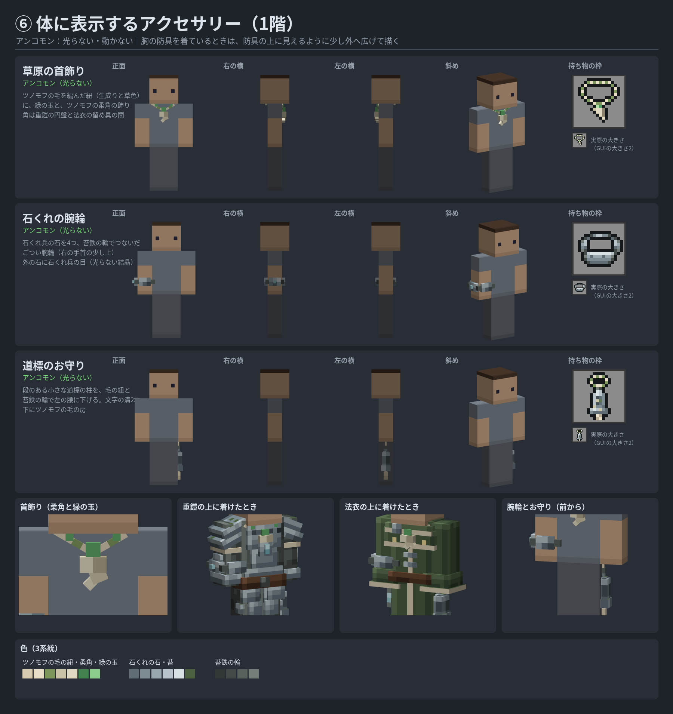

# ⑥ 体に表示するアクセサリー（草原の首飾り・石くれの腕輪・道標のお守り）

| 項目 | 内容 |
| --- | --- |
| 品 | 草原の首飾り（首飾りの枠）・石くれの腕輪（腕輪の枠）・道標のお守り（お守りの枠） |
| レアリティ | アンコモン：光らない・動かない。コモンより少しだけ飾りが多い（玉・苔鉄の輪・房） |
| 描き方 | GeckoLib。防具と同じボーン（`armorBody`＝胸・腰、`armorRightArm`＝右の手首）に入れ、Curios の枠から体に描く |
| 数値 | Phase 3のまま（IDと数値は変えていない） |

## 品ごとの形

| 品 | 形と部品 |
| --- | --- |
| 草原の首飾り | ツノモフの毛を編んだ紐（生成りと草色が交互）が首の後ろを回り、胸の前でV字に下りる。V字の途中に小さな緑の玉2つ、下に緑の玉とツノモフの柔角の飾り（根元が太く、先が丸く曲がる） |
| 石くれの腕輪 | 石くれ兵の石4つ（表と裏は文字の溝つき）を、角の苔鉄の小さな輪でつないだ、ごつい腕輪。外の石に石くれ兵の「目」（光らない結晶）。右の手首の少し上（手袋や袖口より上） |
| 道標のお守り | 段のある小さな道標の柱（文字の溝2本）を、毛の紐と苔鉄の輪で左の腰に下げる。下にツノモフの毛の房 |

色（3系統）：主＝ツノモフの毛の紐と柔角（生成り・草色・象牙）、副＝石くれの石（灰青と苔）、差し色＝緑の玉・苔鉄の輪。

## 防具の上に着けたとき

胸の防具（`ArmorItem`）を着ていると、防具がアクセサリーを隠してしまいます。そこで描くときに、胴のボーンを横 1.3 倍・前後 1.45 倍、腕のボーンを横と前後 1.25 倍に広げます（高さは変えない。ボーンの中心で広げる。`AccessoryCurioRenderer`）。

- 首飾りの角と玉は、重鎧の胸の円盤と、法衣の留め具の間の高さにした（どちらの上でも隠れない）。
- 法衣の留め具は、首飾りの玉と重ならないように、右の肩寄りに移した。
- お守りは体の横にあるので、広げると腰の帯（重鎧・法衣）より外に出る。
- 防具を着ていないときは広げない（体にぴったり付く）。

## ゲームの中での確認

- CIの写真：`gear_accessories`（防具なし。三人称の前から）・`gear_accessories_plate`（重鎧の上）・`gear_accessories_robe`（法衣の上）。Phase 3の `gear_plate`・`gear_robe` にも写る。

## 作りながら変えたところ

1. 前のモデルの「光る部分」と「揺れる飾り」はやめた（光るのはレアから、動くのはレジェンダリーから）。
2. 防具を着ると隠れた → 上の「防具の上に着けたとき」の仕組みを足した。
3. 自己採点で小さくて読みにくかった → 紐を太く、角と玉を大きくし、腕輪に「目」、お守りに房を足した。

## 品質チェック（自己採点。教材の7項目・各10点）

| 項目 | 点 | 理由 |
| --- | --- | --- |
| シルエット | 8 | V字と角の首飾り・ごつい輪・段の柱と房のお守り。持ち物の枠でも形で分かる |
| 立体感 | 8 | 玉・角の曲がり・石の塊と輪・房が前後に出る |
| Minecraft適合性 | 9 | 防具と同じボーン。防具なし・重鎧・法衣の上で見えることを、ゲームの中（プレイヤーに付けた写真）で確かめた |
| 材質表現 | 9 | 編んだ2色の紐・つやのある玉・骨の角・溝と苔のある石・苔鉄・毛の房 |
| 視認性 | 8 | 体の上では小さいが、生成りと緑の玉が服や鎧の上で目立つ |
| オリジナリティ | 9 | ツノモフの角・石くれ兵の目・道標の柱と、1階の生き物と場所から作った |
| レアリティ表現 | 9 | アンコモン：光らず動かない。小さな飾り（玉・輪・房）だけ足した |
| **合計** | **60 / 70** | 教材の基準（60点）に届いた |

## ファイル

| ファイル | 役割 |
| --- | --- |
| `geo/accessory/{grassland_necklace,ishikure_bracelet,waystone_charm}.geo.json` | GeckoLib のモデル |
| `textures/accessory/*.png` | 絵（32×32。光る部分なし＝`_glowmask` は消した） |
| `animations/accessory/*.animation.json` | 動かない（idle だけ） |
| `textures/item/{grassland_necklace,ishikure_bracelet,waystone_charm}.png` | 持ち物の枠の絵 |
| `src/main/java/.../client/render/AccessoryCurioRenderer.java` | 体に描く。胸の防具を着ているときは広げる |
| `tools/artgen/make_gear_accessories.py` | 形・色・持ち物の絵・確認画像を作るプログラム |

作り直すとき：`python3 tools/artgen/make_gear_accessories.py . /tmp/out`（重鎧・法衣を作り直したときも、この確認画像を作り直す）
