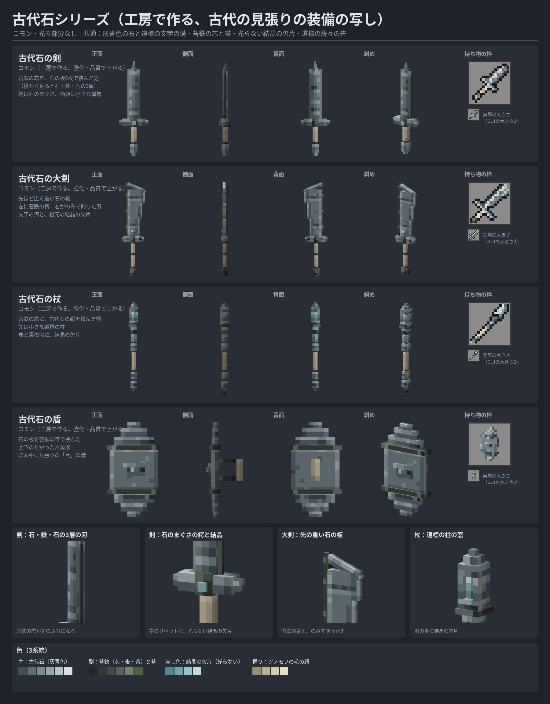

# ② 古代石シリーズの武器と盾（剣・大剣・杖・盾）

| 項目 | 内容 |
| --- | --- |
| 品 | 古代石の剣（片手剣）・古代石の大剣（両手剣）・古代石の杖・古代石の盾 |
| レアリティ | コモン（工房で作る。強化・品質で上がる。光らない・動かない） |
| 世界観 | 1階の見張り石（石くれ兵）と道標の石を、苔鉄の芯で鍛えた工房の品。古代の見張りの装備を写したもの |
| 数値 | Phase 3のまま（IDと数値は変えていない） |

## コンセプト

**ひとことで**：道標の石を積み、苔鉄でまとめた装備。どれにも「道標の文字の溝」「苔鉄の芯と帯」「光らない結晶の欠片」「道標の柱のような段々の先」がある。

## 共通の印と色（3系統）

| | 材質 | 色 |
| --- | --- | --- |
| 主 | 古代石（面取りした灰青色の石。上の面に苔） | `#7C8A92`〜`#B7C3C8`／苔 `#4B6140` |
| 副 | 苔鉄（芯・帯・背・リベット） | `#434A47`〜`#757E79` |
| 差し色 | 光らない結晶の欠片／握りはツノモフの毛の紐 | `#72A4AE`〜`#BFDDE0`／`#D6CAB0` |

## 品ごとの形

| 品 | 形と部品 |
| --- | --- |
| 古代石の剣 | 苔鉄の芯を石の板2枚で挟んだ刃（横から見ると石・鉄・石の3層。芯が刃のふちになる）。文字の溝3本と段々の先。鍔は石のまぐさ（両端が張り出す）に苔鉄の帯・リベット・結晶の欠片。握りは毛の紐。柄頭は小さな道標 |
| 古代石の大剣 | 先ほど広く重い石の板（3段で広がる）。左に苔鉄の背（リベット）、右はのみで削った刃。先は22.5度の斜めの切っ先。根元に結晶の欠片。柄頭は苔鉄の重り、握りは2か所 |
| 古代石の杖 | 苔鉄の芯に、古代石の輪5つを積んだ柄（間から芯が見える）。毛の紐の握り。先は小さな道標の柱で、表と裏の窓の奥に結晶の欠片。段々のかさ。石突きは苔鉄のとげ |
| 古代石の盾 | 上下のとがった長い六角形（石の板を段々に細くする）を、苔鉄の帯2本（リベット）で挟む。真ん中に見張りの「目」（盛り上がった石の横の溝と、結晶の欠片）。裏に握り |

## 持ち方とゲームの中での確認

- 3Dのモデルは手に持ったとき、持ち物の枠・額縁・地面は16×16のドット絵。
- 一人称：剣 [0,−75,5]・0.55倍、大剣 [0,−75,10]・0.45倍、杖 [0,−80,5]・0.48倍。盾は [−8,165,6]・[12,0,−12]・0.95倍、構え [0,180,−5]・[6,5,−12]・1.05倍。
- CIの写真：`gear_lineup_redesign`・`gear_lineup_redesign_side`・`gear_stands_redesign`・`gear_fp_ancient_greatsword`・`gear_fp_ancient_staff`。

## 作りながら変えたところ

1. 文字の溝が見えなかった（溝の高さがピクセルの境にあった）→ ピクセルの行で決めるようにした。
2. 大剣が「レンガの柱」に見えた → 22.5度の斜めの切っ先を付け、刃の板の上下の継ぎ目を見せない塗り方にした（1枚の重い板に見える）。

## 品質チェック（自己採点。教材の7項目・各10点）

| 項目 | 点 | 理由 |
| --- | --- | --- |
| シルエット | 8 | 頭の重い大剣・輪を積んだ杖・長い六角形の盾は遠目でも分かる。剣は十字形だが、まぐさの鍔で区別できる |
| 立体感 | 9 | 3層の刃・積んだ輪・窓のある柱・段の盾。どの向きでも板に見えない |
| Minecraft適合性 | 9 | 22.5度刻み、ゲームの中（並べた所・防具立て・一人称）で確かめた |
| 材質表現 | 9 | のみの跡・文字の溝・苔・リベット・毛の紐で、石と鉄と布が見分けられる |
| 視認性 | 8 | 石と苔鉄はどちらも寒色なので、横の面では差が小さい |
| オリジナリティ | 9 | 1階の道標と見張り石の形（段・文字・目）から作った |
| レアリティ表現 | 9 | コモンらしく光らない。結晶は光らない欠片だけ |
| **合計** | **61 / 70** | 教材の基準（60点）に届いた |

## ファイル

| ファイル | 役割 |
| --- | --- |
| `models/item/ancient_stone_{sword,greatsword,staff}{,_3d}.json` | 持ち物の枠の切りかえと、部品・持ち方 |
| `models/item/ancient_stone_shield{,_model,_blocking}.json` | 盾 |
| `textures/item/ancient_stone_*_model.png`／`ancient_stone_{sword,greatsword,staff}.png` | モデルの絵／持ち物の枠の絵 |
| `tools/artgen/make_gear_ancient_stone.py` | 形・色・持ち方・確認画像を作るプログラム |

作り直すとき：`python3 tools/artgen/make_gear_ancient_stone.py . /tmp/out`
