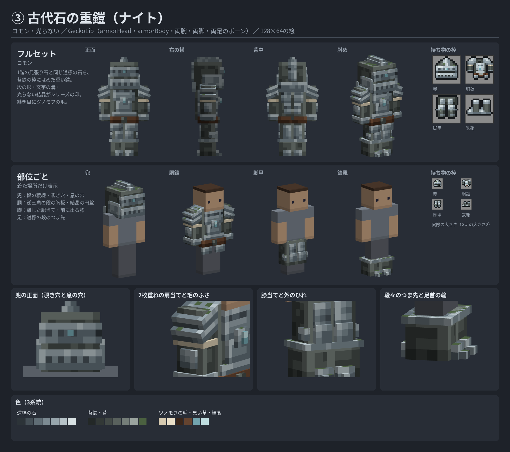
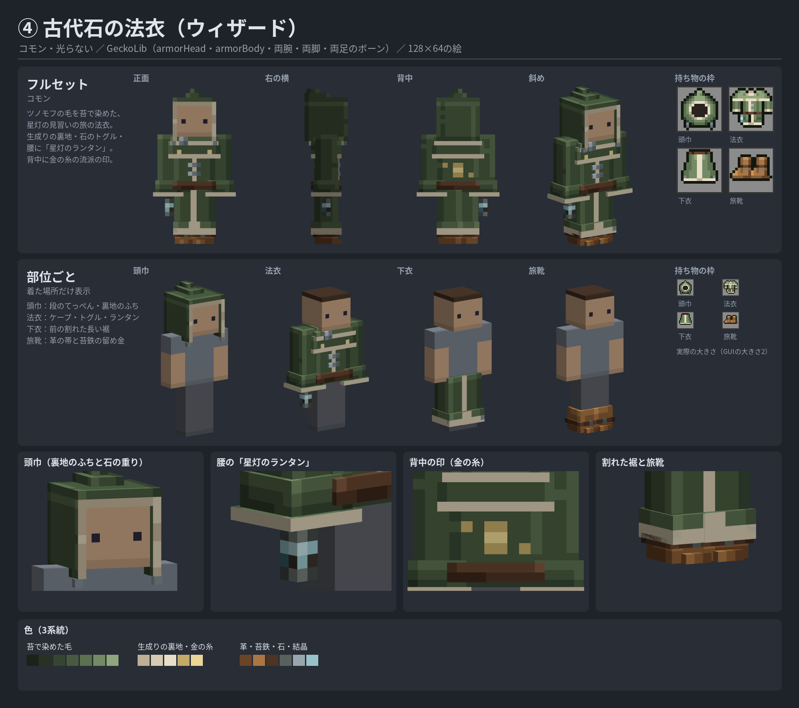

# ③ 古代石の重鎧（ナイト）・④ 古代石の法衣（ウィザード）

| 項目 | 内容 |
| --- | --- |
| 品 | 重鎧：古代石の兜・胴鎧・脚甲・鉄靴／法衣：古代石の頭巾・法衣・下衣・旅靴 |
| レアリティ | コモン（光らない・動かない。前の光る部分はやめた） |
| 描き方 | GeckoLib の防具。1つのシリーズ＝1つのモデル（`geo/armor/ancient_stone_{plate,robe}.geo.json`）で、着た場所のボーンだけを表示する |
| 数値 | Phase 3のまま（IDと数値は変えていない） |

## 重鎧（ナイト）

**ひとことで**：1階の見張り石と同じ道標の石を、苔鉄の枠にはめた重い鎧。段の形・文字の溝・光らない結晶がシリーズの印。継ぎ目にツノモフの毛。

| 部位 | 形と部品 |
| --- | --- |
| 兜 | 苔鉄の鉢。段になった石の稜線が頭の上から後ろへ回り、首まで下りる。額の板（文字の溝と結晶）と顔の板（息の穴の列）の間が、横一本の覗き穴。頬当てと首当て |
| 胴鎧 | 苔鉄の枠に、段になった石の胸板（上は広く下は細い逆三角）。真ん中に結晶をはめた石の円盤。腹の帯、黒い革の帯と苔鉄の留め金、腰の垂れ2枚。背中は段の背板と苔鉄の背の帯（リベット） |
| 肩・腕 | 苔鉄の籠手に、外へ下がる2枚重ねの石の肩当て。その下にツノモフの毛のふさ。外に肘当て、手首に石の輪 |
| 脚甲 | 苔鉄の腿に、左右を離した石の腿当て（文字の溝）。前へ出る膝当てと外の小さなひれ。後ろにふくらはぎの石 |
| 鉄靴 | 苔鉄の靴に、道標の段の形のつま先（2段）。かかとの石と足首の石の輪 |

色（3系統）：主＝道標の石 `#7C8A92`〜`#D8E1E3`、副＝苔鉄 `#434A47`〜`#757E79`（上の面に苔 `#4B6140`）、差し色＝ツノモフの毛 `#D6CAB0`・黒い革 `#4E3424`・光らない結晶 `#72A4AE`。

## 法衣（ウィザード）

**ひとことで**：ツノモフの毛を苔で染めた、星灯の見習いの旅の法衣。生成りの裏地・石のトグル・腰に「星灯のランタン」、背中に金の糸の流派の印。

| 部位 | 形と部品 |
| --- | --- |
| 頭巾 | 顔の前を開けた頭巾。顔のまわりのふちは生成りの裏地。てっぺんは2段にとがる（道標の段と同じ形）。あごの横に石の玉の重り |
| 法衣 | 2段の肩のケープ（下の段の前のすそに金の糸の星2つ）と、右の肩寄りの石の留め具【補完：首飾りの玉とぶつからないように真ん中から外した】。前の合わせ（生成りの裏地）と石のトグル2つ、黒い革の帯。右の腰に「星灯のランタン」（苔鉄のふたと台、光らない結晶のガラス、消えた芯）。背中に金の糸の小さなランタンの印 |
| 袖 | 段になって広がる釣り鐘の袖口（すそは生成りの裏地） |
| 下衣 | 前の割れた長い裾（脚ごとに動く）。割れ目は生成りの裏地、すそは広がり、前のふちに石の重り |
| 旅靴 | 革の靴と少し丸いつま先、苔鉄の留め金のついた黒い革の帯 |

色（3系統）：主＝苔で染めた毛 `#364531`〜`#738A64`、副＝生成りの裏地 `#BCAF96`〜`#E9DFC8` と金の糸 `#C4AA68`・`#EAD696`、差し色＝革 `#6A4426`・`#A97644`。

## GeckoLib の作り方（2つのシリーズで共通）

- ボーン：`armorHead`・`armorBody`・`armorRightArm`・`armorLeftArm`・`armorRightLeg`・`armorLeftLeg`・`armorRightBoot`・`armorLeftBoot`（ピボットはGeckoLibの決まりどおり）。
- 絵は箱のUV（128×64）。GeckoLib は読み込むときに x を反転し、x と y の回転の向きも反転する。確認画像はこの反転を同じように再現して描いている（`tools/artgen/geomodel.py`）。
- 左右の足と靴はまん中で重なるので、左の部品をほんの少し（0.03ピクセル）大きくして、面のちらつき（Zファイティング）を防いだ。
- 法衣のケープの上の段は、頭（あご）と同じ面にならない高さにした（ちらつき防止）。

## ゲームの中での確認

- CIの写真：`gear_armor_redesign`（防具立てに着せて、重鎧と法衣の前・後ろ）・`gear_armor_redesign_34`（斜め）。Phase 3の `gear_plate`・`gear_robe`（プレイヤーが着た所）も、新しいモデルで写る。
- 防具立てでは、絵の向き（背中の印・前の星・覗き穴）が確認画像と同じに出ることを確かめた。

## 作りながら変えたところ

1. 腕の石の輪・足首の輪・靴の帯が、ふくらませた苔鉄の殻の中に隠れていた → 殻より外へ出る大きさにした。
2. 苔鉄が暗すぎて腕が黒い塊に見えた → 苔鉄を一段明るくした。
3. 法衣の頭巾の先（後ろへ垂れる角）が「こぶ」に見えた → てっぺんを2段にとがらせた。
4. 背中の印が大きすぎた（コモンなのに目立つ）→ 小さな金の糸のランタンと星2つにした。
5. 法衣の自己採点が59点 → ケープを2段にし、袖口を段になって広がる釣り鐘の形にした。

## 品質チェック（自己採点。教材の7項目・各10点）

| 項目 | 重鎧 | 法衣 | 理由 |
| --- | --- | --- | --- |
| シルエット | 8 | 8 | 重鎧：段の稜線・2枚の肩当て・逆三角の胸・膝当て。法衣：とがった頭巾・2段のケープ・釣り鐘の袖・広がる裾 |
| 立体感 | 9 | 9 | 板を重ね、前後に段がある。法衣はケープ・袖口・裾が段になる |
| Minecraft適合性 | 9 | 9 | GeckoLib の防具のボーンの決まりどおり。防具立てとプレイヤーで確かめた |
| 材質表現 | 8 | 8 | 石・苔鉄・毛・革・結晶。法衣は織り目と裏地 |
| 視認性 | 8 | 9 | 重鎧は石と鉄が近い色。法衣は生成りの線が緑の上でよく読める |
| オリジナリティ | 9 | 8 | 道標の段・文字の溝・見張りの目／星灯のランタンと印 |
| レアリティ表現 | 9 | 9 | コモン：光らず、結晶は光らない欠片だけ |
| **合計** | **60 / 70** | **60 / 70** | 教材の基準（60点）に届いた |

## ファイル

| ファイル | 役割 |
| --- | --- |
| `geo/armor/ancient_stone_{plate,robe}.geo.json` | GeckoLib のモデル（ボーンと箱） |
| `textures/armor/ancient_stone_{plate,robe}.png` | 絵（128×64。光る部分なし＝`_glowmask` は消した） |
| `animations/armor/ancient_stone_{plate,robe}.animation.json` | 動かない（idle だけ） |
| `textures/item/ancient_stone_{helm,cuirass,greaves,sabatons,hood,robe,legwear,boots}.png` | 持ち物の枠の絵 |
| `tools/artgen/make_gear_ancient_armor.py`・`armor_icons.py`・`geomodel.py` | 形・色・持ち物の絵・確認画像を作るプログラム |

作り直すとき：`python3 tools/artgen/make_gear_ancient_armor.py . /tmp/out`
