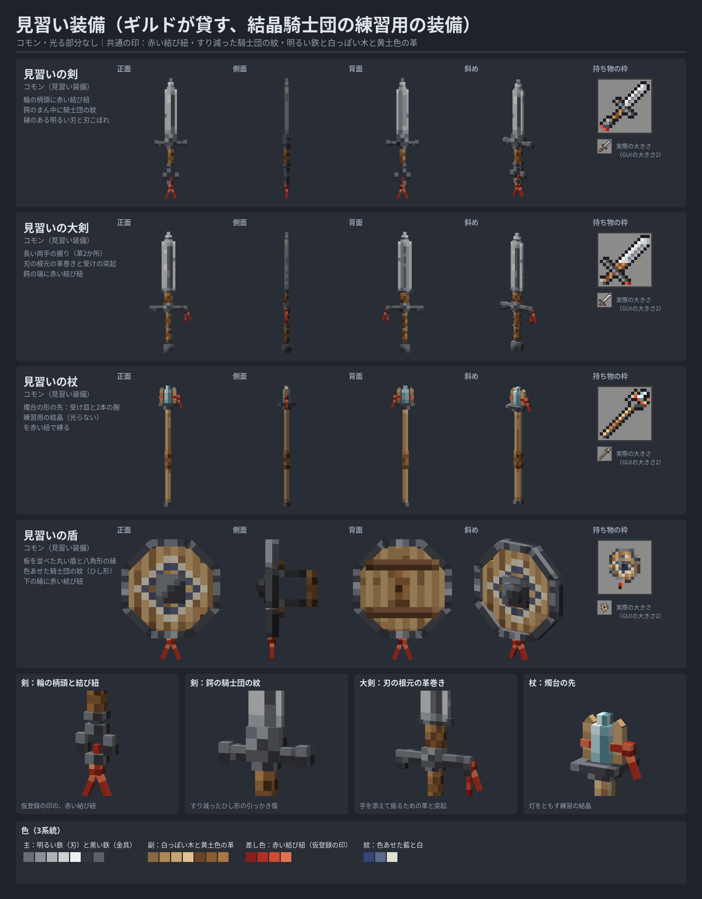

# ① 見習い装備（剣・大剣・杖・盾）

確認画像は、モデルのファイル（部品と絵）から描いています（`tools/artgen/render.py`。明るさの付け方はMinecraftと同じ）。

| 項目 | 内容 |
| --- | --- |
| 品 | 見習いの剣（片手剣）・見習いの大剣（両手剣）・見習いの杖・見習いの盾 |
| レアリティ | コモン（光らない・動かない） |
| 世界観 | 【補完】冒険者ギルドが、仮登録の新人に貸す練習用の装備。もとは結晶騎士団の練習用の装備 |
| 手に入れ方 | 職業を選んだときにもらう（Phase 2。IDと数値は変えていない） |

## コンセプト

**ひとことで**：ギルドの備品。手入れされた明るい鉄と白っぽい木に、「仮登録」の赤い結び紐と、ギルドの貸出札が下がっている。

- 赤い結び紐＝仮登録の印【補完】。4つ全部に結び、遠くからでも「見習いの装備」と分かる。
- 真鍮の貸出札【補完】：ギルドが貸すものなので、返すときに番号で確かめる札が紐の先に下がっている（打ち抜いた番号の点）。
- すり減った騎士団の紋（ひし形）：もとは騎士団の練習用だった名残。剣の鍔の真ん中と、盾の表に色あせた藍と白で。
- コモンなので、飾りはいちばん少なく、光る部分はない。

## 共通の印と色（3系統）

| | 材質 | 色 |
| --- | --- | --- |
| 主 | 明るい鉄（刃）と黒い鉄（金具） | `#AEB2B6`〜`#CFD2D3`／`#47494F` |
| 副 | 白っぽいトネリコの木と、黄土色の革 | `#C9A473`／`#8A5C34` |
| 差し色 | 赤い結び紐（仮登録の印）と真鍮の貸出札 | `#AE3123`〜`#CC4B32`／`#C9A15F` |

## 品ごとの形

| 品 | 形と部品 |
| --- | --- |
| 見習いの剣 | ドットの輪の柄頭（上下左右の4本）に赤い紐を通し、結び目から2本の垂れと貸出札。黄土色の革の握りと黒い鉄の輪。鍔は端に丸い玉、真ん中に紋の板。刃は樋（みぞ）のある明るい鉄で、両側に研いだふち、段々の先 |
| 見習いの大剣 | 車輪の柄頭。長い握り（革2か所）。両端が下がった広い鍔と、真ん中に紋。刃の根元に革を巻き、受けの突起（手を添えて振るため）。鍔の右の端に赤い紐と貸出札 |
| 見習いの杖 | トネリコの柄、革の握り、黒い鉄の輪。先は燭台の形：受け皿と2本の木の腕（先は45度）の間に、練習用の結晶（光らない）を立て、赤い紐で縛る。結び目から垂れと貸出札 |
| 見習いの盾 | 外ほど短いトネリコの板6枚を八角形の黒い鉄の縁で囲む（リベット）。表に色あせた騎士団の紋（藍と白のひし形の帯）。段々の丸い突起。下の縁に赤い紐と貸出札。裏はくるみの当て木2本と、浮かせた革の握り |

## 持ち方とゲームの中での確認

- 3Dのモデルは手に持ったとき、持ち物の枠・額縁・地面では16×16のドット絵（`forge:separate_transforms`）。
- 一人称：Phase 3の値（右に傾いて画面の外へ出ていた）をやめ、まっすぐ立てた。11月21日に剣・大剣を大きくした（剣 [0,−75,10]・0.702倍、大剣 [0,−75,24]・0.765倍。杖は [0,−80,5]・0.45倍のまま）。
- 三人称：剣 0.945倍（持ったときの長さ約1.8ブロック）、大剣 1.19倍（約2.6ブロック）。大きさの決め方は [手に持ったときの大きさと刃の向き](hold.md)。
- 盾：一人称は水門の鍵盾と同じ向きで、大きさだけ合わせた（左手 [−8,165,6]・[12,1,−12]・1.0倍）。構えも同じ。
- CIの写真：`gear_lineup_redesign`（並べて正面）・`gear_lineup_redesign_side`（横）・`gear_stands_redesign`（防具立てに持たせる）・`gear_fp_apprentice`（一人称で剣と盾）・`gear_fp_apprentice_greatsword`（一人称で大剣）・`gear_hold_side_swords`・`gear_hold_side_greatswords`（横から見た三人称）。

## 作りながら変えたところ

1. 盾の紋：最初は板の色むらで紋がにごった。板を落ち着いた色にし、紋は藍と白のはっきりした帯にした。
2. 一人称の持ち方：上のとおり、まっすぐ立てて小さくした。
3. 貸出札：自己採点で59点だったので、「ギルドが貸す」設定を形にする真鍮の札を4つ全部に足した（シルエットに小さな垂れ下がりが増え、どこの装備かが分かる）。
4. 11月21日：剣と大剣が小さすぎた → 握りの所を中心に、剣は1.35倍・大剣は1.7倍にした（[hold.md](hold.md)）。

## 品質チェック（自己採点。教材の7項目・各10点）

| 項目 | 点 | 理由 |
| --- | --- | --- |
| シルエット | 8 | 杖（燭台）と盾（八角形）は遠目でも分かる。剣と大剣は定番の十字形だが、輪の柄頭・垂れる紐と札で区別できる |
| 立体感 | 8 | 輪の柄頭・紐の結び目と垂れ・札・盾の段の突起と裏の当て木。剣の刃は横から見ると薄い |
| Minecraft適合性 | 9 | 1ピクセル＝1/16ブロック、22.5度刻み。ゲームの中（並べた所・防具立て・一人称）で確かめた |
| 材質表現 | 8 | 樋と刃こぼれのある鉄・木目・巻いた革・塗料のはげた紋・真鍮の札が見分けられる |
| 視認性 | 9 | 明るい鉄と木に、赤い紐が1点だけ目立つ。持ち物の枠でもはっきり読める |
| オリジナリティ | 9 | 「仮登録の赤い紐」「ギルドの貸出札」「練習の燭台の杖」は、このModのギルドの設定から作った |
| レアリティ表現 | 9 | コモンらしく、光らず飾りが最も少ない。差し色は紐の赤だけ |
| **合計** | **60 / 70** | 教材の基準（60点）に届いた |

## ファイル

| ファイル | 役割 |
| --- | --- |
| `models/item/apprentice_{sword,greatsword,staff}.json` | 手に持つ3D（`_3d`）と、持ち物の枠のドット絵の切りかえ |
| `models/item/apprentice_{sword,greatsword,staff}_3d.json` | 部品と持ち方 |
| `models/item/apprentice_shield{,_model,_blocking}.json` | 盾の持ち方・部品・構え |
| `textures/item/apprentice_*_model.png`／`apprentice_{sword,greatsword,staff}.png` | モデルの絵／持ち物の枠の絵 |
| `tools/artgen/make_gear_apprentice.py` | 形・色・持ち方・確認画像をすべて作るプログラム |

作り直すとき：`python3 tools/artgen/make_gear_apprentice.py . /tmp/out`
