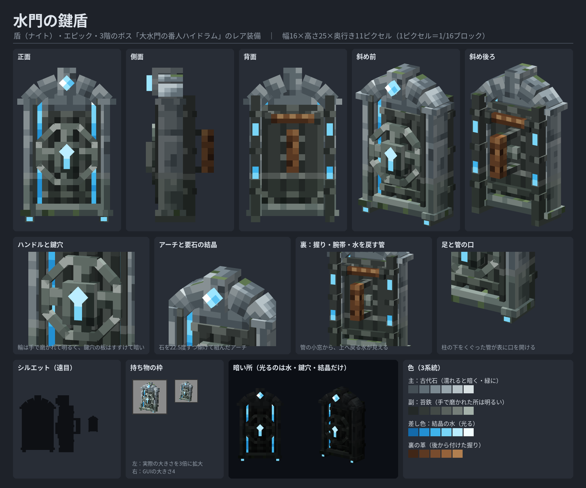

# 水門の鍵盾（すいもんのかぎたて）

確認画像は、すべてモデルのファイル（部品と絵）から描いています（`tools/artgen/render.py`）。明るさの付け方はMinecraftと同じです（2つの光と環境光。光る部品は明るさを変えない）。

| 項目 | 内容 |
| --- | --- |
| 名前 | 水門の鍵盾 |
| カテゴリ | 盾（ナイトの左手）。扱いはバニラの盾と同じで、右クリックで構える |
| レアリティ | エピック【補完】（ボスのレア装備は、雑魚のレア装備（レア）より一段上にする） |
| 世界観 | 第1章・3階「古代の水路」。ボス「大水門の番人ハイドラム」のレア装備（Phase 0-A 21章。基準確率6%） |
| 使う人 | ナイト（Lv7から） |
| 戦い方 | 構えて味方の前に立つ。固有効果「水の膜」：敵から受けるダメージ −6%【補完】 |

## コンセプト

**ひとことで**：番人が水門を開け閉めしていた「鍵」の機械を、そのまま盾にしたもの。中を魔力の水が一周し続けている。

設定から決めたこと：
- 3階の地形（古代の水路網・水門・水車・青い結晶の灯）→ 門の形、石と鉄、水色の光。
- 古代記録「水路管理局の掲示」の「この水路は、魔力の循環路を兼ねる。流れが止まれば、街は乾く」→ 水が盾の表から裏へ一周する「循環の輪」。
- ボスのギミック（離れた水門を、何人かで同時に動かす）→ 「鍵（ハンドル）を回すと門が開く」。
- 効果「受けたダメージの一部を水の膜で受ける」→ 光る水が膜になる、という見た目の理由。
- 【補完】裏の革の握りと腕帯は、手に入れた騎士が後から付けたもの（機械の番人は、盾を手で持つ必要がなかった）。だから革だけが新しく、水位の跡がない。

## シルエット

- **正面**：石のアーチの頭、左右の受け石（肩）、まっすぐな柱、下の台石と足でできた「門」の外形。アーチの真ん中の要石は、冠のように1ピクセル突き出る。中央に八角形のハンドル。丸や凧形の盾とは、遠目でも違う形にした。
- **側面**：前から順に、鍵穴の板（いちばん前）→ ハンドルの輪 → レール → 柱 → 裏の管 → 握り（いちばん後ろ）。前にも後ろにも出っ張りがあるので、板に見えない。柱の下をくぐって表へ出る管のL字も見える。
- **背面**：補強の横木2本、革の腕帯、面から浮かせた握り、ハンドルの軸のナット。左右の柱の裏を水の管が上り、管の小窓から光る水が見える。

## 部品（67部品。1ピクセル＝1/16ブロック）

| 部品 | 構造 | 材質 |
| --- | --- | --- |
| アーチ | 石5つを扇形に組む。外の4つは22.5度・45度に傾け、真ん中の要石は傾けずに一段前と上へ出す | 古代石 |
| 要石の結晶 | 45度に傾けた小さな角柱（ひし形）。要石から前へ0.9ピクセル出る | 結晶（光る） |
| 受け石・台石 | 柱の上でアーチを受ける肩と、柱の下の台。柱より外と前後へ出る | 古代石 |
| 柱 | 古代石を3段に積む（継ぎ目が見える） | 古代石 |
| レール | 柱の内側の角に付けた、扉と水路の溝金具 | 苔鉄 |
| 扉 | 裏板の前に縦板3枚。板の間は暗い溝。上下の横の帯とリベットで留める | 苔鉄 |
| アーチの下の石 | 扉の上、アーチの内側。一段奥まって暗い | 古代石 |
| ハンドル | 八角形の輪（軸に平行な4本＋45度の4本）・十字のスポーク・中心の鍵穴の板。軸で扉から1ピクセル浮く | 苔鉄（輪は手で磨かれて明るい） |
| 鍵穴 | 45度に傾けた四角（丸い頭）と縦の溝の2つの板 | 水（光る） |
| 表の水路 | 柱とレールの内側の溝。扉より奥で、上から下へ流れる | 水（光る） |
| 管（裏） | 柱の裏を上る、丸く見える角管。金具の帯3つと、水が見える小窓2つ | 苔鉄・水（光る） |
| 管の曲がり（足） | 柱の下をくぐって表へ出て、口が光る | 苔鉄・水（光る） |
| 裏の横木 | 上下2本。リベット留め | 苔鉄 |
| 握り | 2つの支えで面から4ピクセル浮かせた握り棒。斜めに巻いた革 | 苔鉄・革 |
| 腕帯 | 握りの上の革の帯と、両端の金具。縫い目つき | 革・苔鉄 |

## 材質と色（3系統）

| | 材質 | 色 |
| --- | --- | --- |
| 主 | 古代石（ワールドの古代石の素材と同じ、青みのある灰色） | `#7C8A92`。濡れた所は `#5A6A60` へ |
| 副 | 苔鉄（扉・レール・管）／手で磨かれた苔鉄（ハンドルの輪） | `#434A47`／輪は `#A4B1AA` |
| 差し色 | 結晶の水（光る。この1色だけが光る） | `#3FB4EC`〜`#BBEDFF` |
| （裏だけ） | 革（後から付けた握りと腕帯） | `#784C2E` |

見分けやすくするための明暗の順番：明るい石の枠 → 暗い扉 → 中くらいのスポーク → 明るい輪 → 暗い鍵穴の板 → 光る鍵穴。

## 特徴的な装飾

- **鍵穴**：ひし形の頭と縦の溝。名前の「鍵」を、正面のいちばん前で見せる。
- **要石（キーストーン）の結晶**：アーチの頂上。3階の「青い結晶の灯」。
- **水位の跡**：高さ −4.6ピクセルより下は濡れて暗く、緑がかる。境には白い水あかの線、いちばん下には苔。水に浸かっていた門だったことが分かる。
- **リベットと継ぎ目**：表の横の帯、裏の横木と板の継ぎ目。

## 発光

**中**：光るのは、水の線（表の水路・管の口・裏の小窓）、鍵穴、要石の結晶の3か所だけです（部品ごとに `forge_data` の明るさ15）。
- テクスチャのアニメーション（128×128を8コマ、1コマ0.2秒）で、表の水は上から下へ、裏の小窓の水は下から上へ流れる。鍵穴はゆっくり明るくなったり暗くなったりする。
- エピックの「小さな粒」は、今の仕組み（持っている間に出る紫の粒）がそのまま出ます。
- 回る・揺れる部品はレジェンダリーの印なので、入れていません（ハンドルは回りません）。

## 大きさと持ち方

- 幅16×高さ25×奥行き11ピクセル（バニラの盾は12×22×7）。
- **三人称**：バニラの盾と同じ置き方で、0.9倍（少し大きい分だけ縮める）。構えると体の前に「門」が立つ。
- **一人称（ふだん）**：バニラと同じ置き方だと、厚い石のアーチが目の前の左下をふさいだ（CIの1回目の写真）。そこで0.9倍にして少し下げ、斜めに回して、アーチ・裏の腕帯・管の光る小窓が左下に見えるようにした。
- **一人称（構え）**：照準をふさがないよう、バニラより少し左に置いた（1.0倍）。
- 右手に持ったときの置き方は、左手を左右に写した値をプログラムで計算している（盾の中心がモデルの原点にあるため、その分を足す）。
- 一人称の置き方は、ゲームの手の描き方（腕の位置 → 持ち方の移動・回転・拡大 → −0.5）を再現した描画で調整してから、CIの写真で確かめた。
- 持ち物の枠では、枠いっぱい（16ピクセル中15）に収まる。

## 参考にした設計の考え方（教材）

- シルエットの「つかみ」を、頭（アーチと要石）・肩・足・中心の輪の複数の場所に置く。
- 部品を分け、つなぎ方に理由を持たせる（輪は軸で扉から浮かせる、管は金具の帯で留める、握りは支えで浮かせる）。
- 隣り合う部品の明暗を逆にする（上の「明暗の順番」）。
- 色は3系統。光るのは1色・3か所だけ。
- 背面にも見せ場を作る（管・小窓・握り・腕帯）。

## オリジナルにするために

- 参考MODの盾の形は使っていません。門（水門）・ハンドル・循環する水という、このModの3階の設定から形を作りました。
- 参考画像の「A.K.」の刻印から学んだ「持ち主の手の跡」の考え方は、「後から付けた革の握り」として取り入れました。

## 作りながら変えたところ

最初の説明（モデルを作る前）から、確認画像を見ながら次の4つを変えました。
1. **左右のレール**：最初は「苔鉄の角柱」の予定でした。作ってみると、正面で鉄の面積が石より広くなり、「主の材質＝古代石」になりませんでした。そこで柱を古代石の3段積みにし、レールは柱の内側の角に付けた細い苔鉄の溝金具にしました。
2. **ハンドルの出っ張り**：つかむための小さな出っ張り4つは、輪の形が読みにくくなるのでやめました。
3. **受け石と台石**：小さく見たときに墓石のような形に見えたので、柱の上に肩、下に台を足して「門」の形にしました。
4. **鍵穴**：4ピクセルの絵では十字に見えたので、45度に傾けた小さな四角（丸い頭）と縦の溝の、2つの部品にしました。
5. **一人称の持ち方**：ゲームの中の写真（CIの1回目）で、アーチが目の前をふさいでいたので、置き方を変えました（上の「大きさと持ち方」）。

## 品質チェック（自己採点。教材の7項目・各10点）

| 項目 | 点 | 理由 |
| --- | --- | --- |
| シルエット | 8 | 門の外形（アーチ・肩・足・冠の要石）で、丸や凧形の盾と遠目でも違う。とても小さく見ると、四角に近づくのが弱いところ |
| 立体感 | 9 | 前後3段の奥行き、軸で浮いたハンドル、裏の管と握り。どの向きから見ても板に見えない |
| Minecraft適合性 | 9 | 1ピクセル＝1/16ブロック、22.5度刻み、バニラの盾と同じ構えの切りかえ。ゲームの中（一人称・構え・三人称・夜）で確かめた |
| 材質表現 | 8 | 石・鉄・磨かれた鉄・革・水が見分けられ、水位の跡で「水に浸かっていた」ことも分かる。石と鉄がどちらも寒色なので、横の面では差が小さい |
| 視認性 | 8 | 明るい枠 → 暗い扉 → 明るい輪 → 光る鍵穴の順で読める。扉の中（縦板・帯・スポーク）は、まだ少し細かい |
| オリジナリティ | 9 | 3階の設定（水門・循環する水路・鍵）から作った形。参考MODの形は使っていない |
| レアリティ表現 | 9 | エピックの決まりどおり、光るのは1色・3か所、動く部品はなし。ボスのレア装備だけの外形 |
| **合計** | **60 / 70** | 教材の基準（60点）に届いた |

次に直すなら：扉の中の細かさ（横の帯を1本にする、縦板の筋をなくす）と、横の面の石と鉄の差（石をもう少し暖かい灰色に寄せる）。

## ゲームの中の扱い

- **数値【補完】**：Lv7から、防御11・HP50（エピックの倍率1.25がかかる）、耐久600、装備すると取引できなくなる、修理は苔鉄3・結晶の欠片2、受けるダメージ −6%（今ある特殊効果 `damage_reduction` を使う）。
- **手に入れ方**：3階のボス（ハイドラム）は Phase 8 で作るので、そのときにボスのドロップに入れます。今はクリエイティブのタブか、`/give @p amemaru:floodgate_key_shield` で確かめられます。
- **自動テスト**：`floodgateKeyShieldWaterVeil`（エピック・左手のレア装備・盾のアイテム・防御が上がる・受けるダメージ −6%・Lv6や壊れたときは効かない）。
- **CIの写真**：`shield_first_person`・`shield_blocking`・`shield_third_person_front`・`shield_third_person_back`・`shield_turnaround`（ゲームの中の4方向：左から正面・側面・背面・反対の側面）・`shield_turnaround_night`（夜）。

## ファイル

| ファイル | 役割 |
| --- | --- |
| `src/main/resources/assets/amemaru/models/item/floodgate_key_shield_model.json` | 部品（67）と絵の場所 |
| `src/main/resources/assets/amemaru/models/item/floodgate_key_shield.json` | 持ったときの向き（バニラの盾と同じ置き方）と、構えたときの切りかえ |
| `src/main/resources/assets/amemaru/models/item/floodgate_key_shield_blocking.json` | 構えたときの向き |
| `src/main/resources/assets/amemaru/textures/item/floodgate_key_shield_model.png`（＋`.mcmeta`） | 絵（128×128を8コマ。水が流れるアニメーション） |
| `src/main/resources/data/amemaru/amemaru/equipment/floodgate_key_shield.json` | 数値・効果・説明文 |
| `tools/artgen/make_floodgate_key_shield.py` | 形・色・持ち方をすべて作るプログラム |
| `tools/artgen/javamodel.py`・`render.py`・`sheet.py` | Java版モデルを組み立てる道具・確認画像を描く道具（次の品からも使う） |

作り直すとき：`python3 tools/artgen/make_floodgate_key_shield.py . /tmp/out`（モデル・絵・確認画像を作り直す）。

**Blockbenchで開くとき**：`floodgate_key_shield_model.json` を「Java Block/Item」として開けます。光る部品の `forge_data` はBlockbenchで書き出すと消えるので、書き出した後にこのプログラムで付け直すか、手で戻してください。
