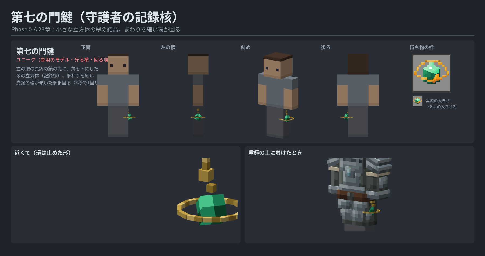

# ⑪ 階ごとのアクセサリー（2〜7階）と第七の門鍵

【11月24日に決定】「階層ごとにアクセサリーも追加しましょう」。2階から先の階ごとに、その階の素材で作る5つ（闘環・智環・首飾り・
腕輪・お守り）と、名のある魔物が落とすレアのお守り1つを足しました【補完】。奥の階の品ほど、メインステータスの上限が少し高い
（同じ章の中で1階ごとに +5%）【補完】。メインステータスとサブの決まりは Phase 0-A 21章のとおり（指輪は闘環＝攻撃・智環＝魔力）。

| 階 | 闘環・智環 | 首飾り | 腕輪 | お守り | レアのお守り（名のある魔物から5%） |
| --- | --- | --- | --- | --- | --- |
| 2階 | 樹皮の闘環・樹皮の智環 | 光茸の首飾り | 根結びの腕輪 | 迷い灯のお守り | 葉隠れの尾飾り（10%の確率で、25%の追加ダメージ） |
| 3階 | 水路銅の闘環・水路銅の智環 | 澄み水の首飾り | 歯車の腕輪 | ナマズひげのお守り | 水鏡のお守り（受けるダメージ −3%） |
| 4階 | 祈り石の闘環・祈り石の智環 | 鈴音の首飾り | 壁画の腕輪 | 聖獣の毛のお守り | 欠けた聖印（攻撃が当たると12%の確率で、与えたダメージの5%だけHPが回復する） |
| 5階 | 真鍮の闘環・真鍮の智環 | 翠核の首飾り | 防衛兵の腕輪 | 監視眼のお守り | 結び台の欠片（HPが30%以下の敵に与えるダメージ +10%） |
| 6階（11月25日） | 霜銀の闘環・霜銀の智環 | 氷晶の首飾り | 凍て毛皮の腕輪 | 雪灯のお守り | 群れ長の白牙（12%の確率で、20%の追加ダメージ）・霜熊の氷の棘（寒さに強い 25%） |
| 7階（11月25日） | 鏡氷の闘環・鏡氷の智環 | 氷角の首飾り | つららの腕輪 | 合言葉の札 | 白角の欠片（移動の速さ +6%）・吹雪の灯（ロスト耐性 +20%） |

- 首飾り・腕輪・お守りは体に表示する（アンコモン：光らない・動かない）。指輪とレアのお守りは、持ち物の絵だけ
- 説明文に、何階の品か（と、レアのお守りの効き目）が出る
- 6階（第2章のはじめ。第2世代）は、0-A 21章の第2章の一覧の「霜銀の闘環／智環・氷晶の首飾り・雪灯のお守り」と、6階の素材の
  「凍て毛皮の腕輪」【補完】（一覧の「凍て鶴の腕輪」は、凍て鶴の出る8階で作る）。名のある魔物が2体なので、レアのお守りも2つ
- 7階は、7階の素材（鏡氷・氷角・つらら蝙蝠の翼・吹雪の芯・プリズムの欠片）で作る【補完】。「吹雪の灯」のロスト耐性は、7階から出る
  ロスト状態「薄れ」に効く（特殊効果 `lost_resist`。ステータスのロスト耐性と足して50%まで。[`docs/phase8_iceforest.md`](../phase8_iceforest.md)）
- **第2章からのアクセサリーは、防具職人が織る「台座布」を1つ使う**（0-A 19章の三すくみ【提案】。[`docs/phase8_village.md`](../phase8_village.md)）
- 確認画像：[2階](accessories_f2_sheet.png)・[3階](accessories_f3_sheet.png)・[4階](accessories_f4_sheet.png)・[5階](accessories_f5_sheet.png)・[6階](accessories_f6_sheet.png)・[7階](accessories_f7_sheet.png)
- 作り直し方：`python3 tools/datagen/build_floor_accessories.py`（データ）→ `python3 tools/artgen/make_floor_accessory_art.py .`（見た目。
  すべての絵が16×16に戻る）→ `python3 tools/artgen/enhance_icons.py .`（16×16に戻った絵を、すべて32×32に。`--only` で一部だけにすると、
  ほかの階の絵が16×16のまま残る。11月25日に一度そうなったので直した）

## 第七の門鍵（5階のユニーク）

| 項目 | 内容 |
| --- | --- |
| 決めたこと | Phase 0-A 23章（確定）：守護者の記録核「第七の門鍵」（お守り）。小さな立方体の翠の結晶。まわりを細い環が回る。古代守護者の心臓部。技術者たちが未来へ託した「通行証」 |
| 効き目 | 認証：3人以上の味方が8ブロック以内にいると、その全員の被ダメージが5%減る（いくつあっても1つ分） |
| 手に入れ方 | 偉業：古代守護者の初撃破パーティで、結び台に一番長く乗っていた人（サーバーで1つ。初めて倒したときに守護者が渡す。全員に知らせ） |
| 取引 | 取引不可（取引所に出せない。持ち主が決まっている） |
| 見た目 | ユニーク：専用のモデルと演出。左の腰から下がる真鍮の鎖の先に、角を下にした翠の立方体（記録核。光る）。そのまわりを、真鍮の細い環が傾いたまま回り続ける（4秒で1回り）。立方体もゆっくり上下する【補完】 |
| 持ち物の絵 | 斜め上から見た翠の立方体と、それを斜めに囲む金の環 |
| 作り直し方 | `python3 tools/artgen/make_gate_key.py .` → `tools/artgen/enhance_icons.py --only seventh_gate_key` |
