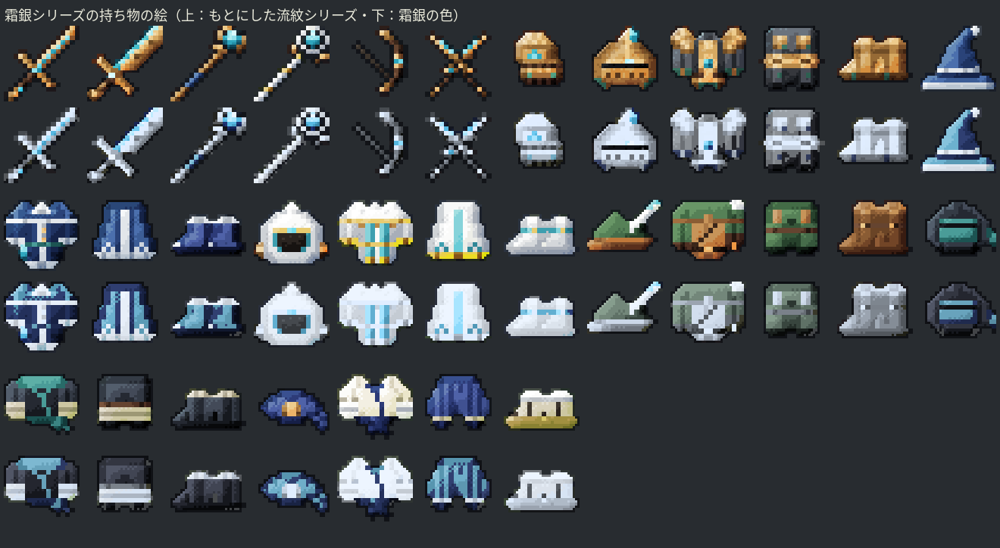
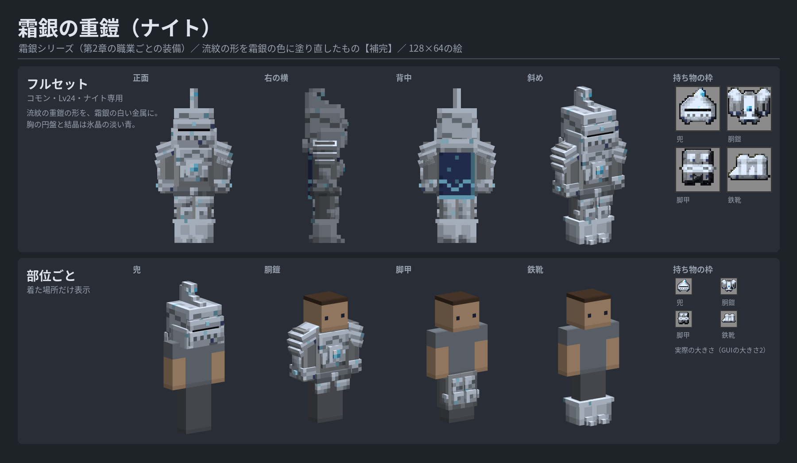
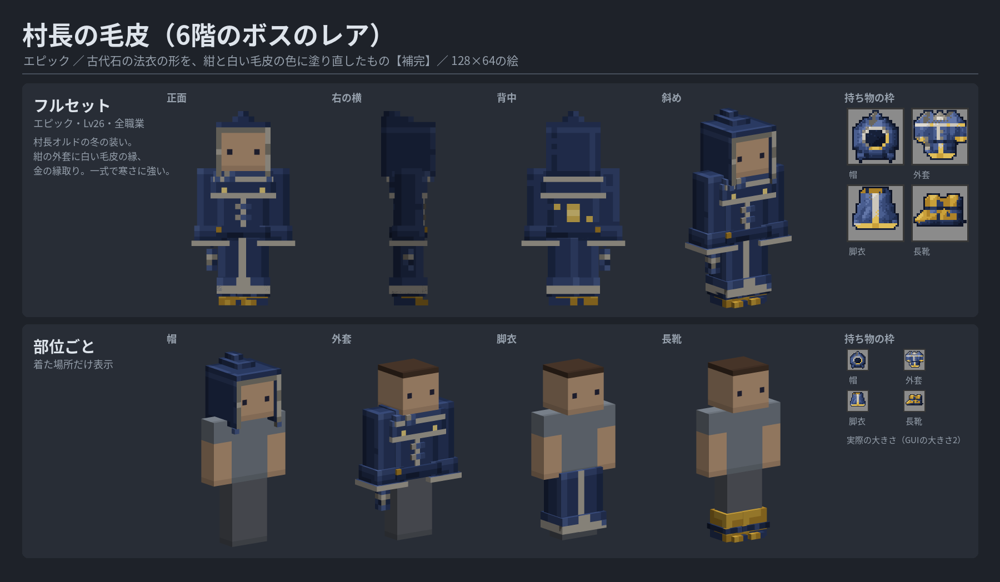

# ⑫ 霜銀シリーズ（第2章の職業ごとの装備）と ⑬ 村長の毛皮

| 項目 | 内容 |
| --- | --- |
| 決めたこと | Phase 0-A 20章「装備の世代」：第2章 凍てつく記憶。主な素材は霜銀・氷晶・凍て毛皮。「霜銀シリーズ → 女王シリーズ（10階のレア）」。対応レベル 15〜28。【11月23日に決定】3階からは職業ごとの固有の防具と武器。【11月25日に決定】防具は一式（頭・胴・脚・足）そろえた形 |
| 品 | 6職業 × 武器（ナイトは剣と大剣）・防具一式4と、ナイトの盾 ＝ 32品 |
| 手に入れ方 | 工房で作る。武器は武器工房（武器職人）、防具と盾は防具工房（防具職人）。熟練度4〜5（第2章の上限は5） |
| レアリティ | コモン（第2世代）。工房の「大成功」で品質が上がる |
| 使える人 | その職業だけ。Lv24から【補完】（6階のおすすめ Lv24〜31 のはじめ。守護者シリーズは Lv22） |
| 数値【補完】 | 流紋シリーズの同じ品の約1.45倍（守護者シリーズの素の数値を少し上回るくらい）。会心・速さのような小さな数は、はね上がらないよう +1 まで。`tools/balance/estimate.py` の6階の目安は、この装備で作った |
| 素材【補完】 | 6階の霜銀・氷晶・凍て毛皮・霜狼の牙・凍て鳥の羽根。重い鎧と武器の金属は霜銀、ローブや軽装は凍て毛皮と羽根が多い |
| 別の生産職の部品 | 0-A 19章の三すくみ【提案】：武器は**結晶細工**（装飾師が作る）、防具と盾は**補強金具**（武器職人が作る）を1つ使う（アクセサリーは**台座布**。防具職人が作る）。[`docs/phase8_village.md`](../phase8_village.md) |
| 作り直し方 | `python3 tools/datagen/build_gear_frost_silver.py`（データ）→ `python3 tools/artgen/make_frost_silver_gear.py .`（見た目）→ `python3 tools/artgen/make_frost_silver_gear.py . --sheets`（確認画像） |

## 品の一覧

| 職業 | 武器 | 頭 | 胴 | 脚 | 足 |
| --- | --- | --- | --- | --- | --- |
| ナイト | 霜銀の剣（攻撃28）・霜銀の大剣（攻撃45）・霜銀の盾（防御10・HP36） | 霜銀の兜 | 霜銀の胴鎧（防御9・HP44） | 霜銀の脚甲 | 霜銀の鉄靴 |
| ウィザード | 霜銀の杖（魔力35・MP80） | 霜銀の尖り帽 | 霜銀の長衣（防御6・MP58・魔力6） | 霜銀の下衣 | 霜銀の布靴 |
| ヒーラー | 霜銀の鈴杖（魔力32・MP80・回復7） | 霜銀の白頭巾 | 霜銀の白法衣（防御6・MP44・HP22・回復3） | 霜銀の白下衣 | 霜銀の白靴 |
| アーチャー | 霜銀の弓（攻撃26・会心4） | 霜銀の羽根帽 | 霜銀の狩り胴着（防御7・HP36・会心2） | 霜銀の革脚絆 | 霜銀の長靴 |
| ローグ | 霜銀の双短剣（攻撃26・会心4） | 霜銀の覆面 | 霜銀の黒装束（防御6・HP32・速さ1・会心2） | 霜銀の黒脚絆 | 霜銀の足袋 |
| モンク | 霜銀の籠手（攻撃26・HP44） | 霜銀の鉢巻 | 霜銀の道着（防御7・HP44・速さ1） | 霜銀の袴 | 霜銀の草鞋 |

## 見た目【補完】

**今は、流紋シリーズ（3〜4階）の形と絵をそのまま使い、色だけを霜銀の色に塗り直したもの**です（守護者シリーズと同じやり方。
`make_frost_silver_gear.py` の色の置き換え：青銅・金 → 霜銀の白い銀、明るい水色 → 氷晶の淡い氷青、暗い青・藍 → 夜の雪の藍、
灰・白・生成り → 雪の白、ほかの色 → うすく冷たく）。コモンなので光る部分はありません。霜銀シリーズだけの形（毛皮の襟・氷晶の飾りなど）は、
まだ作っていません。

確認画像：[ナイト](frost_silver_knight_sheet.png)・[ウィザード](frost_silver_wizard_sheet.png)・[ヒーラー](frost_silver_healer_sheet.png)・
[アーチャー](frost_silver_archer_sheet.png)・[ローグ](frost_silver_rogue_sheet.png)・[モンク](frost_silver_monk_sheet.png)

## 生産職どうしの部品

| 部品 | 作る工房（生産職） | 材料 → できる数 | 使う品 |
| --- | --- | --- | --- |
| 補強金具 | 武器工房（武器職人） | 霜銀2・苔鉄1 → 2つ | 防具と盾 |
| 台座布 | 防具工房（防具職人） | 凍て毛皮1・ツノモフの毛2 → 2つ | アクセサリー |
| 結晶細工 | 装飾工房（装飾師） | 氷晶2・結晶の欠片1 → 2つ | 武器 |

熟練度3（第1章の上限でも作れる）【補完】。一人では全部そろわないので、ほかの生産職の人と部品を融通しあう（0-A 19章）。

## 村長の毛皮（6階のボスのレア）

| 項目 | 内容 |
| --- | --- |
| 決めたこと | 6階のボス「村長の残響オルド」のレア【補完】。【11月25日に決定】防具は一式 |
| 品 | 村長の毛皮帽（防御5・HP30）・村長の毛皮外套（防御9・HP52・寒さに強い 20%）・村長の毛皮の脚衣（防御7・HP40）・村長の毛皮の長靴（防御4・HP22・速さ1） |
| 手に入れ方 | オルドを倒したとき：帽4%・外套5%・脚衣4%・長靴4%（天井あり） |
| レアリティ・使える人 | エピック（第2世代）・Lv26・全職業 |
| 一式の効果 | 4つとも着ると「寒さに強い 30%」（外套と合わせて50%。凍えと、鈍足・凍結の時間が短くなる） |
| 修理 | 凍て毛皮2・霜銀1 |
| 見た目【補完】 | 古代石の法衣の形を、紺の外套・白い毛皮の縁・金の縁取りの色に塗り直したもの。金の縁取りとボタンが光る（エピックの「光る部分」） |
| 作り直し方 | `python3 tools/datagen/build_floor6_data.py`（データ）→ `python3 tools/artgen/make_village_things.py`（見た目。`--fur-sheet` で確認画像） |
