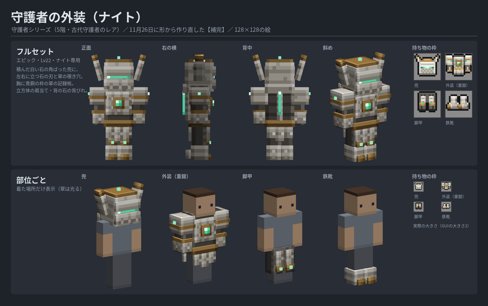

# ⑩ 守護者シリーズ（5階のボスのレア。職業ごと）

| 項目 | 内容 |
| --- | --- |
| 決めたこと | Phase 0-A 20章「見習い装備 → 古代石シリーズ → 守護者シリーズ（5階のレア）」。【11月23日に決定】5階の守護者シリーズも職業ごと。【11月25日に決定】防具は一式全部（頭・胴・脚・足）そろえた形 |
| 品 | 6職業 × 武器1・防具一式4（頭・胴〈外装〉・脚・足）＝ 30品（[`docs/phase8_altar.md`](../phase8_altar.md) の表） |
| 手に入れ方 | 古代守護者（5階のボス）だけが落とす。武器4%・防具は各3%（天井あり）。**自分の今の戦闘職の品だけを引く**（敵の定義の `job_match`。`DropService.forJob`） |
| レアリティ | エピック（光る部分と、小さな粒） |
| 使える人 | その職業だけ（`jobs` が1つ）。Lv22から（データのとおり。前にこの表に「Lv10」とあったのは書きまちがい）。装備で持ち主が決まる |
| 武器の特殊効果 | 8ブロック以内の味方1人ごとに、与えるダメージ +3%（5人まで。`ally_power`）。0-A の「つながりが力になる」 |
| 外装の特殊効果 | 敵から受けるダメージ −5%（`damage_reduction`） |
| 一式の効果【補完】 | 同じ職業の守護者の頭・胴・脚・足を4つとも着ると、受けるダメージがさらに −5%（防具の定義の `set_effects`。4つとも使える状態で、壊れていないときだけ。説明文に「今 n/4」） |
| 頭・脚・足の数値【補完】 | 流紋シリーズの同じ部位 × 「守護者の外装 ÷ 流紋の胴」（1.5倍まで。会心・速さの1→2のような小さな数で、はね上がらないように） |
| 修理 | 外装：翠の核片1・防衛兵の装甲片2。頭・脚・足：翠の核片1・防衛兵の装甲片1 |
| 作り直し方 | `python3 tools/datagen/build_floor5_data.py`（データ）→ `python3 tools/artgen/make_altar_things.py .`（見た目。結び台と、守護者シリーズの防具6職業と武器6。中で `make_gear_guardian_armor.py`・`make_gear_guardian_weapons.py` を呼ぶ）→ `python3 tools/artgen/enhance_icons.py .`（持ち物の絵を32×32に） |

## 見た目【補完】（11月26日に形から作り直した）

11月26日のご指示「階層が変わったときの装備が色しか変わっていないのはよくないので見た目をしっかりと変える」で、流紋シリーズの形の
塗り直しをやめ、古代守護者（白い石と青銅の巨人・胸の翠の記録核）の姿から、職業ごとに形を作り直しました。前の見た目は
「流紋の形と絵の、色だけの塗り直し」でした（11月24〜25日）。

シリーズの印：あたたかい白い石（面のふちが明るく、表に「結び目の格子」の細い溝）・落ち着いた青銅の帯と枠・**翠の記録核**（立方体の
結晶。光る）。角ばった板・四角や八角の輪・浮かぶ立方体のように、曲線のない「組み上げた」形にしました（流紋は波打つ曲線と青銅）。

| 職業 | 頭 | 外装（胴） | 脚 | 足 |
| --- | --- | --- | --- | --- |
| ナイト | 積んだ白い石の角ばった兜。左右に外へ開く石の刃（先は青銅）、横一本の翠の覗き穴（光る）、格子の顔の板 | 格子の胸板と、青銅の枠の中の翠の記録核（光る）。立方体の石の肩当て（青銅の帯・外に翠の鋲）。3枚の石の垂れ。背に石の背びれと翠のすじ | 暗い石の腿・格子の前板・青銅の膝当てと翠の鋲 | 角ばった石の靴・青銅のつま先・かかとの石のひれ |
| ウィザード | 段の石の尖り帽（ピラミッド）・青銅の帯・てっぺんの台の上に**浮かぶ翠の立方体** | 白い法衣（背に結び目の格子の印）・四角の青銅の襟・翠の立方体の垂れ飾り・背の格子の石板・2枚重ねの平たい石の肩の板 | 白いすそ（青銅の四角の連なり）と格子の石の板 | 白い靴と厚い石の底・青銅のつま先 |
| ヒーラー | 肩までの白いヴェール・額の青銅の輪と翠・**頭の後ろの八角の青銅の後光**（てっぺんに翠） | 白い衣・肩の白い掛け・円い青銅の胸当て（格子の石の円盤と翠）・先に翠の付いた2本の石の数珠・広い袖口と石の腕輪 | 白いすそと、前と横に下がる格子の石のタイル | 白い布の足・石の底・青銅の紐と足首の輪 |
| アーチャー | 石の帽子と前のつば・**右目の翠の片眼鏡**（青銅の枠）・左に扇に開いた3枚の石の羽根（先に翠） | 暗い革の胴に、前と後ろの石の小札（格子）・右肩だけの石の板・背の石の矢筒（翠のふた）・左の腕に格子の石の腕当て | 暗い革・石のすね当てと翠の鋲 | 暗い革の長靴・青銅の前の板・石のかかと |
| ローグ | 角ばった黒い頭巾（てっぺんが尖る）・**顔をすべておおう石の面と、縦一本の翠のすじ** | 黒い胴・右肩だけの2枚の石の肩当て・ななめの青銅の帯と翠の玉3つ・背の重なる石の肩掛け・石の前腕の当て | 黒い脚絆・石の膝当て・腿の翠のすじ | 黒い割れたつま先の足袋・石の底・青銅の足首の輪 |
| モンク | 格子の石の鉢巻・前に翠の玉3つ（まん中が大きい）・後ろに2本の石の房 | 袖のない白い道着・**首からU字に下がる大きな石の数珠**（少し暗い石。下に翠の玉）・青銅の格子の帯・前腕の石の輪と青銅の輪 | 白い袴（ひだ・青銅のすそ）と、すその石のおもり | **石の下駄**（厚い台と2本の歯）・翠の鼻緒・白い巻き布 |

| 武器 | 形 |
| --- | --- |
| 守護者の核剣（ナイト） | 白い石の一枚岩の刃（格子の溝・左に青銅の背・まん中の翠のすじ・斜めに断った先）。刃の根元の四角の青銅の輪の中に翠の核。暗い石の握りと青銅の帯・翠の柄頭 |
| 守護者の核杖（ウィザード） | 積んだ石の柄（白い布の握り）の先に、前を向いた四角の青銅の輪（角に石）。輪の中に浮かぶ翠の立方体 |
| 守護者の核鈴（ヒーラー） | 石の柄の先の青銅の横木（両はしに石）から下がる、段の石の鐘と翠の舌。左右に翠の房 |
| 守護者の核弓（アーチャー） | 角ばった石の塊の腕を、青銅の継ぎ目でつなぐ。継ぎ目の翠・弭の翠・石の握りの翠の核。弦は白（弦の位置と持ち方は流紋の弓と同じ） |
| 守護者の双核刃（ローグ） | 三角の白い石の刃（根元が広い）と、まん中の翠のすじ・四角の青銅の鍔・翠の柄頭 |
| 守護者の核拳（モンク） | 格子の石の筒（青銅の輪）と、四角い石のこぶし。拳の前に青銅の歯3つ・甲と前に翠の核（両手にはめる） |

エピックの見せ方：翠の記録核の部品だけが光る（武器は `forge_data`、防具は `guardian_<職業>_glowmask.png`。1着に4〜8か所の小さな翠）。
持っていると小さな光の粒が出る（`GearSparkles`。エピックの決まり）。防具の絵は 128×128、武器は 64×64。

確認画像：防具 [ナイト](guardian_knight_sheet.png)・[ウィザード](guardian_wizard_sheet.png)・[ヒーラー](guardian_healer_sheet.png)・
[アーチャー](guardian_archer_sheet.png)・[ローグ](guardian_rogue_sheet.png)・[モンク](guardian_monk_sheet.png)／武器 [guardian_sheet.png](guardian_sheet.png)

## 品質チェック（自己採点。教材の7項目・各10点）

| 項目 | ナイト | ウィザード | ヒーラー | アーチャー | ローグ | モンク | 武器 | 理由 |
| --- | --- | --- | --- | --- | --- | --- | --- | --- |
| シルエット | 9 | 9 | 9 | 9 | 9 | 8 | 9 | 石の刃の兜・ピラミッドと浮かぶ核・八角の後光・片眼鏡と扇の羽根・石の面・数珠と下駄。武器は職業ごとに形が違う |
| 立体感 | 9 | 8 | 9 | 8 | 8 | 8 | 8 | 立方体の肩当てと背びれ・段の帽子・後光と胸当て・矢筒・重なる石の肩掛け・数珠 |
| Minecraft適合性 | 9 | 9 | 9 | 9 | 9 | 9 | 9 | GeckoLib の防具のボーンの決まり（絵は128×128）、武器は22.5度刻み。持ち方は流紋と同じ |
| 材質表現 | 8 | 8 | 8 | 8 | 8 | 8 | 8 | 白い石の格子の溝と明るいふち・積んだ段・青銅・光る翠・白い布 |
| 視認性 | 9 | 9 | 8 | 8 | 9 | 9 | 9 | 白い石と翠の光で、どの職業も守護者と分かる。ローグは黒に白い面と翠のすじ |
| オリジナリティ | 9 | 9 | 9 | 9 | 9 | 9 | 9 | 古代守護者の体（白い石・青銅・翠の記録核）から作った。流紋の形は使っていない |
| レアリティ表現 | 9 | 9 | 9 | 9 | 9 | 9 | 9 | エピック：翠の核だけが光り、持つと光の粒 |
| **合計** | **62** | **61** | **61** | **60** | **61** | **60** | **61** | 教材の基準（60点）に届いた |

作りながら直したところ：格子の溝が2ピクセルおきで市松模様に見えた（3ピクセルおきに、溝の濃さを弱く）・ナイトの兜の石の刃が
細すぎた（太く）・ウィザードの肩の石の板が薄すぎた（厚く）・ヒーラーの後光の横の棒が、輪の向きに沿っていなかった（八角の輪の
棒の回し方を直した）・モンクの数珠が明るい石で、白い道着にとけて前から見えなかった（少し暗い石に。視認性が8点から9点）。

## ゲームの中での確認

- CIの写真：`phase8_f5_guardian_knight`・`phase8_f5_guardian_wizard`・（11月26日から）`phase8_f5_guardian_healer`・
  `phase8_f5_guardian_archer`・`phase8_f5_guardian_rogue`・`phase8_f5_guardian_monk`（守護者の防具一式と武器を着けた前の姿）・
  `phase8_f5_guardian_set_tooltip`（兜と外装の説明文。「一式の効果 … 今 4/4」）
- 自動テスト：`AltarGameTests.guardianGearIsPerJob`（30品・武器4%・防具3%・職業ごとに武器1と防具一式4・ナイトはナイトの品だけを
  引く）・`EquipmentGameTests.armorSetBonusNeedsAllFour`（一式の効果は4つそろったときだけ。ほかのシリーズが混ざる・レベル不足・
  壊れた品では効かない）
