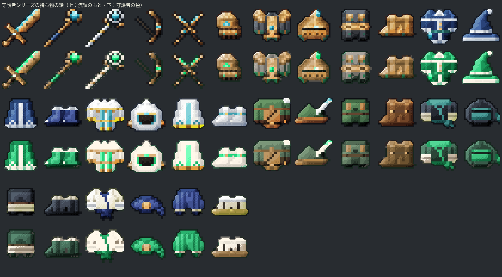

# ⑩ 守護者シリーズ（5階のボスのレア。職業ごと）

| 項目 | 内容 |
| --- | --- |
| 決めたこと | Phase 0-A 20章「見習い装備 → 古代石シリーズ → 守護者シリーズ（5階のレア）」。【11月23日に決定】5階の守護者シリーズも職業ごと。【11月25日に決定】防具は一式全部（頭・胴・脚・足）そろえた形 |
| 品 | 6職業 × 武器1・防具一式4（頭・胴〈外装〉・脚・足）＝ 30品（[`docs/phase8_altar.md`](../phase8_altar.md) の表） |
| 手に入れ方 | 古代守護者（5階のボス）だけが落とす。武器4%・防具は各3%（天井あり）。**自分の今の戦闘職の品だけを引く**（敵の定義の `job_match`。`DropService.forJob`） |
| レアリティ | エピック（光る部分と、小さな粒） |
| 使える人 | その職業だけ（`jobs` が1つ）。Lv22から（データのとおり。前にこの表に「Lv10」とあったのは書きまちがい）。装備で持ち主が決まる |
| 武器の特殊効果 | 8ブロック以内の味方1人ごとに、与えるダメージ +3%（5人まで。`ally_power`）。0-A の「つながりが力になる」 |
| 外装の特殊効果 | 敵から受けるダメージ −5%（`damage_reduction`） |
| 一式の効果【補完】 | 同じ職業の守護者の頭・胴・脚・足を4つとも着ると、受けるダメージがさらに −5%（防具の定義の `set_effects`。4つとも使える状態で、壊れていないときだけ。説明文に「今 n/4」） |
| 頭・脚・足の数値【補完】 | 流紋シリーズの同じ部位 × 「守護者の外装 ÷ 流紋の胴」（1.5倍まで。会心・速さの1→2のような小さな数で、はね上がらないように） |
| 修理 | 外装：翠の核片1・防衛兵の装甲片2。頭・脚・足：翠の核片1・防衛兵の装甲片1 |
| 作り直し方 | `python3 tools/datagen/build_floor5_data.py`（データ）→ `python3 tools/artgen/make_altar_things.py`（見た目）→ `tools/artgen/enhance_icons.py --only <名前,…>` |

## 見た目【補完】

**今は、流紋シリーズ（3〜4階）の形と絵をそのまま使い、色だけを塗り直したもの**です（`make_altar_things.py` の色の置き換え：
青・水色 → 守護者の記録核の翠、灰色 → 温かい石の色、茶 → 青銅）。形は流紋シリーズと同じで、守護者シリーズだけの形
（白い石の装甲板・青銅の縁・翠の核の光の筋など）は、まだ作っていません。外装（胴）は、流紋の胴の形を職業ごとに使います。
11月25日に足した頭・脚・足も、流紋の同じ部位の形と絵を塗り直したものです（体に着たときの形は、もとから流紋の geo に4つの部位が
そろっているので、そのまま一式で表示されます）。

エピックの見せ方：武器の翠の部品（刃の溝・鍔の玉・杖の先の核など。翠が面の半分より多い部品）と、外装の翠の小さな粒（流紋の
「流水の結晶」の明るい水色だった所。服じゅうが光らないよう、1着40画素まで）は光る（`forge_data`・`_glowmask.png`）。持っていると
小さな光の粒が出る（`GearSparkles`。エピックの決まり）。

これから作るときの向き：古代守護者の体と同じ「白い石の板・青銅の継ぎ目・胸の翠の記録核」。武器は刃や杖の先に翠の核を埋め、
外装は肩と胸に白い石の板を重ねる（職業ごとの形は 0-A 20章のとおり）。

## ゲームの中での確認

- CIの写真：`phase8_f5_guardian_knight`・`phase8_f5_guardian_wizard`（守護者の防具一式と武器を着けた前の姿）・
  `phase8_f5_guardian_set_tooltip`（兜と外装の説明文。「一式の効果 … 今 4/4」）
- 自動テスト：`AltarGameTests.guardianGearIsPerJob`（30品・武器4%・防具3%・職業ごとに武器1と防具一式4・ナイトはナイトの品だけを
  引く）・`EquipmentGameTests.armorSetBonusNeedsAllFour`（一式の効果は4つそろったときだけ。ほかのシリーズが混ざる・レベル不足・
  壊れた品では効かない）
