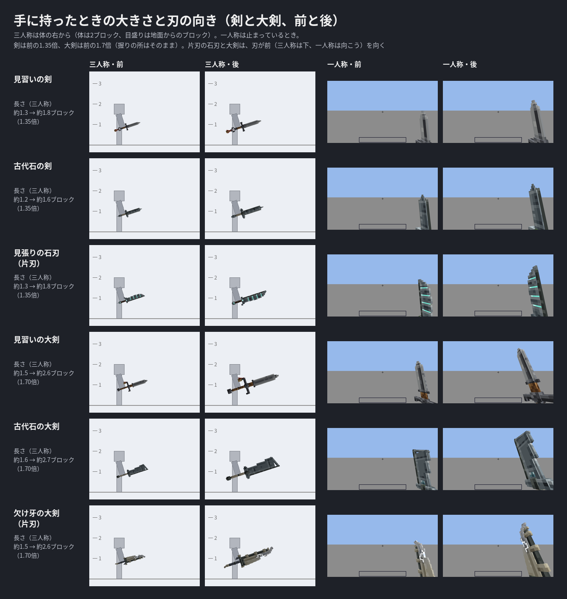
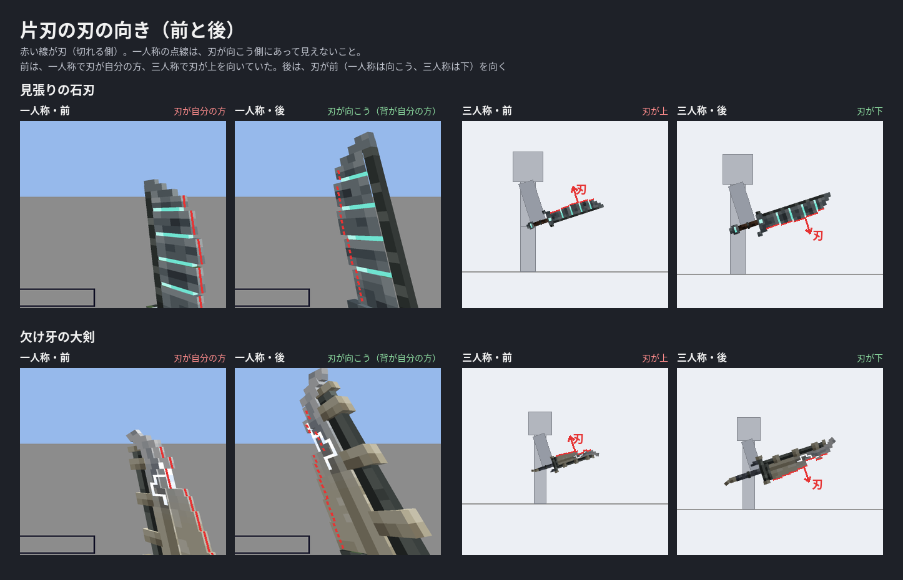

# 手に持ったときの大きさと刃の向き（剣・大剣）

| 項目 | 内容 |
| --- | --- |
| 品 | 剣3つ（見習いの剣・古代石の剣・見張りの石刃）と大剣3つ（見習いの大剣・古代石の大剣・欠け牙の大剣）。杖と盾は変えていない |
| 直したこと | ①片刃の2つ（見張りの石刃・欠け牙の大剣）は、刃が自分の方を向いていた → 刃が前を向くようにした。②剣を大きく、大剣はもっと大きくした |
| 変えていないこと | 形・色・絵（持ち物の枠・額縁・地面の16×16の絵も）・数値。変えたのは、手に持ったときの置き方（`display` の一人称・三人称）だけ |
| 頼まれた日 | 11月21日 |

「見切りの石刀」という品はないので、片刃の片手剣がこれだけの **見張りの石刃** のことと読んだ【補完】。

## 刃の向き（片刃）

- **原因**：片刃の2つは、正面から見て右（モデルの +x）を刃に作っている。Minecraft の手の向き（右手は y −90度）では、モデルの +x の側が、一人称では自分の方、三人称では上を向く（バニラの釣り竿が y +90度で持たせているのと同じ理由）。
- **直し方**：手の中で、刃の軸（握りを通るモデルの y の線。x 8・z 8）のまわりに180度回した。持ち方の値では `[rx, ry, rz]` → `[rx, ry±180, −rz]`。軸の上の握りは動かないので、手の位置は変わらない。左手は右手を左右に写す（いままでと同じ決まり）。
- **結果**：一人称では刃が向こう（自分には背が見える）、三人称では刃が下を向く。腕を振り下ろすと、刃の側から当たる。
- 刃の側が分かるように、確認画像（hold_edge.png）では刃の線を赤で描いた。一人称の「後」の点線は、刃が向こう側にあって見えないこと。
- これからの片刃の武器も、刃はモデルの +x に作り、`weapons.export_weapon(..., edge_forward=True)` で書き出す（`make_gear_rare_f1.py` の `SINGLE_EDGE`）。

## 大きさ

- 剣は前の **1.35倍**、大剣は前の **1.7倍**【補完】。一人称・三人称とも同じ倍率。
- 握りの所（手の中の点）を中心に大きくした。手の位置はそのままで、刃が手から長くのびる。
- 一人称は、大きくした刃が画面の上で切れすぎないよう、刃を前（向こう）へ少し深く倒した（剣 5度 → 10度、大剣 10度 → 24度）【補完】。
- 体（2ブロック）と比べた長さ（三人称。持ったときの刃の向きの長さ）：

| 品 | 前 | 後 |
| --- | --- | --- |
| 見習いの剣 | 約1.3ブロック | 約1.8ブロック |
| 古代石の剣 | 約1.2ブロック | 約1.6ブロック |
| 見張りの石刃 | 約1.3ブロック | 約1.8ブロック |
| 見習いの大剣 | 約1.5ブロック | 約2.6ブロック |
| 古代石の大剣 | 約1.6ブロック | 約2.7ブロック |
| 欠け牙の大剣 | 約1.5ブロック | 約2.6ブロック |

- 走ったときの腕の振り（腕は前後に約29度）でも、刃のいちばん低い所は地面から0.2ブロック以上あり、地面にめりこまない（計算で確かめた）。

## 持ち方の値（右手。左手は y と z を逆にした値）

| 品 | 一人称（回転・移動・拡大） | 三人称（回転・移動・拡大） |
| --- | --- | --- |
| 見習いの剣 | [0,−75,10]・[1.078,1.958,0.935]・0.702 | [0,−90,0]・[0,3.645,0.5]・0.945 |
| 古代石の剣 | [0,−75,10]・[1.078,1.958,0.935]・0.7425 | [0,−90,0]・[0,4.05,0.5]・1.0125 |
| 見張りの石刃 | [0,105,−10]・[1.078,1.958,0.935]・0.675 | [0,90,0]・[0,4.05,0.5]・1.0125 |
| 見習いの大剣 | [0,−75,24]・[1.03,1.423,0.758]・0.765 | [0,−90,0]・[0,3.4,0.5]・1.19 |
| 古代石の大剣 | [0,−75,24]・[1.03,1.423,0.758]・0.765 | [0,−90,0]・[0,3.4,0.5]・1.19 |
| 欠け牙の大剣 | [0,105,−24]・[1.03,1.423,0.758]・0.765 | [0,90,0]・[0,3.4,0.5]・1.19 |

値は手で書かず、`tools/artgen/weapons.py` の `hold_display` が、それぞれの作り手の持ち方（前の値）から計算する（`HOLD_SIZE`：剣 1.35倍・10度、大剣 1.7倍・24度）。

## 確かめ方

- 確認画像：`python3 tools/artgen/make_hold_sheet.py . docs/gear`。Minecraft の手の描き方（三人称は腕の付け根・前へ18度の腕・手の先、一人称はカメラの前の腕の位置と縦の視野70度）を再現して描く。一人称の描き方は、前のCIの写真（`gear_fp_sentinel`・`gear_fp_fang`）と重ねて、向きが合うことを確かめてある。
- CIの写真：一人称は `gear_fp_apprentice`（見習いの剣と盾）・`gear_fp_ancient_sword`・`gear_fp_sentinel`・`gear_fp_apprentice_greatsword`・`gear_fp_ancient_greatsword`・`gear_fp_fang`。三人称は横から `gear_hold_side_swords`・`gear_hold_side_greatswords`（防具立ての右腕を、プレイヤーが物を持つときと同じ前へ18度にした）。`gear_stands_redesign`・`gear_armor_redesign` にも写る。

## ファイル

| ファイル | 役割 |
| --- | --- |
| `tools/artgen/weapons.py` | `HOLD_SIZE`・`hold_display`（大きさと片刃の向き）。`export_weapon` が書き出すときに掛ける |
| `tools/artgen/make_gear_rare_f1.py` | `SINGLE_EDGE`（片刃の2つ）・`base_display`（石刃の一人称のもとの大きさ） |
| `tools/artgen/make_hold_sheet.py` | 確認画像（hold_sheet.png・hold_edge.png）を作るプログラム |
| `models/item/*_3d.json` | 6つの武器の持ち方（`display`） |

作り直すとき：`make_gear_apprentice.py`・`make_gear_ancient_stone.py`・`make_gear_rare_f1.py` を動かしてから、`make_hold_sheet.py` を動かす。
