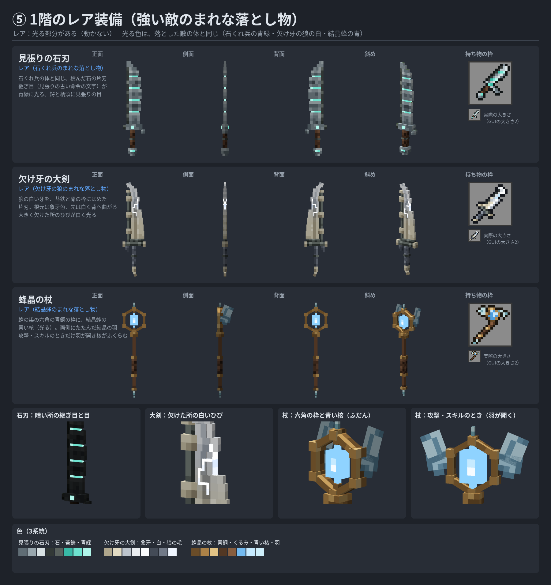

# ⑤ 1階のレア装備（見張りの石刃・欠け牙の大剣・蜂晶の杖）

| 項目 | 内容 |
| --- | --- |
| 品 | 見張りの石刃（片手剣）・欠け牙の大剣（両手剣）・蜂晶の杖（杖） |
| レアリティ | レア：光る部分がある（動かない）。蜂晶の杖だけ、攻撃・スキルのときに羽が開く（下の「蜂晶の杖」） |
| 世界観 | 1階の強い敵のまれな落とし物。光る色は、落とした敵の体と同じにした |
| 数値 | Phase 3のまま（IDと数値は変えていない） |

| 品 | 落とす敵 | 光る色 |
| --- | --- | --- |
| 見張りの石刃 | 石くれ兵 | 石くれ兵の継ぎ目と同じ青緑 `#6FE3D0` |
| 欠け牙の大剣 | 欠け牙の狼 | 狼の牙と同じ白（ロストの白）`#F0F6FF` |
| 蜂晶の杖 | 結晶蜂 | 結晶蜂の結晶と同じ青 `#8FD3FF` |

## 見張りの石刃

**ひとことで**：石くれ兵が巡回の間ずっと握っていた石刃。体と同じく石を積んだ片刃で、継ぎ目に残る見張りの古い命令の文字が青緑に光る。

- 苔鉄の背（左）に、石の塊を5つ積んだ片刃。刃の側（右）は塊ごとに幅が違い、段になる。研いだふちは明るい。
- 塊の間の継ぎ目（少し奥）が光る。鍔の真ん中と柄頭にも、横一本の「見張りの目」が光る。
- 先は背の側がとがる段々の先（道標の段）。鍔は片刃の側へ長くのびた石（刃の側を守る）。
- 握りは黒い革に苔鉄の輪。
- 刃が太いので、一人称のもとの大きさは古代石の剣より少し小さい（0.5倍。剣の1.35倍を掛けて0.675倍）。
- 片刃（刃は右＝モデルの +x）。持つと刃が前を向く（一人称は向こう、三人称は下）。持ったときの長さは約1.8ブロック（[手に持ったときの大きさと刃の向き](hold.md)）。
- 色：主＝古代石・副＝苔鉄・差し色＝青緑の光。

## 欠け牙の大剣

**ひとことで**：欠け牙の狼の、白く欠けた牙を刃に埋めた両手剣。弱った相手ほど深く届く。

- 刃は1本の牙：根元が広く、先へ細くなり、先は背の側へ曲がる（段と22.5度の切っ先）。背の側は厚く、刃の側は薄い。
- 根元は象牙色、先へ行くほど白いエナメル。上下の継ぎ目は見せない塗り方（1本の牙に見える）。
- 刃の上の方が大きく欠け、割れた面と、そこから根元の方へ稲妻のように走るひびが白く光る（表と裏）。
- 刃の背は苔鉄の枠と、背骨のような骨の板3つ。鍔は苔鉄の棒と両端の骨、背の側に狼の毛の房。握りは狼の毛を巻き、柄頭は骨の爪。
- 片刃（牙の刃は右＝モデルの +x）。持つと刃が前を向き、自分には背の骨が見える。持ったときの長さは約2.6ブロック（[hold.md](hold.md)）。
- 色：主＝牙（象牙〜白）・副＝苔鉄と骨・差し色＝狼の毛（青灰）と白い光。

## 蜂晶の杖（GeckoLib）

**ひとことで**：結晶蜂の核を先にはめた杖。核は今も、針を撃つ前のように脈打っている。

- 先は蜂の巣の六角形の青銅の枠（頂点が上と下）。真ん中に結晶蜂の青い核（光る）を、上下の青銅のピンでとめる。
- 枠の両側に、結晶の薄い羽が2枚ずつ（前の羽と後ろの羽）。ふだんはたたんで後ろへのびる。
- 柄はくるみの木に黒い革の握りと青銅の輪。石突きとてっぺんに、結晶蜂の針（細い結晶）。
- **動き**：レアなので、ふだん（idle）は動かない（前のモデルの、浮いて回る結晶はやめた。回る部品はレジェンダリーの印のため）。攻撃が当たったとき・スキルを使ったとき（`use`。サーバーから流す）だけ、0.7秒で羽が横へ開いて、核が1.4倍にふくらんで戻る。
- 持ち物の枠は2Dのドット絵（`forge:separate_transforms`。手に持つときだけGeckoLibの3D）。持ち方はほかの杖と同じ向きで、先の六角が大きいので一人称だけ少し小さくした（0.42倍）。
- 色：主＝青銅・副＝くるみの木・差し色＝青い核と結晶の羽。

## ゲームの中での確認

- CIの写真：`gear_lineup_rare`（並べて昼）・`gear_lineup_rare_night`（夜。光る所）・`gear_fp_sentinel`・`gear_fp_fang`・`gear_fp_bee`（一人称）・`gear_fp_bee_use`（use の途中：羽が開く）。防具立てにも持たせた（`gear_armor_redesign`）。石刃と大剣は、横から見た三人称の写真もある（`gear_hold_side_swords`・`gear_hold_side_greatswords`）。

## 作りながら変えたところ

1. 大剣の刃が白い板に見えた → 根元から先へ細くなる形にし、象牙色から白へ、継ぎ目を見せない塗りにした。
2. 大剣の欠けとひびが白い牙の中で見えなかった → ひびを牙の厚い所より手前に出し、根元の方へ稲妻のようにのばした。まわりのエナメルを少しくすませた。
3. 杖の核の縞（蜂の印）が電池のように見えた → 縞をやめ、上下のとがった青い結晶にした（蜂らしさは、六角の枠・羽・針で出す）。
4. 杖の羽の向き：Bedrock の左右（left が +x）と、ゲームの中の左右が逆なので、ボーンと回し方を合わせ直した。
5. 一人称（CIの写真）：石刃と杖が大きく見えたので、少し小さくした。use の途中の写真で、羽が開いて核がふくらむことを確かめた。
6. 11月21日：石刃と大剣の刃が自分の方を向いていた（三人称では上）、剣と大剣が小さすぎた → 手の中で刃の軸のまわりに180度回して刃を前へ向け、剣は1.35倍・大剣は1.7倍にした（[hold.md](hold.md)）。

## 品質チェック（自己採点。教材の7項目・各10点）

| 項目 | 石刃 | 大剣 | 杖 | 理由 |
| --- | --- | --- | --- | --- |
| シルエット | 8 | 9 | 9 | 段の片刃／曲がる牙／六角と羽。どれも定番の剣・杖と違う |
| 立体感 | 8 | 8 | 9 | 継ぎ目の奥行き／厚い背と薄い刃／枠・核・羽の前後 |
| Minecraft適合性 | 9 | 9 | 9 | 22.5度刻み・光る部品。杖はGeckoLibで、use の動き（羽が開く）もゲームの中で確かめた |
| 材質表現 | 8 | 8 | 8 | 石と苔鉄／象牙・エナメル・骨・毛／青銅・木・結晶 |
| 視認性 | 9 | 9 | 9 | 光る色が1色で、形の見せ場と重なる |
| オリジナリティ | 9 | 9 | 9 | 落とした敵の体（積んだ石・欠けた牙・結晶蜂）から作った |
| レアリティ表現 | 9 | 9 | 9 | レア：光る部分あり・ふだんは動かない |
| **合計** | **60** | **61** | **62** | 3つとも教材の基準（60点）に届いた |

## ファイル

| ファイル | 役割 |
| --- | --- |
| `models/item/{sentinel_blade,chipped_fang_greatsword}{,_3d}.json`・`textures/item/*_model.png` | 石刃・大剣（Java版モデル。光る部品は `forge_data` の明るさ15） |
| `geo/item/bee_crystal_staff.geo.json`・`animations/item/bee_crystal_staff.animation.json` | 杖（GeckoLib。ボーン：staff・core・wing_left・wing_right。アニメーション：idle・use） |
| `textures/item/bee_crystal_staff.png`・`_glowmask.png`・`_icon.png` | 杖の絵・光る所・持ち物の枠の絵 |
| `models/item/bee_crystal_staff{,_3d}.json` | 持ち物の枠の2Dと、手に持つ3D（`builtin/entity`）の切りかえ |
| `tools/artgen/make_gear_rare_f1.py` | 形・色・動き・確認画像を作るプログラム |

作り直すとき：`python3 tools/artgen/make_gear_rare_f1.py . /tmp/out`
