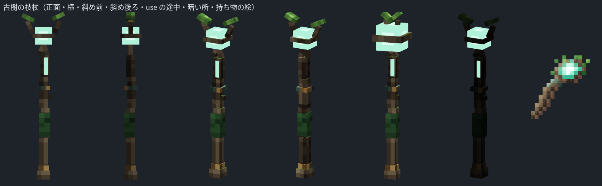

# ⑦ 2階のレア装備（古樹の枝杖）

左から：正面・横・斜め前・斜め後ろ・use の途中（節がふくらみ、小枝が開く）・暗い所（光る所だけ）・持ち物の絵（32×32）。

| 項目 | 内容 |
| --- | --- |
| 品 | 古樹の枝杖（杖） |
| レアリティ | レア：光る部分がある（動かない）。攻撃・スキルのときだけ、節がふくらみ、小枝が開く |
| 世界観 | 2階のボス「森番の古樹オールドウォード」のまれな落とし物（6%。出ないと少しずつ出やすくなる）。0-A 20章「古樹の枝杖（杖：魔法が当たると少し回復）」 |
| 数値【補完】 | 必要Lv6・ウィザード・魔力23・MP45・耐久520・装備で持ち主が決まる。**スキル（魔法）が当たると、与えたダメージの5%だけHPが戻る**。修理は古代石2・結晶の欠片2 |
| 光る色 | ボスの幹の光る節と同じ淡い青緑 |

1階のレアの蜂晶の杖（魔力19・MP30・スキルで10%の確率で40%の追加ダメージ）は攻める杖、古樹の枝杖は長い戦いで倒れにくくする杖です【補完】。

## 古樹の枝杖（GeckoLib）

**ひとことで**：森番の古樹の枝を、そのまま杖にしたもの。芯を古代の管の細い筋が通り、魔法が当たるたびに、樹液のような淡い光が持ち手へ流れ込む。

- 柄はねじれた枝（濃い樹皮。段ごとに少しずつずれる）。上の方に古代の管の輪がはまり、その上の柄の表を、淡い青緑に光る細い筋が1本走る（芯を通る古代の管の名残）。
- 握りには緑のつるを巻く。石突きは根のこぶと、青銅の口金。
- 先は2本の小枝が、光る節（ボスの幹の節と同じ色。樹皮の帯が巻く）を抱える。小枝は先で外へ曲がり、先に若葉。
- **動き**：レアなので、ふだん（idle）は動かない。攻撃が当たったとき・スキルを使ったとき（`use`。サーバーから流す）だけ、0.7秒で節が1.45倍にふくらみ、小枝が少し開いて戻る（蜂晶の杖と同じ考え方）。
- 持ち物の枠は2Dのドット絵（`forge:separate_transforms`。手に持つときだけGeckoLibの3D）。持ち方は蜂晶の杖と同じ向きで、先が小さいので一人称は蜂晶の杖より少し大きい（0.46倍）。
- 色：主＝樹皮（こげ茶）・副＝青銅の輪と緑のつる・差し色＝淡い青緑の光。

## 作りながら変えたところ

1. 柄の光る筋が太く何本もあり、光る所が多すぎた（レアの「光る色は1色、見せ場は1つ」から外れる）→ 光る筋は1本の細い筋にし、見せ場は先の節にした。
2. 節が小さく、遠くから見えなかった → 節を大きくし、小枝で抱える形にした。

## ゲームの中での確認

- CIの写真：`phase8_f2_staff`（一人称）。

## 品質チェック（自己採点。教材の7項目・各10点）

| 項目 | 点 | 理由 |
| --- | --- | --- |
| シルエット | 8 | 二股の小枝が節を抱える先。蜂晶の杖（六角の枠と羽）とも、古代石の杖（積んだ輪）とも違う |
| 立体感 | 8 | 小枝の前後・輪の出っぱり・つるの巻き |
| Minecraft適合性 | 9 | 箱の組み合わせと光る部品（ほかの杖と同じ作り）。GeckoLibで、use の動きもある（確認画像の5つ目） |
| 材質表現 | 8 | 樹皮・青銅・つる・若葉・光る節 |
| 視認性 | 9 | 光る色が1色で、見せ場（先の節）と重なる |
| オリジナリティ | 9 | 落としたボスの体（幹の光る節・古代の管）から作った |
| レアリティ表現 | 9 | レア：光る部分あり・ふだんは動かない |
| **合計** | **60** | 教材の基準（60点）に届いた |

## ファイル

| ファイル | 役割 |
| --- | --- |
| `geo/item/elder_branch_staff.geo.json`・`animations/item/elder_branch_staff.animation.json` | 杖（GeckoLib。ボーン：staff・head・twig_left・twig_right・knot など。アニメーション：idle・use） |
| `textures/item/elder_branch_staff.png`・`_glowmask.png`・`_icon.png` | 杖の絵・光る所・持ち物の枠の絵 |
| `models/item/elder_branch_staff{,_3d}.json` | 持ち物の枠の2Dと、手に持つ3D（`builtin/entity`）の切りかえ |
| `data/amemaru/amemaru/equipment/elder_branch_staff.json` | 数値と説明文 |
| `tools/artgen/make_gear_rare_f2.py` | 形・色・動き・確認画像を作るプログラム（持ち物の絵は `make_forest_things.py` と `enhance_icons.py`） |

作り直すとき：`python3 tools/artgen/make_gear_rare_f2.py . /tmp/out`
