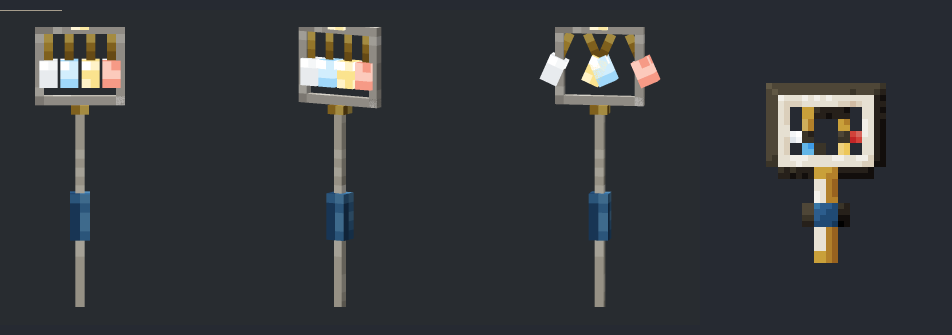

# ⑨ 4階のレア装備（祈り手の鈴）

| 項目 | 内容 |
| --- | --- |
| 品 | 祈り手の鈴（ヒーラーの鈴杖） |
| レアリティ | エピック |
| 世界観 | 4階のボス「祈りの残響カンターレ」のまれな落とし物（5%。出ないと少しずつ出やすくなる）。歌い手たちが鳴らしていた、四つの音の鈴 |
| 数値【補完】 | 必要Lv8・ヒーラー・魔力26・MP60・回復7・耐久560・装備で持ち主が決まる。**回復スキルで癒やした相手の防御を、5秒の間 +8%**（`heal_ward`）。修理は歌声の結晶2・結晶の欠片2 |
| 形 | 白い石の柄に青い握り。先に白い石の四角い輪があり、白・青・金・紅の結晶の鈴が4つ下がる（ボスの4人の歌い手の色） |
| 動き | 攻撃・スキルのとき（`use`）、4つの鈴が順に揺れて少しふくらむ |
| 描き方 | GeckoLib（`geo/item/prayer_bell_staff.geo.json`）。持ち物の枠は2Dの絵（`prayer_bell_staff_icon.png`） |
| 作り直し方 | `python3 tools/artgen/make_temple_things.py`（見た目）→ `tools/artgen/enhance_icons.py --only prayer_bell_staff_icon` |

## ゲームの中での確認

- CIの写真：`phase8_f4_bell`（ヒーラーで持ったとき）
- 自動テスト：`TempleGameTests.prayerBellIsTheFourthFloorRare`
