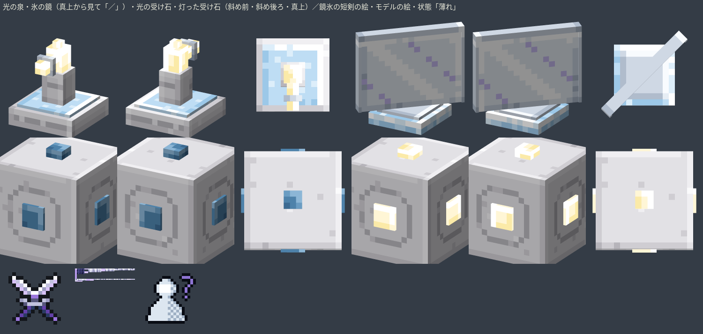
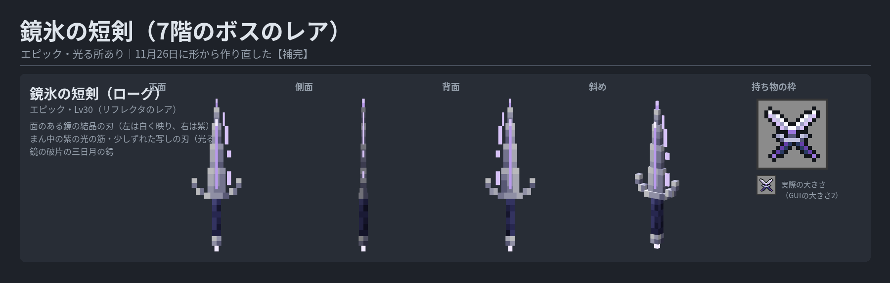

# ⑭ 7階のレア装備（鏡氷の短剣）

| 項目 | 内容 |
| --- | --- |
| 品 | 鏡氷の短剣（ローグの双短剣。両手に1本ずつ持つ） |
| レアリティ | エピック |
| 世界観 | Phase 0-A 20章（確定）：7階のボス「鏡像獣リフレクタ」のレア「鏡氷の短剣（短剣：一定確率で攻撃が二重に当たる）」5%。出ないと少しずつ出やすくなる（天井）。鏡のたてがみから削り出した短剣で、刃に映る自分の姿が、ほんの一瞬遅れて動く |
| 数値【補完】 | 第2世代・必要Lv30・ローグ・攻撃32・会心6・耐久600・装備で持ち主が決まる。**攻撃が当たると15%の確率で、鏡の写しがもう一度当たる（与えたダメージの100%）**（特殊効果 `double_hit`。白い光のかけらと、ガラスの鳴る音）。修理は鏡氷2・プリズムの欠片1 |
| 形【補完】 | 11月26日に形から作り直した（前は霜銀の双短剣の塗り直し）。鏡のたてがみから削り出した、段のある鏡の結晶の刃（左の面は白く映り、右の面は紫）と、刃のまん中の紫の光の筋。刃の右に寄りそう、少しずれた淡い紫の「写しの刃」（0-A の「刃に映る自分の姿が、ほんの一瞬遅れて動く」を形に）。鏡の破片の三日月の鍔・夜の雪の色の巻いた握り・プリズムの欠片の柄頭。大きさと持ち方は霜銀の双短剣と同じ |
| 光る所 | エピック：刃のまん中の紫の筋・刃の先・柄頭のプリズムの欠片と、写しの刃（6部品。Java のモデルの `forge_data` の明るさ15） |
| 描き方 | 手に持つと3D（`models/item/mirror_ice_daggers_3d.json`）、持ち物の枠・額縁・地面は2Dの絵（32×32） |
| 作り直し方 | `python3 tools/artgen/make_iceforest_things.py . <確認画像の出力先>`（7階のブロックと、この短剣。短剣は中で `tools/artgen/make_gear_rare_reshape.py` の `export_rare_weapon` を呼ぶ。持ち物の絵は `rare_icons.py`）→ `python3 tools/artgen/enhance_icons.py .`。短剣の確認画像（[mirror_ice_daggers_sheet.png](mirror_ice_daggers_sheet.png)）は `make_gear_rare_reshape.py` が作る |

## ゲームの中での確認

- CIの写真：`phase8_f7_daggers`（ローグで持ったとき）
- 自動テスト：`IceForestGameTests.floor7GearAndPassphraseWords`（効き目）・`reflectaCopiesWardAndBreak`（リフレクタのレア 5%）
