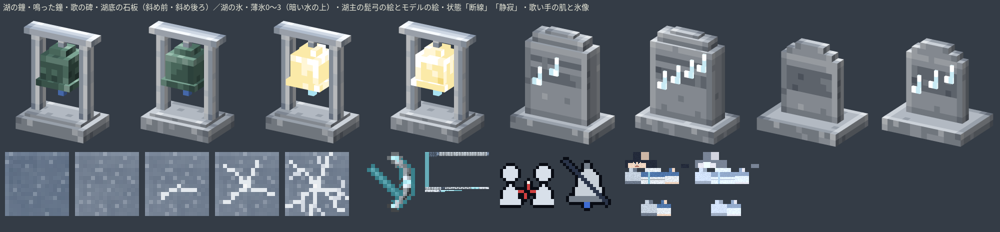

# ⑮ 8階のレア装備（湖主の髭弓）

| 項目 | 内容 |
| --- | --- |
| 品 | 湖主の髭弓（アーチャーの弓） |
| レアリティ | エピック |
| 世界観 | Phase 0-A 20章（確定）：8階のボス「声なき湖主ムーネ」のレア「湖主の髭弓（弓：静寂状態でも予兆の音が自分にだけ聞こえる）」4%。出ないと少しずつ出やすくなる（天井）。ムーネの光る長いひげを弦に張った弓。湖の音がすべて消えても、この弦だけは、危ないものが来る前に、持ち主の耳もとで小さく鳴る |
| 数値【補完】 | 第2世代・必要Lv34・アーチャー・攻撃35・会心7・耐久620・装備で持ち主が決まる。**ロスト状態「静寂」の間も、予兆が出た所から鈴の音が自分にだけ聞こえる**（特殊効果 `warning_ear`。働きはクライアントの `client/LakeSoundFilter.java`）。修理は静氷2・湖の真珠1 |
| 形 | 霜銀の弓の形を、湖の主の白い鱗の色（灰白に、ほんの少し青）に塗り替え、弦・握りの石・弓の先を、ムーネのひげの光る水色にした（今は塗り直し。それだけの形は、まだ） |
| 光る所 | エピック：弦・握りの石・弓の先（ひげ）の部品が光る（Java のモデルの `forge_data` の明るさ15） |
| 描き方 | 手に持つと3D（`models/item/lake_lord_whisker_bow_3d.json`）、持ち物の枠・額縁・地面は2Dの絵（32×32） |
| 作り直し方 | `python3 tools/artgen/make_lake_things.py . <確認画像の出力先>`（霜銀の弓の絵とモデルから塗り替える） |

## ゲームの中での確認

- CIの写真：`phase8_f8_bow`（アーチャーで持ったとき）
- 自動テスト：`LakeGameTests.floor8GearAndSerena`（効き目）・`muneVeilBrokenByTwoBells`（ムーネのレア 4%）
