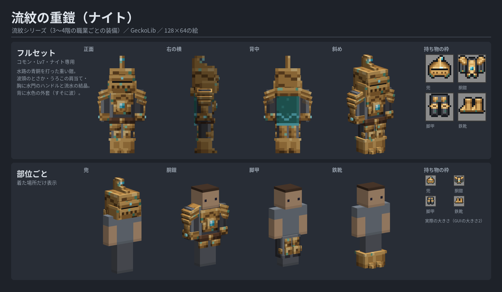
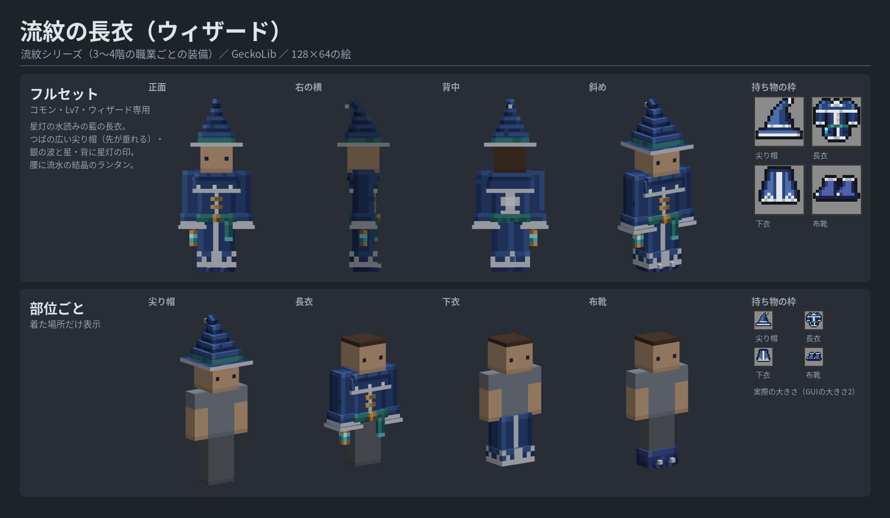
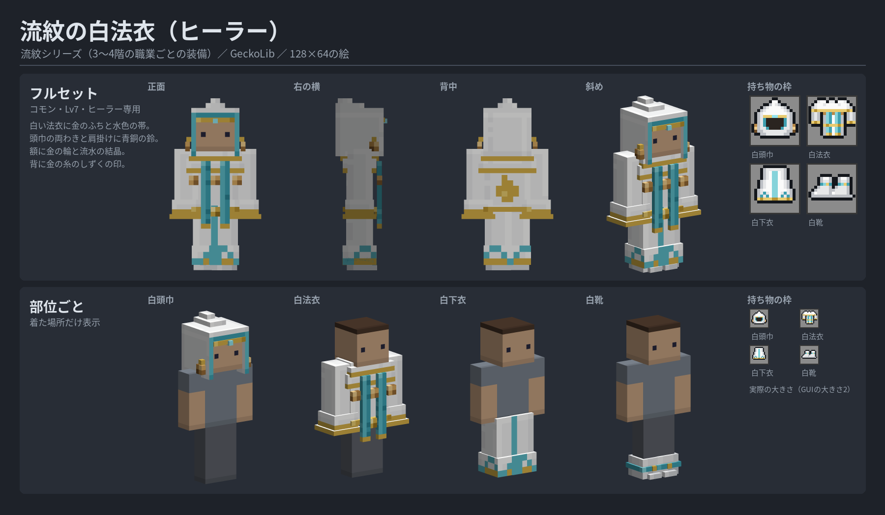
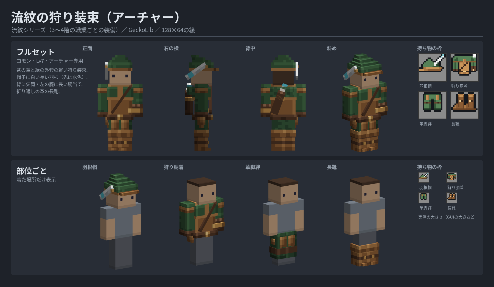
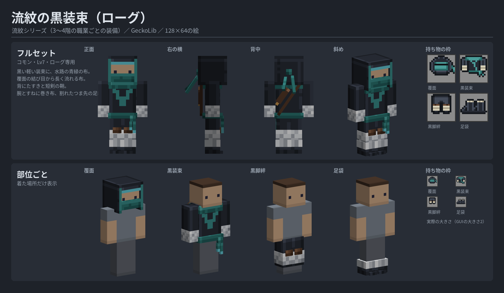
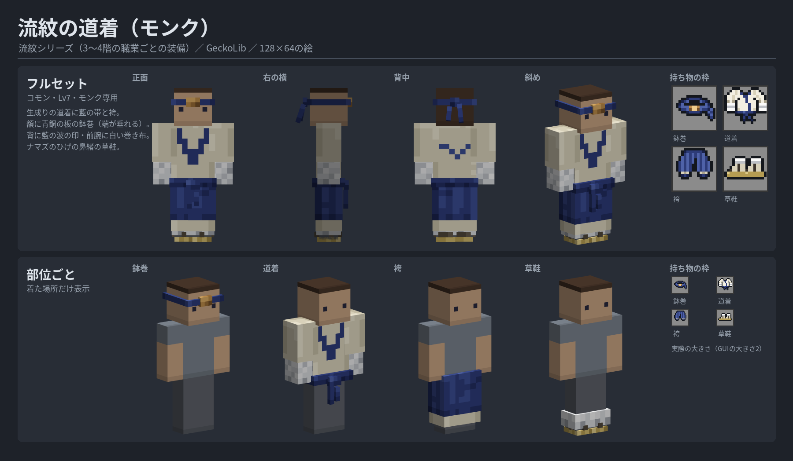
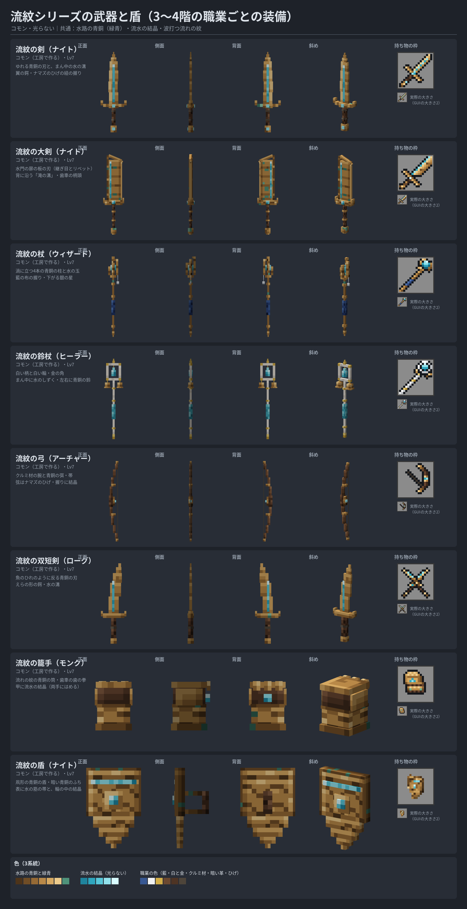

# ⑧ 流紋シリーズ（3〜4階の職業ごとの装備）

確認画像は、すべてモデルのファイル（部品と絵）から描いています（`tools/artgen/render.py`）。

| 項目 | 内容 |
| --- | --- |
| 決めたこと | 【11月23日に決定】最序盤（1〜2階）は複数の職業が同じ防具を着てよいが、3階からは職業ごとの固有防具と武器にする |
| 品 | 6職業 × 頭・胴・脚・足（24）と、武器7（ナイトは片手剣と両手剣）・ナイトの盾1。計32 |
| シリーズの名前 | 流紋（りゅうもん）シリーズ【補完】。3階「古代の水路」の水の筋と、水路の青銅から |
| レアリティ | コモン（工房で作る。光らない・動かない） |
| 使える人 | その職業だけ（`jobs` が1つ）。Lv7から（3階のおすすめ Lv5〜8 のうしろ） |
| 作り方 | 工房（武器は武器工房、防具と盾は防具工房）で、3階の素材から。熟練度2〜3（第1章の上限は3） |
| 描き方 | 防具：GeckoLib。職業ごとに1つのモデル（`geo/armor/ryumon_<職業>.geo.json`、128×64の絵）で、着た場所のボーンだけを表示する。武器：Java版のモデル（手に持つと立体、持ち物の枠は32×32の絵）。盾は枠でも3D |
| 作り直し方 | `python3 tools/datagen/build_gear_ryumon.py`（データ）→ `tools/artgen/make_gear_ryumon_armor.py`・`make_gear_ryumon_weapons.py`（見た目）→ `tools/artgen/enhance_icons.py --only <名前,…>`（持ち物の絵を32×32に） |

## 職業ごとの固有装備の仕組み（Phase 8 その2）

| 仕組み | 中身 |
| --- | --- |
| 職業だけの品 | 防具・武器の定義の `jobs` に、職業を1つだけ書く。ほかの職業は着ても数値が入らない（今までと同じ決まり。`GearService.usable`） |
| 職業ごとの見た目 | 防具のシリーズ（`item_types.json` の `armor.series`）を職業ごとに1つ作る。0-A 20章の向き：ナイトは重い金属鎧、ウィザードはローブ、ヒーラーは白い法衣と鈴、アーチャーは軽い革と羽根飾り、ローグは黒い軽装と布、モンクは道着と籠手 |
| 説明文 | 職業が1つの品は「必要レベル 7 ・ ナイト専用」のように出す（今の職業でなければ赤） |
| 工房の一覧 | 武器・防具の工房の「作る」の一覧を、職業でしぼれる【補完】。右上のボタン「職業：ナイト」を押すたびに、次の職業 →…→「すべて」と変わる。初めは自分の職業。選んだものは画面を閉じても覚えている。職業の決まっていない品（アクセサリーなど）は、いつも出る |
| 職業の武器のタグ | `tags/items/weapons/<職業>.json` に流紋の武器を足した（その職業の武器として扱う） |
| これから | 5階の守護者シリーズ、第2章からの霜銀・灼鋼・天輝・女王・執行者・神域の各シリーズも、同じやり方で職業ごとに作る |

## 数値と材料【補完】

数値は、11月24日のバランスの調節（[`docs/phase8_balance.md`](../phase8_balance.md)）のあとの古代石シリーズの1.3〜1.4倍に、職業の役目に合うステータスを
足しました（ナイト＝防御とHP、ウィザード＝魔力とMP、ヒーラー＝回復とMP、アーチャー・ローグ＝会心と速さ、モンク＝HPと速さ）。
盾は古代石の盾（防御6）より強く、3階のボスのレア「水門の鍵盾」（防御8・エピック）より弱くしています。
流水の結晶は胴と武器と盾に1〜2つ（1人分をそろえるのに2〜4つ。3階を1〜2回まわる数）。

| 職業 | 場所 | 品 | 数値 | 材料（工房・熟練度） |
| --- | --- | --- | --- | --- |
| ナイト | 武器 | 流紋の大剣 | 攻撃31 | 水路の青銅7・かじられた歯車3・苔鉄3・流水の結晶1（武器・3） |
| ナイト | 武器 | 流紋の剣 | 攻撃19 | 水路の青銅5・かじられた歯車2・苔鉄2・流水の結晶1（武器・2） |
| ナイト | 盾 | 流紋の盾 | 防御7・HP25 | 水路の青銅6・かじられた歯車3・流水の結晶1（防具・3） |
| ナイト | 頭 | 流紋の兜 | 防御4・HP18 | 水路の青銅4・かじられた歯車3・苔鉄2（防具・2） |
| ナイト | 胴 | 流紋の胴鎧 | 防御6・HP30 | 水路の青銅6・かじられた歯車4・苔鉄2・流水の結晶1（防具・3） |
| ナイト | 脚 | 流紋の脚甲 | 防御5・HP24 | 水路の青銅5・かじられた歯車3・苔鉄2（防具・3） |
| ナイト | 足 | 流紋の鉄靴 | 防御3・HP12 | 水路の青銅3・かじられた歯車2・澱みのゼリー2（防具・2） |
| ウィザード | 武器 | 流紋の杖 | 魔力24・MP55 | 水路の青銅3・澱みのゼリー3・結晶の欠片2・流水の結晶2（武器・3） |
| ウィザード | 頭 | 流紋の尖り帽 | 防御2・MP25・魔力3 | ツノモフの毛4・澱みのゼリー3・ナマズのひげ1（防具・2） |
| ウィザード | 胴 | 流紋の長衣 | 防御4・MP40・魔力4 | ツノモフの毛6・澱みのゼリー4・ナマズのひげ2・流水の結晶1（防具・3） |
| ウィザード | 脚 | 流紋の下衣 | 防御3・MP25・魔力2 | ツノモフの毛5・澱みのゼリー3・ナマズのひげ1（防具・3） |
| ウィザード | 足 | 流紋の布靴 | 防御2・MP15・速さ1 | ツノモフの毛3・澱みのゼリー2・水路の青銅1（防具・2） |
| ヒーラー | 武器 | 流紋の鈴杖 | 魔力22・MP55・回復5 | 水路の青銅4・澱みのゼリー2・結晶の欠片1・流水の結晶2（武器・3） |
| ヒーラー | 頭 | 流紋の白頭巾 | 防御3・MP20・回復1 | ツノモフの毛4・澱みのゼリー2・水路の青銅1（防具・2） |
| ヒーラー | 胴 | 流紋の白法衣 | 防御4・MP30・HP15・回復2 | ツノモフの毛6・澱みのゼリー3・水路の青銅2・流水の結晶1（防具・3） |
| ヒーラー | 脚 | 流紋の白下衣 | 防御3・MP20・HP10 | ツノモフの毛5・澱みのゼリー3・ナマズのひげ1（防具・3） |
| ヒーラー | 足 | 流紋の白靴 | 防御2・MP10・速さ1 | ツノモフの毛3・澱みのゼリー2・ナマズのひげ1（防具・2） |
| アーチャー | 武器 | 流紋の弓 | 攻撃18・会心3 | ナマズのひげ3・水路の青銅3・苔鉄1・流水の結晶1（武器・3） |
| アーチャー | 頭 | 流紋の羽根帽 | 防御2・HP12・会心2 | ツノモフの毛3・澱みのゼリー2・ナマズのひげ1（防具・2） |
| アーチャー | 胴 | 流紋の狩り胴着 | 防御5・HP25・会心1 | ツノモフの毛5・澱みのゼリー3・水路の青銅2・流水の結晶1（防具・3） |
| アーチャー | 脚 | 流紋の革脚絆 | 防御4・HP18・速さ1 | ツノモフの毛4・澱みのゼリー3・かじられた歯車1（防具・3） |
| アーチャー | 足 | 流紋の長靴 | 防御2・HP8・速さ2 | ツノモフの毛3・澱みのゼリー2・水路の青銅1（防具・2） |
| ローグ | 武器 | 流紋の双短剣 | 攻撃18・会心3 | 水路の青銅4・ナマズのひげ2・欠けた牙2・流水の結晶1（武器・3） |
| ローグ | 頭 | 流紋の覆面 | 防御2・HP10・会心2 | ツノモフの毛3・澱みのゼリー3・ナマズのひげ1（防具・2） |
| ローグ | 胴 | 流紋の黒装束 | 防御4・HP22・速さ1・会心1 | ツノモフの毛5・澱みのゼリー4・ナマズのひげ2・流水の結晶1（防具・3） |
| ローグ | 脚 | 流紋の黒脚絆 | 防御3・HP16・速さ1 | ツノモフの毛4・澱みのゼリー3・かじられた歯車1（防具・3） |
| ローグ | 足 | 流紋の足袋 | 防御2・HP8・速さ3 | ツノモフの毛3・澱みのゼリー2・ナマズのひげ1（防具・2） |
| モンク | 武器 | 流紋の籠手 | 攻撃18・HP30 | 水路の青銅5・かじられた歯車3・流水の結晶1（武器・3） |
| モンク | 頭 | 流紋の鉢巻 | 防御2・HP15・会心1 | ツノモフの毛3・ナマズのひげ1・澱みのゼリー1（防具・2） |
| モンク | 胴 | 流紋の道着 | 防御5・HP30・速さ1 | ツノモフの毛6・澱みのゼリー2・水路の青銅1・流水の結晶1（防具・3） |
| モンク | 脚 | 流紋の袴 | 防御4・HP22 | ツノモフの毛5・澱みのゼリー3・かじられた歯車1（防具・3） |
| モンク | 足 | 流紋の草鞋 | 防御2・HP10・速さ2 | ツノモフの毛2・ナマズのひげ1・かじられた歯車2（防具・2） |

2人（ナイトとウィザード）で3階を回るときの目安（`python3 tools/balance/estimate.py`）：古代石のころ（Lv7）は雑魚に4〜22秒・名のある魔物に77〜107秒。
流紋シリーズをそろえたころ（Lv8）は3〜17秒・62〜86秒、敵の1回の攻撃で減るHPは1割ほど少なくなります。ボスは水を抜かないとほとんど減らない
（1/5）ので、流紋シリーズでもひとりでは倒せません。

相場の基準価格（`market_prices/default.json`。`tools/datagen/build_shops.py`）：3階の素材を足した（かじられた歯車・澱みのゼリー30、水路の青銅90、
ナマズのひげ120、流水の結晶600。水門の鍵盾8800）。流紋シリーズの品は、材料の値段から計算される（190〜2140ノット）。

## 形と色

シリーズの印：水路の青銅（あたたかい青銅に、少しの緑青）・流水の結晶（水色。光らない）・波打つ「流れの紋」（青銅の板の溝と、布のすその波）。

| 職業 | 頭 | 胴・腕 | 脚 | 足 |
| --- | --- | --- | --- | --- |
| ナイト（流紋の重鎧） | 青銅の兜。前から後ろへ高くなり、てっぺんで前へ巻く波頭のとさか（しぶきは結晶）。額の結晶・暗い覗き穴・息の穴・波のほお当て・うろこの首当て | 暗い鉄の下地に流れの紋の胸板、胸に水門のハンドルの円盤と結晶。うろこのように3枚重なる肩当て・腕当ての結晶。背に水色の外套（すそに波） | 流れの紋の腿当て・輪の膝当て・うろこのふくらはぎ | 青銅の靴・段のつま先・足首の輪 |
| ウィザード（流紋の長衣） | 藍のつばの広い尖り帽（ふちは銀）。青緑の帯、先は後ろへ垂れて銀の星 | 藍の長衣・銀の合わせ・青銅のトグル・2段の肩掛け・青緑の帯。右の腰に流水の結晶のランタン。背に銀の糸の「星灯」の印 | 前の割れた長い裾（割れ目とすその波は銀） | 濃い藍の布靴・つま先の銀の玉・足首の銀の輪 |
| ヒーラー（流紋の白法衣） | 白頭巾（裏地は水色）。額に金の輪と結晶、両わきに青銅の鈴 | 白い法衣・金のふちの2段の肩掛け・前に水色のストール2本・肩掛けのすそに鈴3つ・金の紐の帯。背に金の糸のしずくの印 | 白い長い裾（割れ目は水色、すそに水色の波と金のふち） | 白い靴・水色の帯と金の留め金 |
| アーチャー（流紋の狩り装束） | 緑の帽子（すそに革）・前のつば・右に白い長い羽根（先は水色） | 革の胴着・緑の短い外套（前は開く）と下ろした頭巾・ななめの革帯・背の矢筒と矢羽根・左の腕に長い腕当て | 緑の脚絆・腿の革の当て・膝の巻き革・右の腿の袋 | 折り返しの革の長靴・留め帯と青銅の留め金 |
| ローグ（流紋の黒装束） | 黒い頭巾と、口と鼻をおおう青緑の布。後ろの結び目から、下がりながら流れる2本の布 | 黒い装束（打ち合わせは青緑）・首の布・青緑の帯（左に結び目と垂れ）・背にたすきと短剣の鞘・前腕の巻き布 | 黒い脚絆・すねの巻き布・膝の革の当て | つま先の割れた黒い足袋・足首の巻き布 |
| モンク（流紋の道着） | 藍の鉢巻・額の青銅の板・後ろの結び目と垂れる端 | 生成りの道着（打ち合わせは藍）・藍の帯（前に結び目と垂れ）・ひじまでの袖・前腕の白い巻き布。背に藍の波の印 | 藍の袴（ひだ）・すそを絞った生成りの紐 | わらの草鞋・ナマズのひげの鼻緒と紐・足首の白い巻き布 |

| 武器 | 形 |
| --- | --- |
| 流紋の剣 | 少し左右にゆれる青銅の刃と、まん中の水の溝（結晶）。左右に広がって先が上へ反る鍔（まん中に結晶）。ナマズのひげの紐を巻いた握り。柄頭の表と裏に結晶 |
| 流紋の大剣 | 水門の扉の板の刃（4ピクセルごとの継ぎ目）。左に暗い青銅の背（リベット）、その横に「滝の溝」。巻き上がる太い鍔と結晶。歯車の柄頭 |
| 流紋の杖 | 青銅の柄と藍の布の握り。先の輪から4本の柱が高さを変えて渦のように立ち、まん中に水の玉（結晶）。柱から銀の星が下がる |
| 流紋の鈴杖 | 白い柄と金の輪。先の白い四角の輪（角は金）のまん中に水のしずく（結晶）、輪の下の左右に青銅の鈴 |
| 流紋の弓 | クルミ材の腕と青銅の弭・帯。弦はナマズのひげ。握りに結晶（弦の位置と持ち方は古代石の弓と同じ） |
| 流紋の双短剣 | 魚のひれのように片側へ反る青銅の刃と水の溝、えらの形の鍔（大きさは古代石の双短剣と同じ） |
| 流紋の籠手 | 流れの紋の青銅の筒・拳の前に歯車の歯3つ・甲に結晶（両手にはめる。腕の座標で作る） |
| 流紋の盾 | 上が平らで下へとがる凧形の青銅の盾。暗い青銅のふち、上に水の筋の帯、まん中の輪の中に結晶。裏に握り |

## 品質チェック（自己採点。教材の7項目・各10点）

| 項目 | ナイト | ウィザード | ヒーラー | アーチャー | ローグ | モンク | 武器と盾 | 理由 |
| --- | --- | --- | --- | --- | --- | --- | --- | --- |
| シルエット | 9 | 9 | 8 | 9 | 8 | 8 | 8 | 波頭のとさか・尖り帽・頭巾と鈴・羽根と矢筒・流れる布・鉢巻と袴。武器は職業ごとに形が違う |
| 立体感 | 9 | 8 | 8 | 9 | 9 | 8 | 8 | 重なる肩当て・外套・矢筒・たすきと鞘・結び目と垂れ。布の段 |
| Minecraft適合性 | 9 | 9 | 9 | 9 | 9 | 9 | 9 | GeckoLib の防具のボーンの決まり、武器は22.5度刻み。持ち方は古代石と同じ |
| 材質表現 | 8 | 8 | 8 | 9 | 8 | 9 | 8 | 青銅と緑青・結晶・布の織り目と巻き布・袴のひだ・革の縫い目・わら |
| 視認性 | 8 | 9 | 9 | 9 | 8 | 9 | 9 | 職業ごとに主な色を分けた（青銅・藍・白・緑・黒・生成り）。ローグは黒が多いので、ふちに水色と明るい青緑 |
| オリジナリティ | 9 | 8 | 9 | 8 | 9 | 8 | 9 | 水門のハンドル・しずくの印と鈴・扉の板の大剣・歯車の拳・ナマズのひげの弦と鼻緒 |
| レアリティ表現 | 9 | 9 | 9 | 9 | 9 | 9 | 9 | コモン：光らず、結晶は光らない |
| **合計** | **61** | **60** | **60** | **62** | **60** | **60** | **60** | 教材の基準（60点）に届いた |

作りながら直したところ：緑青の斑が多すぎて迷彩のように見えた（減らし、くぼみと下の面だけに）・ヒーラーのストールが全部金になっていた
（2ピクセルの幅に左右のふちを塗っていた。ふちは下だけに）・白が灰色に見えた（明るく）・ウィザードの帽子の帯と、つばの銀が重なって
白っぽい帽子に見えた（帯を青緑に）・ローグの布の垂れが上を向いていた（回す向きを逆に）・袴のひだが見えなかった・双短剣の反りが小さかった。

## これから直すところ【提案】

ゲームの中の写真（CI の `phase8_ryumon_*`）を見て、光の当たり方で色が沈む所（ローグの黒・ヒーラーの白の影）を直します。

## ファイル

| ファイル | 役割 |
| --- | --- |
| `data/amemaru/amemaru/equipment/ryumon_*.json`・`recipes/workshop/ryumon_*.json` | 数値・材料（`tools/datagen/build_gear_ryumon.py`） |
| `geo/armor/ryumon_<職業>.geo.json`・`textures/armor/ryumon_<職業>.png` | 防具のモデルと絵（`tools/artgen/make_gear_ryumon_armor.py`） |
| `models/item/ryumon_*.json`・`textures/item/ryumon_*.png`・`*_model.png` | 武器・盾のモデルと絵、持ち物の絵（`make_gear_ryumon_weapons.py`・`ryumon_icons.py`・`enhance_icons.py`） |
| `tools/artgen/ryumon_common.py` | シリーズの色と塗り方（青銅・緑青・結晶・布・流れの紋） |
