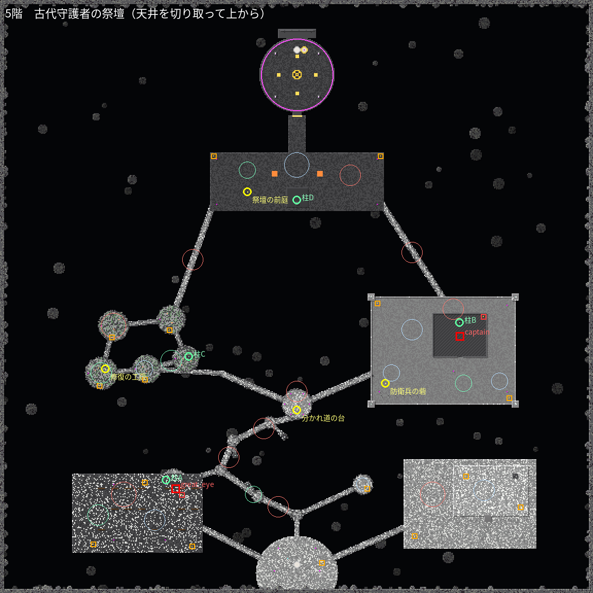
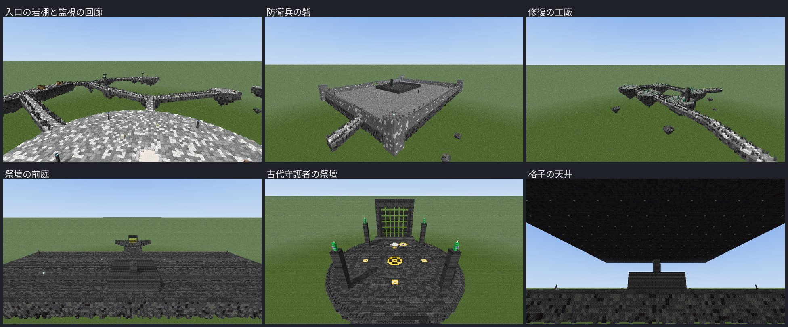

# Phase 8 その4：5階「古代守護者の祭壇」と第1章の終わり（11月24日）

0-A 9章・10章の5階と古代守護者（確定）と、11月23日・24日のご指示から作った階です。数値と細かい形は【補完】です。

## 0-A の5階（確定）

| 項目 | 内容 |
| --- | --- |
| おすすめのレベル | 9〜12 |
| 地形・環境 | 深い奈落の上の円形の祭壇。4本の柱と、上へ続く大扉。天井の星は、よく見ると格子の結び目 |
| 雑魚 | 監視眼ウォッチャー（浮かぶ目。見つかると守護者が強くなる）／防衛兵センチネル（盾持ち）／修復ドローン（守護者を回復するので最優先） |
| ボス | 古代守護者（第1章の章ボス・6人パーティ）。4つの「結び台」に4人が同時に乗ると結界が解ける。「接続判定」 |
| 物語 | 5日目。古代文明の滅亡とリンク・コアの存在が分かる。ガルドが正式な冒険者と認める |
| ロストの侵食 | 守護者の左腕が白く欠けている |
| ボスのレア | 守護者シリーズ（職業ごと） |
| ユニーク（23章） | 守護者の記録核「第七の門鍵」（お守り）。認証：3人以上の味方が8ブロック以内にいると、その全員の被ダメージが5%減る。偉業：古代守護者の初撃破パーティで、結び台に一番長く乗っていた人。取引不可 |

## ご指示から

- 11月23日：一層上がるたびに広く・複雑に・難しく。5階の守護者シリーズも職業ごと（「職業ごとの固有防具と武器」は3階から）
- 11月24日：ボスはパーティでないと倒せない強さ。ボスの攻撃は分かりやすく。**一部屋ずつではなく、何層か作ってから見せる**
  （4階と5階をまとめて作った）。クリアした層から次の層へそのまま行ける（5階の祭壇にも「次の階への円」。6階ができるまでは
  「まだ開いていない」と出る）

## 広さと区画【補完】

576×576（4階より広い）・高さ96（`tools/mapgen/build_floor5.py` が組み立て、`structures/map/floor5/` と `floors/floor5.json` を
書き出す）。大きな洞の中の奈落に、浮かぶ石の道と台が続く。歩ける所は床の高さ 48（立つのは 49）。天井（高さ 92）は暗い岩に、
12マスごとの格子の線と、その結び目に光る石（星に見えて、よく見ると格子の結び目）。霧は夜の青（`#24394B`。28〜170。【11月24日】CIの写真で遠くの砦や工廠が黒い影にしか見えなかったので、少し明るくした）。

| 区画 | 中身 |
| --- | --- |
| 入口の岩棚 | 戻りの円・道しるべの石・「奈落に落ちると戻される」の札。北へ、奈落のふちを通る道（物語の場所「奈落のふち」） |
| 監視の回廊 | 浮かぶ石の道が枝分かれする。道の脇に監視の塔（細い石の柱と見張りの台。白く欠けた塔はロストの侵食）。西の台に名のある魔物「監視の大眼」と**接続の柱 A** |
| 南の脇道 | 西の「記録の間」（崩れた書庫。宝箱）と、東の「崩れた見張り台」（高い段。宝箱） |
| 分かれ道の台 | 丸い台。**中継の灯**。東は防衛兵の砦、西は修復の工廠 |
| 防衛兵の砦（東） | 高さ6の城壁と胸壁・角の塔・兵舎と訓練の木偶。内郭に名のある魔物「防衛隊長」と**接続の柱 B**。**中継の灯** |
| 修復の工廠（西） | いくつもの台を青銅の橋でつないだ工房（青銅の箱・歯車の柱・作業台）。修復ドローンが多い。**接続の柱 C**（ドローンのぜんまい3つを納める）。**中継の灯** |
| 祭壇の前庭 | 砦と工廠からの道が合わさる広い台。北のまん中の祠に**接続の柱 D**。祠の前を格子の門がふさぎ、左右の仕掛け石2つを12秒のうちに押すと1分開く。**中継の灯**。物語の場所「格子の空」 |
| 古代守護者の祭壇 | ボスの部屋（半径36の円。外まわりに低い欄干）。斜め4か所に結界の柱、東西南北の半径18に結び台、まん中に金の結び目の模様。北に「上へ続く大扉」、その前に出口の円と**次の階への円** |

決まり：

- **接続の柱**（1階の石柱と同じ仕組み。パーティの誰かが灯すと、仲間の分も数える）：4本とも灯すと祭壇の封印が開く（`seal_requires`：`pillars`）

| 柱 | 場所 | 課題 |
| --- | --- | --- |
| A | 監視の回廊の西の台 | 監視の大眼を倒す |
| B | 防衛兵の砦の内郭 | 防衛隊長を倒す |
| C | 修復の工廠 | 修復ドローンのぜんまい3つを納める |
| D | 前庭の祠 | 仕掛け石2つを12秒のうちに押して祠の格子を1分開け、中の柱に触れる（2人なら同時に、1人なら走って。約44ブロック） |

- **警戒**：監視眼に見つかると、階の「警戒」が1つ上がる（監視の大眼は2つ）。同じ目は60秒（大眼は45秒）に1度だけ。警戒は
  3まで、5分ごとに1つずつ消える。守護者は、戦いが始まったときの警戒1つにつき**攻撃 +10%**（始まりに「祭壇の警戒 2：見つかった数だけ、守護者の攻撃が強い
  （+20%）」と出る）。監視眼に見つからないように進むか、先に目を落とす
- **奈落**：高さ 24 より下へ落ちた人は、ともした中継の灯（いちばん近い所。なければ入口）へ戻され、最大HPの15%のダメージ。
  奈落へ落ちた魔物は消える
- 中継の灯は4つ（分かれ道の台・防衛兵の砦・修復の工廠・祭壇の前庭）。宝箱は18（`chests/floor5_ancient`）
- `tools/mapgen/check_floor5.py`：入口から、4本の柱・宝箱18・中継の灯4・守り手・仕掛け石・封印の前まで歩いて行ける（奈落へ落ちる
  所は数えない）。封印を通らずに祭壇へは入れない。封印を通れば、結び台4つ・まん中・出口の円・次の階への円まで行ける

見本の絵の道具（`mapgen/render.py`）は、まわりの洞の壁と奈落の暗さを描かず、下に緑の地面と空を描きます。ゲームの中は暗い洞です
（CIの写真 `phase8_f5_*` で確かめる）。

## 敵（11月24日の強さに合わせた【補完】）

| 敵 | HP | 攻撃 | 動き |
| --- | --- | --- | --- |
| 監視眼ウォッチャー | 2200 | 66 | 金の枠の、宙に浮かぶ大きな目。はじめて人を見つけると目が赤く光り、警戒を上げる。少し離れて浮かび、一直線の予兆のあとで光線。体はもろい |
| 防衛兵センチネル | 4800 | 86 | 白い石と青銅の兵。左腕に塔の盾、右手に槍。**前（120度）から受けるダメージは 0.25 倍**（はじめて弾かれると「後ろか横から攻めよう」）。盾打ち（前の扇。押し返す）と、槍の突進（短い一直線） |
| 修復ドローン | 1200 | 40 | 青銅の小さな球に4枚の羽根。近くのいちばん傷ついた祭壇の機械（守護者も）へ翠の光の糸を伸ばし、少しあとで直す（守護者はその0.1倍）。糸の間に大きな傷（最大HPの20%）を受けると止まる。人が近づくと離れる。弱い電撃（まわりの円） |

| 名のある魔物 | いる所 | HP | 攻撃 | 動き |
| --- | --- | --- | --- | --- |
| 監視の大眼 | 監視の回廊の西の台（柱 A） | 22000 | 84 | 大きな監視眼。遠くまで見え、一度に警戒を2つ上げる |
| 防衛隊長 | 防衛兵の砦の内郭（柱 B） | 30000 | 104 | 大きな防衛兵。盾は前140度・0.2 倍。HPが半分を下回ると一度、防衛兵を2体呼ぶ |

名のある魔物が落とすもの：翠の核片 35%・レアのお守り「結び台の欠片」5%・紅の結晶果 6%。

## ボス：古代守護者（第1章の章ボス）【補完】

白い石と青銅の巨人。胸に翠の記録核。左腕は白く欠けている（ロストの侵食：判定が狂っている）。HP 120000（ひとりでも2人ぶん。
1人増えるごとに +60%）・攻撃 132・怒るまで35分。戦いの始まりの警戒1つにつき攻撃 +10%。

- **第1段階（HP100〜70%）**：
  - 腕の薙ぎ払い：前の扇（140度・9ブロック）。押しのける。**欠けた左腕**では、打つ直前に向きが裏返ることがある（30%。白い光と
    音で知らせ、予兆の扇も裏返る。技の名前は「欠けた左腕の薙ぎ払い ― 向きが狂うかもしれない」）
  - 直線の光線：長い一直線（30ブロック・幅2.4）の予兆のあとで撃つ
  - 叩きつけ：ヘイト1位の足もとに赤い円（半径3.2）
- **第2段階（70〜35%）**：4本の結界の柱が光り、守護者を**結界**が包む（無敵）。4つの結び台が光る。結び台に、戦う人の数だけ
  （4人より少なければその人数）**同時に3秒**乗ると、結界がほどけて守護者が4秒よろめき、**10秒の間、受けるダメージ 1.5 倍**。
  結界の間は15秒ごとに防衛兵2体と修復ドローン1体を呼ぶ（5体まで。乗っている人を残りの人が守る）。第2段階のうちは45秒ごとに張り直す。
  札に「結界：無敵。4つの結び台に同時に乗って3秒（乗っている台 1/4）」のように、乗っている数が出る
- **第3段階（35〜0%）**：**接続判定**。「……接続を、判定する」の3秒の予兆のあいだ、ひとりひとりのまわりに6ブロックの輪が出る
  （中に味方がいれば緑、いなければ赤）。終わりに、6ブロック以内に倒れていない味方がいない人へ大ダメージ（いる人は12%だけ）。
  寄り添えば耐えられる。14秒ごと。ひとりで戦っているときは判定しない
- **みんなで受ける一撃**（記録核の光）：誰かの足もとに青い円。円の中の人みなで、最大HPの240%を分け合う
- **最後**：HPが尽きても倒れず、動きを止めて祭壇のまん中を見つめる（祭壇のまん中に青い円）。全員が円の中に集まると、ゆっくり
  膝をつき「……登録外の、接続波形……」とつぶやいて倒れる（60秒たっても集まらなければ、そのまま倒れる）。集まる間と膝をついた後は、
  攻撃が効かない
- 倒すと：倒した全員の記録帳に古代記録「守護者の記録核」（「記録核、再生。全域同期実験、失敗。……のちの者は、これを『大断絶』と
  呼ぶ」「中枢装置リンク・コア、稼働を継続。守護者は、資格なき者を通さぬこと」）。サーバーで初めて倒したときは、倒したパーティで
  結び台に一番長く乗っていた人に**第七の門鍵**（取引できない。みんなに知らせが出る）
- レア：守護者シリーズ30品（職業ごとに武器1と防具一式4。武器4%・防具は各3%。自分の職業の品だけを引く）。翠の核片 100%・結晶果

## 守護者シリーズ（職業ごと）【補完】

5階のボスだけが落とす、職業ごとの武器と防具一式（頭・胴・脚・足）。6職業 × 5 = 30品。ドロップは人ごとに引き、**その人の今の
戦闘職の品だけ**が出る（敵の定義の `job_match`。ナイトはナイトの5品だけを引く）。どれもエピック。武器は4%、防具はそれぞれ3%
（ひとりあたり合わせて16%。【補完】）。

【11月25日に決定】「防具は一式全部揃えた形にしてください」：はじめは外装（胴）だけだったのを、頭・脚・足も足して一式にした。

| 職業 | 武器 | 外装 |
| --- | --- | --- |
| ナイト | 守護者の核剣（攻撃 42） | 守護者の外装（重鎧）（防御 9・HP 42） |
| ウィザード | 守護者の核杖（魔力 33・MP 70） | 守護者の外装（法衣）（防御 6・MP 56・魔力 6） |
| ヒーラー | 守護者の核鈴（魔力 30・MP 70・回復 7） | 守護者の外装（白衣）（防御 6・MP 42・HP 21・回復 3） |
| アーチャー | 守護者の核弓（攻撃 25・会心 4） | 守護者の外装（革鎧）（防御 7・HP 35・会心 2） |
| ローグ | 守護者の双核刃（攻撃 25・会心 4） | 守護者の外装（黒装束）（防御 6・HP 31・速さ 2・会心 1） |
| モンク | 守護者の核拳（攻撃 25・HP 40） | 守護者の外装（道着）（防御 7・HP 42・速さ 2） |

防具一式（頭・脚・足の数値は、流紋シリーズの同じ部位に「守護者の外装 ÷ 流紋の胴」の倍率〈1.5倍まで〉をかけたもの。【補完】）：

| 職業 | 頭 | 胴（外装） | 脚 | 足 |
| --- | --- | --- | --- | --- |
| ナイト | 守護者の兜（防御 6・HP 25） | 守護者の外装（重鎧）（防御 9・HP 42） | 守護者の脚甲（防御 8・HP 34） | 守護者の鉄靴（防御 4・HP 17） |
| ウィザード | 守護者の尖り帽（防御 3・MP 35・魔力 4） | 守護者の外装（法衣）（防御 6・MP 56・魔力 6） | 守護者の下衣（防御 4・MP 35・魔力 3） | 守護者の布靴（防御 3・MP 21・速さ 1） |
| ヒーラー | 守護者の白頭巾（防御 4・MP 28・回復 2） | 守護者の外装（白衣）（防御 6・MP 42・HP 21・回復 3） | 守護者の白下衣（防御 4・MP 28・HP 14） | 守護者の白靴（防御 3・MP 14・速さ 1） |
| アーチャー | 守護者の羽根帽（防御 3・HP 17・会心 3） | 守護者の外装（革鎧）（防御 7・HP 35・会心 2） | 守護者の革脚絆（防御 6・HP 25・速さ 1） | 守護者の長靴（防御 3・HP 11・速さ 2） |
| ローグ | 守護者の覆面（防御 3・HP 14・会心 2） | 守護者の外装（黒装束）（防御 6・HP 31・速さ 2・会心 1） | 守護者の黒脚絆（防御 4・HP 23・速さ 2） | 守護者の足袋（防御 3・HP 11・速さ 4） |
| モンク | 守護者の鉢巻（防御 3・HP 21・会心 1） | 守護者の外装（道着）（防御 7・HP 42・速さ 2） | 守護者の袴（防御 6・HP 31） | 守護者の草鞋（防御 3・HP 14・速さ 3） |

- 武器の特殊効果：8ブロック以内の味方1人ごとに、与えるダメージ +3%（5人まで。ally_power）
- 外装の特殊効果：受けるダメージ −5%（damage_reduction）
- **一式の効果**【補完】：同じ職業の守護者の頭・胴・脚・足を4つとも着ると、受けるダメージがさらに −5%（防具の定義の `set_effects`。
  4つとも使える〈レベル・職業〉・壊れていないときだけ。説明文に「一式の効果 … 今 n/4」と出る）
- 見た目【補完】：**今は流紋シリーズ（3〜4階）の形と絵を、そのまま塗り直したもの**（青と水色を守護者の記録核の翠に、灰色を温かい
  石の色に。頭・脚・足も、流紋の同じ部位を塗り直す）。職業ごとの形の違いは流紋シリーズと同じで、守護者シリーズだけの形はまだない。詳しくは [`docs/gear/guardian.md`](gear/guardian.md)

## 物語（5日目）・古代記録・ロストの侵食

- 5階に入る（本人）：「足もとから、底の見えない奈落が口を開けている」「その手前を、いくつもの眼が見張っている」
- 奈落のふち・格子の空（物語の場所。一人一度）：「……落ちても、塔の糸が、ともした灯まで引き戻してくれる。ただし、無傷ではすまない」・
  「見上げると、天井いっぱいに星が光っている」「……いや、よく見ると、星は格子の結び目に並んでいる」
- 初撃破（パーティ）：「古代守護者の祭壇　踏破」
- **ガルドの昇格式**：守護者を倒した人がガルドと話すと、昇格式の会話（「15年前、俺たちが越えられなかった祭壇だ」「迷い人と呼ぶのは、
  今日で終わりだ」「今日から、お前はこの街の冒険者だ」）。称号「コネリアの冒険者」とガルドの親密度 +20。一人一度
- 古代記録「守護者の記録核」：守護者を倒すと手に入る（上）。古代文明の滅亡（大断絶）とリンク・コアの存在が分かる
- ロストの侵食：守護者の左腕が白く欠けている（薙ぎ払いの向きが裏返る）。監視の回廊の白く欠けた塔

## 素材と宝箱

| 素材 | 落とす敵 |
| --- | --- |
| 監視眼のレンズ | 監視眼ウォッチャー |
| 防衛兵の装甲片 | 防衛兵センチネル |
| 修復ドローンのぜんまい | 修復ドローン（柱 C に3つ納める） |
| 翠の核片（レア） | 名のある魔物（35%）・古代守護者（100%）・宝箱 |

宝箱は18（`chests/floor5_ancient`）：5階の素材・1〜4階の素材・翠の核片・結晶果。5階のアクセサリー（闘環・智環・首飾り・腕輪「防衛兵の腕輪」・
お守りと、レアのお守り「結び台の欠片」）と第七の門鍵は [`docs/gear/accessories.md`](gear/accessories.md)。

## 管理者のコマンド

- `/amemaru admin floor alert 5 clear`：警戒を消す
- `/amemaru admin pillars complete 5 @p`：接続の柱を4本とも灯した印をつける（封印が開く）
- `/amemaru admin boss skill 5 <sweep|beam|slam|barrier|judge|gather|share>`：守護者の技を出させる（barrier は結界、gather は
  「集まるのを待つ」形）

## 確かめたこと

- `python3 tools/mapgen/check_floor5.py`（上の「決まり」）
- 自動テスト `AltarGameTests`：5階の形（4階より広い・柱4本の課題・仕掛け石・奈落・結び台とまん中と結界の柱・中継の灯4・名のある魔物2・
  格子の空・宝箱・守護者の記録核）・警戒（上がり、3で止まる）・防衛兵の盾（前だけ）と修復ドローンの修理・結び台の人数（min(4, 戦う人)）と
  接続判定の数え方と門鍵を渡す人・守護者シリーズが職業ごと（12品・確率4%・武器と外装が1つずつ・自分の職業の品だけを引く）・
  第七の門鍵（ユニーク・8ブロック・5%・取引できない）
- CIの写真 `phase8_f5_*`（入口・回廊・分かれ道・砦・工廠・5階の敵・格子の空・封印・守護者・光線・叩きつけ・結界・結び台・解けたとき・
  接続判定・集まるのを待つ・膝をつく・倒したとき・守護者シリーズを着たナイトとウィザード）
- 見本の絵：`python3 tools/mapgen/build_floor5.py /tmp/out --render /tmp/out`（天井を切り取って上から見た地図と、斜め上からの絵）

## 【補完】の一覧

広さ576×576・浮かぶ道と台・区画の中身と並び・接続の柱4本の課題・仕掛け石（12秒・1分）・警戒（3まで・5分・+10%）・奈落（高さ24・
15%）・名のある魔物2体・敵とボスの数値と技・欠けた左腕の向きの裏返り・結界（結び台の人数は min(4, 戦う人)・3秒・1.5倍10秒・呼ぶ兵）・
接続判定（6ブロック・3秒・ひとりでは判定しない）・集まると膝をつく終わり方・守護者シリーズの形（流紋シリーズの塗り直し）と数値と効果・
門鍵は初撃破のときだけ・ガルドの昇格式の文と称号・物語の場所の文・素材と宝箱の中身。
