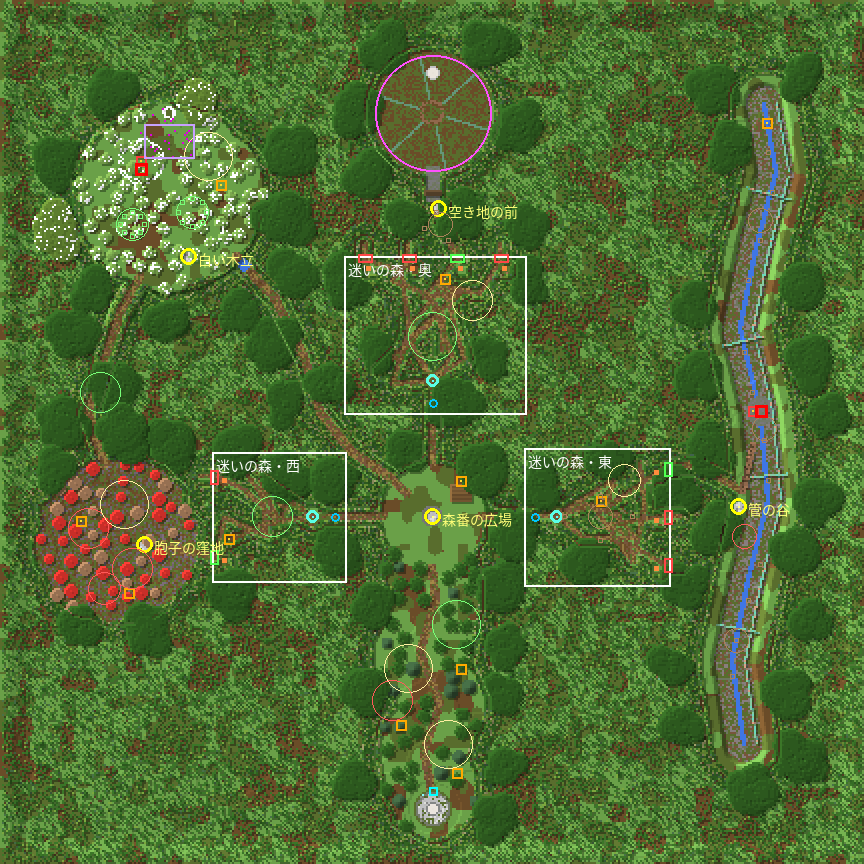
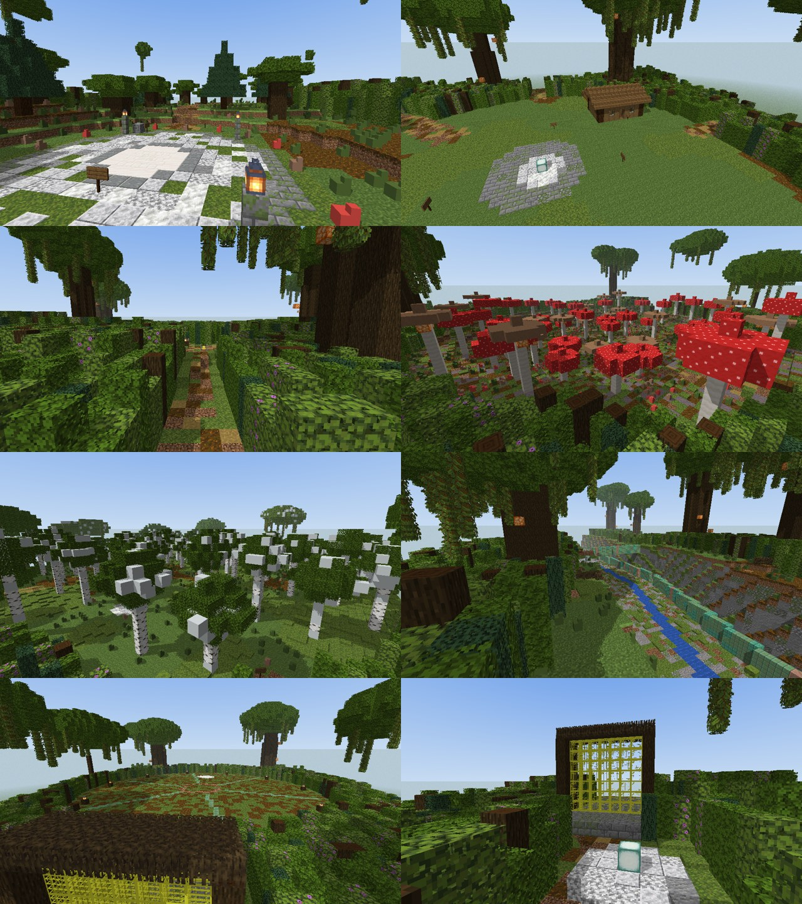
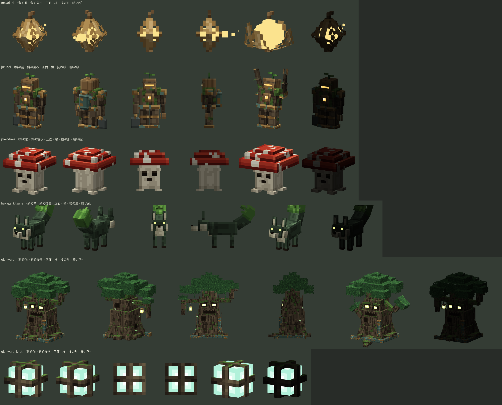
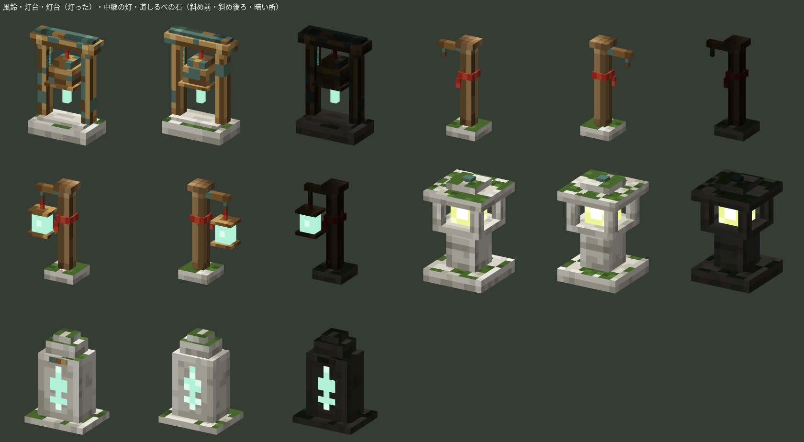
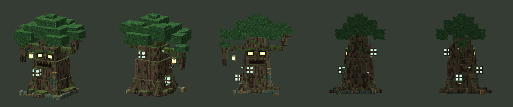

# Phase 8 その1：2階「忘れられた森」（11月23日）

Phase 0-A 9章の2階「忘れられた森」（古代の金属の管に根を巻きつけた巨木の森。霧が濃く、光るキノコと風鈴のような古代の
装置がある）を作りました。あわせて、[`docs/phase8.md`](phase8.md) の「階ごとに広く・複雑に・難しくする決まり」の土台
（区画・迷いの森・中継の灯・毒と解毒薬・暗さと灯り・物語の場所）を作りました。3階から先も、この土台の上に作ります。

| 0-A 9章の2階 | このModで |
| --- | --- |
| 雑魚：迷い灯・樹皮兵・ポコダケ・葉影ギツネ | 4種（下の「敵」）。名のある魔物（中ボス）2体は、その大きな個体【補完】 |
| ボス：森番の古樹オールドウォード（根で地面を割り、幹の光る節を壊すと怯む。HP30%で森が暗くなり、灯を持つ人のまわりしか見えなくなる） | 下の「ボス」 |
| ギミック：迷いの森（正しい道に「結び目の灯」を置いていかないと同じ場所に戻される。鐘を鳴らす人と、こだまの方向を聞く人に分かれて道を探す） | 迷いの森が3つ（下の「迷いの森」） |
| 古代記録「森番の日誌」 | 森番の広場の小屋の石板 |
| 物語：2日目、霧の奥でノアが初めて目撃される（0-A 11章：最初に到達したパーティにだけ姿が見え、全体に告知） | 白い木立の北のはずれに入ったパーティに一度だけ（下の「物語」） |
| ロストの侵食：帰り道を忘れた獣が同じ場所をぐるぐる歩く。白く抜けた木の影 | 白い木立の葉影ギツネが同じ輪を回り続ける・白い幹の木立【補完】 |

上から見た地図（色は、いちばん上のブロック）。白い枠が迷いの森、緑の線が正しい出口、赤い線が間違いの出口、黄色の丸が中継の灯、
だいだいの四角が宝箱、水色が鐘、うすい円が敵の湧く所です（答えが見えるので、遊ぶ前の人には見せない方がよい図です）。

左上から：入口・森番の広場・迷いの森・奥・胞子の窪地・白い木立・管の谷・森番の空き地・封印の門（ゲームを起動せずに描いた見本の絵。
光の具合や霧は、ゲームの中と少し違います）。

## 11月23日のご指示との対応

| ご指示 | 2階で |
| --- | --- |
| 一層上がるたびに広くなり | 432×432（1階の384×384の約1.3倍）。区画は7つ（1階は6つ）。高い台地（白い木立）と深い谷（管の谷）で、高さも使う |
| より複雑に | 広場から3方向の迷いの森を抜けないと、奥へ行けない。奥の森ほど出口が多く、にせのこだまも返る。白い木立から広場へは、台地から飛び下りる一方通行の近道。宝箱の2つは名のある魔物が守る |
| 難しく（敵の体力と攻撃力が上がるだけではつまらない） | 新しい動きの敵（誘う・足をからめる・毒・背後を狙う）と、組み合わせ方。霧（遠くが見えない）。ボスは、節を壊す順番・地面の予兆・暗くなったら灯のまわりに集まる、で戦う |
| 後半はかなりの時間がかかるようにしてもよい | 2人で2〜2時間半ほど【補完】。広いので、中継の灯（灯した所から入れる）を5つ置いた |

## 区画

| 区画 | 場所 | 中身 |
| --- | --- | --- |
| 入口の空き地 | 南のはずれ | 戻りの円・道しるべの石（中継の灯へ飛ぶ）・案内の看板 |
| 外れの森 | 入口と広場の間 | 迷い灯・葉影ギツネ・ポコダケ。宝箱 |
| 森番の広場 | 真ん中 | 中継の灯1・森番の小屋（古代記録「森番の日誌」）。3つの迷いの森の入口 |
| 胞子の窪地 | 西（迷いの森・西の先） | 低い窪地（高さ12）に大きなキノコとポコダケ。中継の灯2。北の白い木立へ上る坂 |
| 白い木立 | 北西の台地（高さ26） | 白く抜けた幹の木立。中継の灯3・北のはずれの空き地（ノアが見える所。木を生やさない）・葉隠れの長が守る宝箱。広場へ飛び下りる近道 |
| 管の谷 | 東（迷いの森・東の先） | 底（高さ8）を古代の管と水が走る長い谷。中継の灯4・苔衣の樹皮兵長が守る宝箱 |
| 森番の空き地 | 北（迷いの森・奥の先） | ボスの部屋（半径29）。南の封印の門の前に中継の灯5 |

宝箱は13（中身は `loot_tables/chests/floor2_ancient.json`：苔鉄・古代石・結晶の欠片・解毒薬・灯りの小瓶・古代石の武器・指輪など）。

## 迷いの森

0-A 9章のギミックを、次の決まりで作りました【補完】（`tower/forest/LostWoodsService.java`）。

1. 迷いの森は、やぶで囲まれた区画です。中から出口へ出ると、霧が濃くなって、その森の入口へ戻されます（「気がつくと、○○の入口に戻っていた……」）。
2. 森の中の**古代の風鈴**（鐘）を右クリックで鳴らすと、4秒ほどで、正しい出口の灯台から**澄んだ高いこだま**が返ります。鐘から少し離れた人（12〜14ブロック）にだけ、
   こだまの方角が分かります（「澄んだこだまが、北から返ってきた」）。鐘の近くでは聞き分けられません。だから、**鐘を鳴らす人と、離れて聞く人に分かれる**と早く見つかります。
3. 奥の森では、**低くにごったこだま**（にせのこだま）も、間違いの出口から返ります。
4. 鐘を鳴らすと、**結び目の灯**を1つもらえます（持っていなければ。30秒に1回）。正しい出口の**結び目の灯台**に右クリックで置くと、その森の道が結ばれ、灯台が灯って、
   みんなが正しい出口から先へ行けるようになります。違う灯台に置くと、灯は消えて入口へ戻されます。
5. 結んだ道は、進行日が変わるまで、みんなの分として残ります（朝になると、また迷いの森になる）。
6. 3つの森をすべて結び、白い木立と管の谷の名のある魔物を2体とも倒した人は、森番の空き地の封印の門を通れます（名のある魔物を倒した印は人ごと。11月24日に足した【補完】）。

| 迷いの森 | 先にある所 | 出口 | にせのこだま | 聞こえる距離 |
| --- | --- | --- | --- | --- |
| 迷いの森・西 | 胞子の窪地 | 2 | 0 | 鐘から12ブロック |
| 迷いの森・東 | 管の谷 | 3 | 1 | 13ブロック |
| 迷いの森・奥 | 森番の空き地の前 | 4 | 2 | 14ブロック |

正しい出口は、階の定義（`floors/floor2.json` の `lost_woods`）で決めています。

## 中継の灯と道しるべの石

広い階でも少しずつ進めるようにする手当てです【補完】（`tower/forest/WaypointService.java`）。

- 中継の灯（光る台）に触れると、その人の灯になります（近くの同じパーティの人も）。進行日が変わっても消えません。
- 入口の**道しるべの石**に触れると、自分がともした中継の灯のうち、番号のいちばん大きい灯へ移れます。帰還の羽根で帰っても、進み具合は消えません。
- 番号：1 森番の広場・2 胞子の窪地・3 白い木立・4 管の谷・5 空き地の前。

## 霧

2階は霧が濃く、6ブロック先から霞み、46ブロック先は見えません（色は青みの灰緑 `#8EA396`）。階の定義の `environment`【補完】。

## 毒と解毒薬

- ポコダケの胞子をあびると**毒**になり、1秒ごとに最大HPの2%が減ります（HPは1より下がらない）。毒の印（効果の絵）が出ます【補完】。
- **解毒薬**（薬屋で60ノット。2階の宝箱にも入っている）を使うと毒が消え、そのあと30秒は毒になりません【補完】。

## 敵

| 敵 | Lv | HP | 攻撃 | 守り | 動き |
| --- | --- | --- | --- | --- | --- |
| 迷い灯 | 6 | 900 | 38 | 3 | 人が近づくと9ブロックほど離れて逃げ、仲間（ほかの魔物）のいる方へ誘う。追いつかれると、まわりへ火花。打たれると、まぶしく光って（近くの人は少し目がくらむ）6〜8ブロック先へ消えて現れる |
| 樹皮兵 | 7 | 2600 | 52 | 16 | 硬い。決まった道を巡回する。腕の打ち下ろしと、周りの円の予兆のあとの叩きつけ（当たると根が足にからんで2秒遅くなる） |
| ポコダケ | 6 | 1200 | 30 | 4 | 動かない。人が5ブロックまで近づくと、周りの円の予兆のあとで毒の胞子をはく。胞子の雲が4秒残る（中にいると毒） |
| 葉影ギツネ | 6 | 1300 | 44 | 4 | 2〜3匹の群れ（11月24日に少し遅くした）。相手の背中へ回り込んで噛む（背後からは1.5倍）。噛んだらすぐ離れ、また回り込む |
| 苔衣の樹皮兵長（名のある魔物） | 8 | 15000 | 66 | 22 | 樹皮兵の大きな個体。管の谷の宝箱を守る。倒されると5分でまた現れる |
| 葉隠れの長（名のある魔物） | 8 | 11000 | 56 | 8 | 葉影ギツネの大きな個体。白い木立の宝箱を守る。5分でまた現れる |

数値はすべて【補完】（`data/amemaru/amemaru/enemies/`。11月24日のバランスの調節のあとの数。[`docs/phase8_balance.md`](phase8_balance.md)）。1階と同じく、雑魚はまれに結晶果実を落とし、名のある魔物はゆらぐ結晶・こだまのかけらを落とします。
敵の見た目は GeckoLib のモデルで、待つ・歩く・攻撃・技・倒れる の動きがあります（下の「見た目」）。

## ボス：森番の古樹オールドウォード

空き地の真ん中に根を張った古い大木で、動きません。Lv9・HP55000・攻撃100・守り10（ひとりでも2人ぶんのHP。3人目から1人ごとに+60%。8人まで。22分で怒る。11月24日の調節のあとの数）【補完】。

| 技・仕組み | 中身 |
| --- | --- |
| 幹の光る節 | 幹に3つの光る節（HP2400）があり、残っている間は樹皮が硬い（守り+100）。3つとも壊すと**8秒怯み**（技を止め、守りがなくなる）、25秒で節がまた生える（怒ったあとは15秒） |
| 枝の薙ぎ払い | 前の扇形（7ブロック・120度。1.2秒の予兆） |
| 根の割れ目 | 離れた人へ、地面に一直線の線の予兆（長さ22・幅2.4。1.5秒）を出してから、根が突き上がる（当たると浮く） |
| 根の牢 | 何人か（3人。HP30%からは4人）の足もとに円の予兆を出し、根で打って2秒足をからめる |
| 迷い灯を呼ぶ | HP60%から。迷い灯を2匹ずつ（5匹まで） |
| 大枝の振り下ろし（みんなで受ける一撃。11月24日） | ときどき、ひとりの足もとに青い円。3.2秒のあと、円の中の人みなで最大HPの160%を分け合う（ひとりで受けると倒れる） |
| 暗い森 | HP30%で、古樹が森の灯りを吸い込み、あたりが暗くなる。**森番の灯**が空き地に2つ落ちる。灯（森番の灯か、店の手提げランタン）を持つ人から6ブロックより遠い人は、目がくらむ |

- **森番の灯**：手に持つと、まわりが明るくなり、近く（6ブロック）の人は暗い森でも目がくらみません。塔を出るか、10分たつと消えます。
- 落とし物：古代石・苔鉄（必ず）・結晶の欠片（60%）・こだまのかけら（50%）・ゆらぐ結晶（25%）・澄んだこだま（8%）。結晶果実（翠・白・青）。
  レアは[古樹の枝杖](gear/rare_f2.md)（6%。1階のボスと同じく、出ないと少しずつ出やすくなる）。
- 倒されると2分でまた現れます。初めて倒した人は「忘れられた森　踏破」の場面を見ます（1階と同じ流れ）。

数値はすべて【補完】（`enemies/old_ward.json`・`enemies/old_ward_knot.json`。部屋の広さと人数の補正は `floors/floor2.json` の `boss_room`）。

## 物語

| 場面 | きっかけ | 中身 |
| --- | --- | --- |
| 2階に入った | 初めて2階に入った人 | 霧の音と字幕【補完】 |
| 2階の初撃破 | 2階のボスを、サーバーで初めて倒したパーティ | 白く光って「忘れられた森　踏破」と字幕（1階と同じ流れ）【補完】 |
| 霧の奥の少女 | 白い木立の北のはずれ（物語の場所 `noa_sighting`）に初めて入ったパーティ | 霧の向こうに少女（ノア）が立ち、こちらを見て首をかしげ、霧に溶けるように消える。正体は明かさない。全員に「霧の奥で、見知らぬ少女の姿を見たという知らせが広がった（2階　忘れられた森）」と知らせる |

「霧の奥の少女」の、ノアの立つ所と言葉は【補完】です。物語の場所は、ストーリーイベントの新しいきっかけ `floor_zone`
（階の定義の `story_zones` の箱に人が入る）で作りました。3階から先の物語も、同じきっかけで置けます。

## 見た目

- 敵とボスは GeckoLib のモデル（`tools/artgen/make_forest_models.py`）。森番の古樹は高さ約6.5ブロックで、幹の光る節の位置は、
  ボスの節（`old_ward_knot`。壊せる敵）を置く位置と同じ（上の3つ目の図：幹の3つの光る節を、5つの向きから見たもの）。
- ブロック（古代の風鈴・結び目の灯台・中継の灯・道しるべの石）と品（結び目の灯・森番の灯・解毒薬）の見た目は
  `tools/artgen/make_forest_things.py`。

## 管理者のコマンド

| コマンド | 働き |
| --- | --- |
| `/amemaru admin map build floor 2` | 2階を建てる（建て直す） |
| `/amemaru admin floor tp 2 <所> [人]` | 2階の決まった所へ。`entrance`・`boss`・`woods_west`・`woods_east`・`woods_north`（迷いの森の入口）・`waypoint1`〜`waypoint5`（中継の灯） |
| `/amemaru admin floor woods 2 tie <west/east/north/all>` | 迷いの森を結ぶ（灯台も灯る） |
| `/amemaru admin floor woods 2 reset` | 結んだ道をほどく（迷いの森に戻す） |
| `/amemaru admin floor waypoint 2 light <番号> <人>` | 中継の灯をともしたことにする |
| `/amemaru admin floor waypoint 2 clear <人>` | ともした中継の灯を消す |
| `/amemaru admin boss skill 2 <sweep/crack/cage/call/dark>` | ボスに技を出させる |

## 自動テスト

- `ForestGameTests`：2階の定義（1階より広い・霧・迷いの森3つと出口9・にせのこだま3・中継の灯5つ・封印の条件・守り手2体・宝箱・森番の日誌）／迷いの森を結ぶと封印を通れ、
  ほどくと通れない／中継の灯は番号のいちばん大きい灯へ／毒で HP が減り、解毒薬で消えて30秒は毒にならない／
  ボスの節を3つ壊すと怯んで守りが0になり、HP30%で暗くなって森番の灯が2つ落ちる／2階の敵とレアの装備の定義
- `EquipmentGameTests`：敵の定義が14（2階の7つを含む）・装備の定義が33（古樹の枝杖を含む）
- `StoryTowerGameTests`：ストーリーイベントが7（2階の3つを含む）
- 地図の歩ける道の確かめ（`tools/mapgen/check_floor2.py`。ゲームの外）：入口からすべての所へ行ける・迷いの森の出口をふさぐと
  奥へ行けない・帰り道がある・近道は一方通行・空き地は封印の門からしか入れない

## 確かめて直したこと（11月23日）

自動の確認（CI）の写真を見て、次を直しました。

1. 迷いの森のこだま：「鐘から離れた人だけ方角が分かる」の鐘の位置が二重にずれていて、鐘の近くでも方角が分かっていた
2. 結び目の灯台の見た目：結んだとき・日が変わったときに、読み込まれていない遠くの灯台が前の見た目のまま残っていた
   （日が変わってほどけたのに灯ったまま、など）→ 灯台が読み込まれたときに、今の結び目に合わせる
3. 風鈴を鳴らしたときの知らせが長く、小さい画面では両はしが切れていた → 短くした
4. 霧の奥の少女：ノアの手前の茂みと木で、少女が隠れていた → ノアの前を空き地にし（木・茂み・背の高い草を生やさない）、
   物語の場所の箱を、その空き地の中（ノアから6〜22ブロック南）にした。場面のカメラは、ノアの足もとのあたりを見る
   （体が字幕の帯より上に写る。カメラの `look_height`）
5. 中継の灯に着いたときの向き：白い木立は目の前が木の幹、管の谷は谷と反対を向き、空き地の前は目の前が茂みだった →
   着いた人の向く先に木を生やさず、管の谷は谷の方、空き地の前は道の上で封印の門の方を向く
6. ボスのHPの帯の名前が、上の真ん中の「〇〇がひらく　まで」の札に隠れていた（1階のボスも）→ 帯が出ているときは、札を帯の下に出す

## CIの写真

`phase8_f2_*`：入口・広場・2階の敵・迷いの森・奥（鐘・こだま・結び目の灯）・胞子の窪地・白い木立・管の谷・霧の奥の少女と知らせ・
封印の門・ボス（根の割れ目・根の牢・節を壊して怯む・暗い森・森番の灯を持つ・倒した・踏破）・古樹の枝杖（一人称）。

## 確かめ方

`docs/ingame_check.md` の「Phase 8 その1 を確かめる」にあります。

## ファイル

| ファイル | 役割 |
| --- | --- |
| `tools/mapgen/build_floor2.py` | 2階の地形（構造物 `structures/map/floor2/` の81区画）と階の定義 `floors/floor2.json` を書き出す |
| `tools/mapgen/check_floor2.py`・`tools/mapgen/floor2_figures.py` | 歩ける道の確かめ・上の地図と見本の絵 |
| `tower/FloorFeatures.java`・`tower/FloorEnvService.java` | 階の定義の新しい項目（霧・迷いの森・中継の灯・封印の条件・物語の場所）と、霧・物語の場所の見張り |
| `tower/forest/` | 迷いの森・中継の灯・森のブロック・結び目の灯・森番の灯 |
| `enemy/forest/`・`enemy/boss/OldWard.java`・`OldWardKnot.java` | 2階の敵とボス |
| `combat/PoisonService.java`・`item/AntidoteItem.java` | 毒と解毒薬 |
| `story/StoryEventDef.java`・`StoryEventManager.java`・`story_events/floor2/` | 物語の場所のきっかけ `floor_zone` と、2階の物語 |
| `tools/artgen/make_forest_models.py`・`make_forest_things.py`・`make_gear_rare_f2.py` | 見た目 |
