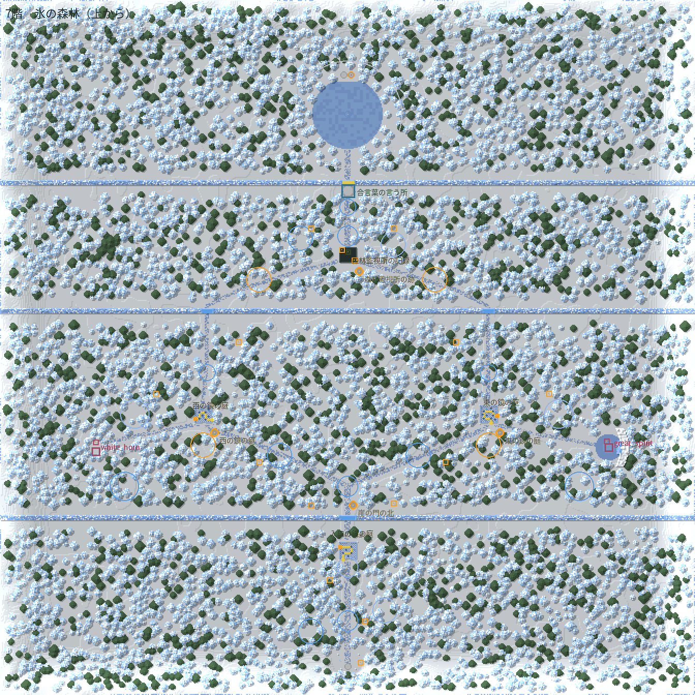
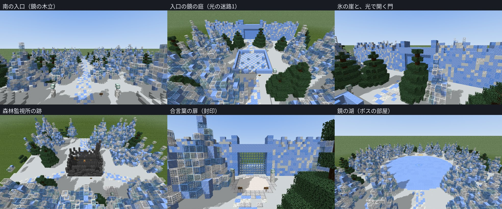

# Phase 8 その6：7階「氷の森林」とロスト状態「薄れ」（11月25日）

0-A 9章の7階・11章のロスト状態・12章と13章の「7日目」・20章の7階のボスのレア（確定）と、11月25日のご指示（「テストは後でまとめて
やるので次の階層も作ってください」・11月24日の「次は一部屋ずつではなく何層か実装してからにしましょう」）から作った階です。数値と
細かい形は【補完】です。



## 0-A の7階（確定）

| 項目 | 内容 |
| --- | --- |
| 地形・環境 | 鏡のような氷の木々の森。氷に映る自分の姿が、ときどき別の仲間の姿になる |
| 雑魚 | 写し身（プレイヤーの姿を真似る敵。名前が「？？？」）／氷角鹿／つらら蝙蝠／吹雪の精 |
| ボス | 鏡像獣リフレクタ。パーティメンバーの写し身を作る。本物の見分け方は、名前の表示とHPバーの動き。ここでロスト状態「薄れ（名前が？？？）」が初登場 |
| ギミック | 氷の鏡を動かして光を導く迷路。最奥の「合言葉の扉」は、パーティ全員が同じ合言葉をチャットに打つと開く |
| 古代記録 | 「森林監視所の記録」――「侵食域では、隣にいる者が誰か分からなくなる。合言葉を決めよ」 |
| 物語 | 7日目。リリアがプレイヤーを忘れる。プレイヤーが「ただいま」と声をかけるたびに、少しずつ思い出す（13章） |
| ロストの侵食 | 映り込みが間違っている。名前が読めなくなる |
| ボスのレア（20章） | 鏡氷の短剣（短剣：一定確率で攻撃が二重に当たる）5% |
| ロスト状態（11章） | 結び直し（仲間のそばで3秒しゃがむ）・回復役の浄化・消耗品「結び紐」で解ける。復活は妨げない。ロスト耐性で最大50%短くなる。かかっている間は画面のふちに白いノイズ |
| リリア（13章） | 名前と顔を忘れる（「はじめまして……ですよね？」）。仕事はできる。「ただいま」の声（サーバー全体・1人1日1回）がアクティブ人数の25%で名前をうっすら、50%で顔、75%でさらに思い出し、10日目の撃破で完全に戻る |

## 広さと区画【補完】

672×672（6階より広い）・高さ96（`tools/mapgen/build_floor7.py` が組み立て、`structures/map/floor7/` の196区画と `floors/floor7.json` を
書き出す）。地面の高さ 16（立つのは 17）。まわりは雪の山。霧は青白い（`#BFD3EA`。30〜170）。空はオーロラ、雪が降る。

森は、登れない**氷の崖**（高さ13〜16。上はぎざぎざ。崖の手前と奥は木のない帯）が東西に3本横切り、南から北へ4つの帯に分かれます。
崖の門は**光の迷路**を解くと開き、3本目の崖のまん中が**合言葉の扉**（封印）です。

| 区画 | 中身 |
| --- | --- |
| 南の入口の林 | 戻りの円・道しるべの石。氷の木の**鏡の木立**（物語の場所） |
| 入口の鏡の庭（光の迷路1） | 21×21の庭。光の泉・鏡5つ（曲がり角3・おとり2）・受け石。解くと**崖1の門**が開く |
| 分かれ道（崖1と崖2の間） | 西の道・東の道。**中継の灯**「崖の門の北」 |
| 西の鏡の庭（光の迷路2） | 鏡7つ（曲がり角4・おとり3）・氷の柱6。解くと**崖2の西の門**。**中継の灯**「西の鏡の庭」 |
| 西の林の空き地 | 名のある魔物「**白角**」（氷角鹿の主）と、その宝箱。まわりに氷の木の輪 |
| 東の鏡の庭（光の迷路3） | 鏡9つ（曲がり角5・おとり4）・氷の柱8。解くと**崖2の東の門**。**中継の灯**「東の鏡の庭」 |
| 東の凍った滝 | 雪をかぶった岩壁と、流れ落ちたまま凍った滝。名のある魔物「**吹雪の大精**」と、その宝箱 |
| 森林監視所の跡（崖2と崖3の間） | 崩れた見張り所（半分崩れた見張りの塔）。**古代記録の書見台**「森林監視所の記録」・宝箱2・**中継の灯** |
| 合言葉の扉（崖3） | 扉の前の円い白い床（**言う所**）と、碑の看板。扉は封印 |
| 鏡の湖（ボス） | 半径34の凍った湖と、まわりの鏡の木の輪。戦いの場は半径52。北の岸に出口の円と**次の階への円** |

宝箱は17（`chests/floor7_iceforest`）。中継の灯は4つ。



## 光の迷路（氷の鏡）【補完】

- **光の泉**は、決まった向きへまっすぐ光を出す。光は、**氷の鏡**（上から見て「／」か「＼」の斜めの板）で90度曲がり、光をさえぎる
  ブロック（氷の柱・塀など）で止まる。**光の受け石**に届くと、受け石が灯り、その庭の**氷の門**（崖の青い氷）が消えて開く
- 鏡を右クリックすると「／」と「＼」が入れ替わる。光の泉・受け石を右クリックすると、今の光の道を見せる
- 光の道は、いつも見えている（近くの人に。届いていれば白い光の粒、届いていなければ火花）
- 鏡の向きと「解けた」は**みんなの分**（ひとりが回せば、ほかの人にも同じ向き）。**進行日が変わると、鏡ははじめの向きに戻り、門は閉じる**
- 鏡の決まり：「／」は東→北・北→東・西→南・南→西、「＼」は東→南・南→東・西→北・北→西
- 庭ごとに、解き方は1つずつ（おとりの鏡は、光の道の外）。地図を作るときに、解き方で光が届くこと・はじめの向きでは届かないことを確かめる
  （`tools/mapgen/check_floor7.py`）

## 合言葉の扉【補完】

- 扉の前の**言う所**（円い白い床。13×13）にいる人が、チャットに言葉を打つと数える。**扉の前にいるパーティの全員**が、**20秒のうちに
  同じ言葉**を打つと、全員に「合言葉」の印（人ごと）がつき、扉を通れる。パーティでなければ、ひとりで言えばよい
- 言葉は、全角と半角・大文字と小文字・空白のちがいをそろえて比べる。32文字まで。「/」で始まる言葉（コマンド）は数えない
- 足りないときは「合言葉：1/3人が同じ言葉を言った」のように出る
- 何を言うかは決まっていない（パーティで決める）。古代記録「合言葉は、互いにしか分からない言葉にすること」のとおり

## 封印【補完】

光の迷路を3つとも解き（みんなの分）、名のある魔物2体（白角・吹雪の大精）を倒し（人ごと）、合言葉をそろえた人（人ごと）だけが、
合言葉の扉を通れる（`floors/floor7.json` の `seal_requires`：`lights+guardians+passphrase`）。

## ロスト状態「薄れ」（11章。7階から）

| 項目 | 内容 |
| --- | --- |
| かかると | 仲間の名前が「？？？」に見える（頭の上の名前と、パーティの欄の名前）。画面のふちに白いノイズ |
| かける敵 | 写し身（斬られると8秒）・吹雪の精（吹雪に巻かれると8秒。大精は12秒）・リフレクタ（屈折の光で12秒、鏡写しで20秒） |
| 解き方 | **結び直し**：ロスト状態の人か、その仲間が、もう一人のそば（2.5ブロック）で**3秒しゃがみ続ける**と、二人ともほどける（光の糸と鈴の音）。**回復役の浄化**（悪い状態をほどく技）でもほどける。消耗品「**結び紐**」：自分とまわり5ブロックの仲間をほどく（10秒に1回。薬屋で150ノット。宝箱・ボスからも） |
| 短くする | **ロスト耐性**（ステータス・アクセサリーのサブ・特殊効果）で、最大50%まで短くなる。7階のレアのお守り「吹雪の灯」はロスト耐性 +20% |
| そのほか | 復活は妨げない。はじめてかかったとき、解き方の手引きが出る |

## 7階の敵【補完】

| 敵 | Lv | HP | 攻撃 | 動き |
| --- | --- | --- | --- | --- |
| 写し身 | 29 | 2050 | 216 | はじめに近づいた人（24ブロック）の姿を写す（その人のスキン。少し透けた氷の姿）。名前はいつも「？？？」（氷の色）。剣で斬る・踏みこんで突く。斬られると**薄れ** |
| 氷角鹿 | 28 | 1900 | 212 | 角で突く・頭を下げて突進（1階の欠け牙の狼と同じ）。当たると**凍え**1つ |
| つらら蝙蝠 | 28 | 1250 | 202 | 空に浮き、翼のつららを撃つ（1階の結晶蜂と同じ） |
| 吹雪の精 | 29 | 1450 | 206 | 宙に浮き、氷のつぶてと**吹雪**（6階の凍て鳥と同じ。円の予兆のあと5秒）。吹雪に巻かれると凍えと**薄れ** |
| 白角（名） | 32 | 20000 | 228 | 氷角鹿の主。大きく、角に当たると凍え2つ。西の林の空き地。レア：白角の欠片（5%） |
| 吹雪の大精（名） | 32 | 18000 | 222 | 吹雪の間が短く（11秒）、広い（半径8）。薄れ12秒。東の凍った滝。レア：吹雪の灯（5%） |

数値は `python3 tools/balance/estimate.py` の目安（Lv30・霜銀+2の2人で、雑魚 2〜4秒・名のある魔物 35〜41秒・ボス 7分）に合わせました。

## ボス：鏡像獣リフレクタ【補完】

氷と鏡の板でできた、獅子のような獣。鏡のたてがみに、近づく者の姿を映し取る。Lv35・HP 96000（2人のときの基準。ひとりでも2人ぶん。
3人目から1人ごとに +60%）。怒るまで30分。曲は「鏡の湖」（ホ短調・140。ガラスの鈴の分散和音が左右を行き来し、旋律を「映り」が追いかける。
なかほどは、旋律を上下にひっくり返した「鏡の旋律」。`tools/audio/boss_music.py`）。

| 技 | 予兆 | 中身 |
| --- | --- | --- |
| 鏡爪 | 前の扇（110°・6.5ブロック） | 前足で払う。押し返す |
| 鏡片の雨 | 長い線（24ブロック・幅2.4） | 鏡のかけらを走らせる。凍え1つ |
| 屈折の光 | 見ている方の細い扇（50°・20ブロック） | 当たると**薄れ**（12秒） |
| 乱反射 | みんなの足もとに赤い円（半径3。第2段階から） | 円の中の人に当たる。動いてよける |
| 鏡写し | なし（たてがみが広がる） | 下の「写し身」 |

- 第2段階（HP70%）・第3段階（HP35%）で、技の間が短くなる（0.88倍・0.75倍）。段階が変わるたびに鏡写しを使う
- **鏡写し**（はじめは20秒後、そのあと60秒ごと）：戦う人ひとりずつの**写し身**（その人の姿。6体まで）を、まわりに立たせ、全員を**薄れ**（20秒）に
  する。写し身は、写した人とは別の人を狙う
- 写し身が残っている間、リフレクタは**鏡の守り**で、受けるダメージが**0.3倍**。写し身を**すべて倒すと、守りが割れて10秒、受けるダメージが
  1.3倍**（攻めどき。画面の上に「鏡の守りが割れた！」）。45秒残った写し身は、本体へ溶けて戻り、1体ごとにHPが3%戻る
- 本物の見分け方（0-A のとおり、名前の表示とHPバーの動き）：写し身の名前は**氷の色の「？？？」**、叩くと**頭の上にHPバー**が出て減る。
  仲間には頭の上のHPバーがなく、仲間のHPはパーティの欄で動く。薄れの間は仲間の名前も「？？？」（白）になるので、色とHPバーで見分ける
- 報酬：鏡氷の短剣（5%。エピック）・プリズムの欠片2・結晶果

## 7日目：リリアがプレイヤーを忘れる（0-A 12章・13章）

- 7階に誰かが初めて入ると、物語の印 `ch2/lilia_forgot`（サーバー全体）がつき、全員に「ギルドの受付のリリアが、冒険者たちのことを
  忘れてしまった……」と知らせが出る
- リリアの会話が「はじめまして……ですよね？」に変わる（ギルドの窓口と職業の画面は、忘れていても開ける）。選んで「**ただいま**」と声を
  かけると数える（**1人1日1回**。サーバー全体の累計）
- 「ただいま」の累計が、**アクティブ人数**（リリアが忘れてからログインした人の数）の**25%**で名前をうっすら、**50%**で顔、**75%**でさらに
  思い出す（そのたび全員に知らせ。会話も段階ごとに変わる）
- 10階のボスの初撃破（`ch2/queen_down`）で、完全に戻る

## 物語の場面【補完】

| 場面 | いつ |
| --- | --- |
| 氷の森林 | 7階に初めて入ったとき。「第2章　凍てついた記憶」「7階　氷の森林」の題と、鏡の森の字幕（映っているのは、隣の仲間の顔） |
| 鏡の木立・森林監視所の跡・合言葉の扉 | その場所に初めて入ったとき |
| 7階の初撃破 | リフレクタを倒したあと。割れた鏡に、仲間たちの名前が読めるようになる |

## 7階の装備と品【補完】

| 品 | 手に入れ方 | 中身 |
| --- | --- | --- |
| 鏡氷の短剣（ローグ） | リフレクタのレア（5%） | 第2世代・エピック・Lv30。攻撃32・会心6。**攻撃が当たると15%で、鏡の写しがもう一度当たる**（与えたダメージの100%）。刃のまん中の紫の筋と、刃に寄りそう「写しの刃」が光る（11月26日に形から作り直した。[`docs/gear/rare_f7.md`](gear/rare_f7.md)） |
| 7階のアクセサリー | 装飾工房で作る5つ（台座布を使う）・名のある魔物のレア2つ | 鏡氷の闘環・智環・氷角の首飾り・つららの腕輪・合言葉の札／白角の欠片（移動 +6%）・吹雪の灯（ロスト耐性 +20%）（[`docs/gear/floor_accessories.md`](gear/floor_accessories.md)） |
| 結び紐 | 薬屋（150ノット）・宝箱・ボス | ロスト状態をほどく消耗品（16個まで重なる） |
| 7階の素材 | 7階の敵と宝箱 | 鏡氷・氷角・つらら蝙蝠の翼・吹雪の芯・プリズムの欠片（レア） |

武器と防具の新しいシリーズは、7階にはありません（霜銀シリーズのまま。0-A 20章の第2章の装備は「霜銀シリーズ → 女王シリーズ（10階のレア）」）。

## 作り直し方

```
python3 tools/mapgen/build_floor7.py            # 地図（区画と floors/floor7.json）
python3 tools/mapgen/check_floor7.py            # 歩いて届くか（門を閉じたまま・開いたとき）と、光の迷路の解き方
python3 tools/datagen/build_floor7_data.py      # 敵・落とす物・物語・リリアの会話・鏡氷の短剣・素材・結び紐・言葉
python3 tools/datagen/build_floor_accessories.py  # 階ごとのアクセサリー（7階を含む）
python3 -I tools/datagen/build_shops.py         # 店（薬屋の結び紐）と相場（6階・7階の素材と品を足した）
python3 -I tools/datagen/weapon_tags.py         # 職業の武器のタグ（鏡氷の短剣）
python3 tools/artgen/make_iceforest_models.py   # 氷角鹿・つらら蝙蝠・吹雪の精・リフレクタのモデル（写し身は、写した人の姿で描く）
python3 tools/artgen/make_iceforest_things.py   # 光の泉・氷の鏡・光の受け石・鏡氷の短剣・状態「薄れ」のアイコン
python3 tools/artgen/make_floor_accessory_art.py  # アクセサリー・素材・結び紐の絵（このあと enhance_icons.py）
python3 tools/artgen/enhance_icons.py .         # 16×16 に戻った絵を 32×32 に
python3 tools/audio/boss_music.py reflecta      # リフレクタの曲
```

## 確かめたこと

- 地図：`check_floor7.py`（門も封印も閉じたままでは崖1の北へ行けない・崖1の門だけでは崖2の北へ行けない・門をすべて開いても湖へは
  入れない・封印を通ると湖と出口の円へ行ける。光の迷路は、ブロックをたどって、解き方で届き・はじめの向きでは届かない）
- 自動テスト：`IceForestGameTests`（7階の形・鏡の決まり・薄れ〈かかる・結び直し・結び紐〉・ロスト耐性・写し身・リフレクタの写し身と
  鏡の守り・リリアの「ただいま」・装備とアクセサリー・合言葉のそろえ方）、`FloorRealPlayGameTests.floor7RealPlay`（7階を本当に建て、
  鏡を右クリックで回して光を3つの受け石に届け、門が開き、扉の前で合言葉を言い、封印が開く）、ボスの曲（1〜7階）
- CIの写真：7階のはじまり・鏡の木立・光の迷路（真上から・鏡の前から・解いたあと）・開いた門・7階の敵・薄れ・森林監視所の跡・
  合言葉の扉（言ったあと）・リフレクタ戦（鏡爪・鏡片の雨・屈折の光・乱反射・鏡写し・守りが割れる）・鏡氷の短剣・忘れたリリア

## 【補完】したこと

- 地図の形（氷の崖3本と門・鏡の庭3つと解き方・森林監視所・凍った滝・鏡の湖）、宝箱・中継の灯の数と場所
- 光の迷路の決まり（みんなの分・進行日で戻る・光の道がいつも見える）・合言葉の決まり（言う所・20秒・そろえ方）・封印の条件
- 薄れの時間・結び直しの距離・結び紐（範囲・間・値段）・ロスト耐性の特殊効果
- 敵とボスの数値・技の名前と中身・鏡の守り（0.3倍）と割れたとき（1.3倍・10秒）・写し身が戻るとHPが戻ること・写し身の頭の上のHPバー
- リリアの「アクティブ人数」の数え方・会話の台詞・知らせの文
- 名のある魔物（白角・吹雪の大精）とレアのお守り・7階のアクセサリー・素材・鏡氷の短剣の数値（攻撃が二重に当たる確率15%）
- リフレクタの曲・場面と字幕の台詞

## まだのこと

- 8〜10階（第2章の残り）
- 写し身の歩き・斬る動きは、プレイヤーの姿の決まった動き（GeckoLib の動きはない）
- 鏡の向きの見た目（上から見て「／」）が、ゲームの中で光の決まりと合っているかは、CIの写真（真上から）で確かめる
