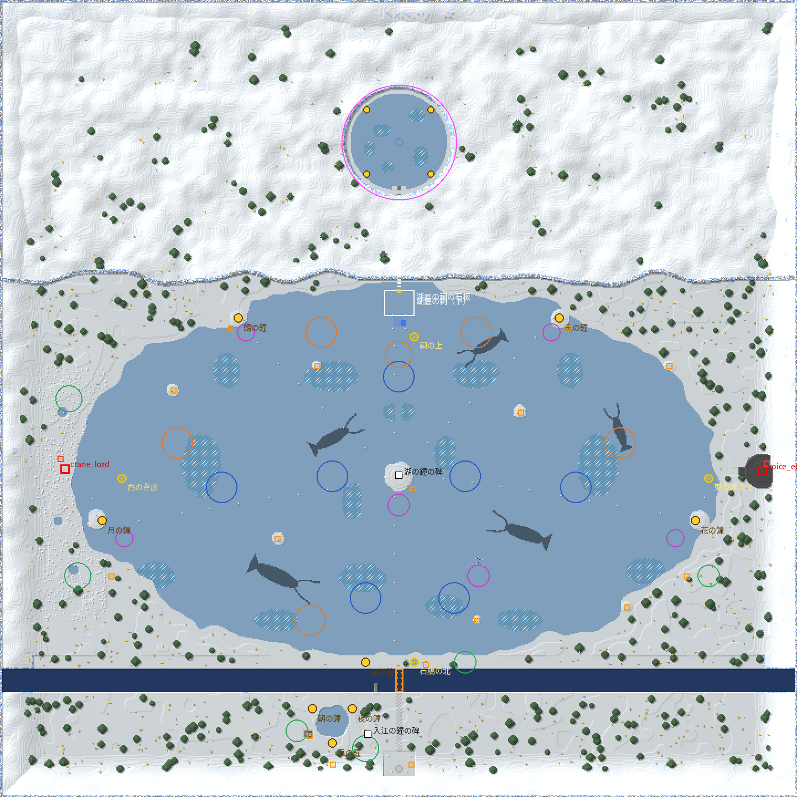
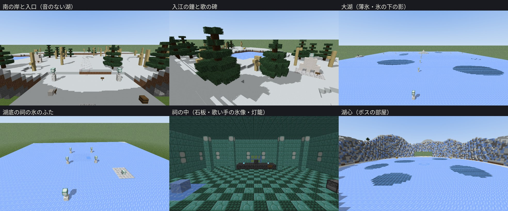
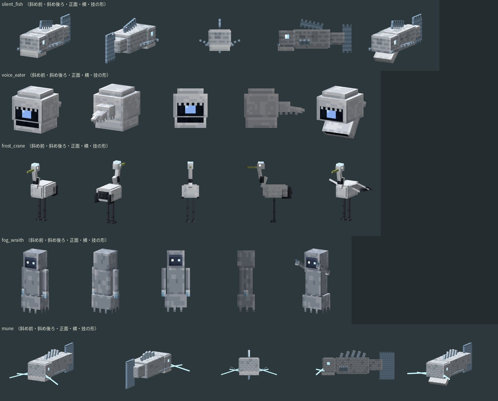

# Phase 8 その7：8階「沈黙の湖」とロスト状態「断線」「静寂」（11月25日）

0-A 9章の8階・11章のロスト状態・12章と13章の「8日目」・20章の8階のボスのレア（確定）と、11月25日のご指示（「テストは後でまとめて
やるので次の階層も作ってください」・「防具は一式全部揃えた形にしてください」・11月24日の「次は一部屋ずつではなく何層か実装してから
にしましょう」）から作った階です。数値と細かい形は【補完】です。



## 0-A の8階（確定）

| 項目 | 内容 |
| --- | --- |
| 地形・環境 | 音のない凍った湖。足音も環境音も消えている。氷の下に巨大な影と、沈んだ祠が見える |
| 雑魚 | 無音の大魚（氷の下から襲う。割れ目が予兆）／声喰い（近くにいると効果音が消える）／凍て鶴／氷霧の亡霊 |
| ボス | 声なき湖主ムーネ。「静寂」の間は効果音・予兆表示・パーティHUDが消え、ボイスチャットの声かけだけが頼りになる |
| ギミック | 氷の割れ目（同じ場所に集まりすぎると割れる）と、湖のまわりの鐘（正しい順番で鳴らすと音が戻り、祠への道が開く） |
| 古代記録 | 「湖底の祠の石板」――「沈黙は、争いを止めた。だが、歌も止めた」 |
| 物語 | 8日目。この石板を持ち帰ると、セレナが「ロストで記憶が消える仕組み」を伝える |
| ロストの侵食 | 音そのものが消えている |
| ボスのレア（20章） | 湖主の髭弓（弓：静寂状態でも予兆の音が自分にだけ聞こえる）4% |
| ロスト状態（11章） | 断線（パーティHUDから味方のHPが消える）・静寂（効果音と予兆の音が消える） |
| セレナ（12章・13章） | 8日目に仕組みを伝える。「記憶は消滅しない。糸が切れて届かなくなるだけで、糸を結び直せば戻る。ただし長く切れたままの糸は結び直しにくい」。伏線「8日目の説明が妙に詳しい」 |

## 広さと区画【補完】

720×720（7階より広い）・高さ96（`tools/mapgen/build_floor8.py` が組み立て、`structures/map/floor8/` の225区画と `floors/floor8.json` を
書き出す）。湖の氷の面は y24（立つのは 25）。氷の下は水（深い所で湖底 y10）。まわりは雪の山。霧は灰青（`#AEB9C4`。24〜140）。
**湖の鐘を鳴らすまで、階じゅうの効果音が消えている**（`environment.silent`。音楽とボイスチャットは消えない）。

| 区画 | 中身 |
| --- | --- |
| 南の岸（入口） | 戻りの円・道しるべの石 |
| 入江 | 南の岸の小さな凍った入り江と、朽ちた舟小屋。**入江の鐘**3つ（朝・昼・夜）と、入江の**歌の碑**（物語の場所「入江の鐘」） |
| 黒い裂け目 | 湖を東西に横切る深い裂け目（底は水）。**沈んだ石橋**の柱が水から見えている（物語の場所「黒い裂け目」）。入江の鐘を鳴らしきると石橋が浮かぶ。裂け目の南の壁に、落ちた人が上がれる石段 |
| 大湖 | 厚い氷の道と、**薄氷**の広がり。氷の下に**影**（大きな魚の影の形）。湖の**歌の碑**（小島）と、**湖の鐘**5つ（月・鶴・魚・花・星。西の岬・北西の小島・北東の小島・東の岸・南の岸）。凍った釣り人たちの氷像（物語の場所「凍った釣り人たち」）。**中継の灯**4つ |
| 西の葦原 | 凍った葦の沼。名のある魔物「**霜冠**」（凍て鶴の長）と、その宝箱 |
| 東の声の洞 | 氷の洞。名のある魔物「**千声喰い**」（声喰いの長）と、その宝箱 |
| 湖底の祠 | 湖の底の小さな祠。上は**氷のふた**（湖の鐘で開く2×3の口。中に人がいる間は閉じない）。**古代記録の石板**（右クリックで「湖底の祠の石板」を受け取る）・**最後の歌い手**の氷像（記憶の氷像）・**祠の灯籠**（熱の結晶をもらえる）。北の扉が封印（物語の場所「湖底の祠」） |
| 湖底の道 | 祠の北の扉から、尾根の下をくぐるトンネル |
| 湖心（ボス） | 尾根に囲まれた円い湖（半径44）。戦いの場は半径56。**湖心の鳴り石**4つ（四方）。北の岸に出口の円と**次の階への円** |

宝箱は18（`chests/floor8_lake`）。地図は `tools/mapgen/check_floor8.py` で、鐘・石橋・ふた・封印のそれぞれの状態で歩いて届くか、
水が漏れないかを確かめた。



## 鐘と歌の碑【補完】

- 鐘の組は2つ：**入江の鐘**（3つ・90秒・石橋が浮かぶ）と**湖の鐘**（5つ・240秒・音が戻り、祠の氷のふたが開く）
- **歌の碑**に触れると、**今日の歌**（その組の鐘を鳴らす順番。「月 → 星 → 鶴 → …」）が浮かぶ。パーティの仲間にも、チャットで同じ歌が届く。
  歌は進行日ごとに変わる（同じ日なら、だれが見ても同じ）
- 鐘を右クリックで鳴らす。順番どおりなら鐘が灯り、まわりに光の輪が広がる（音のない湖でも、鳴ったことが目で分かる）。**違う鐘を鳴らすと、
  灯った鐘はすべて消え、はじめから**（今日の歌は変わらない）。最初の鐘から制限時間をすぎても、はじめから
- 湖の鐘は、湖じゅうに散らばっている（西の岬から東の岸まで）。パーティで手分けして、声をかけあって順番に鳴らす遊び
- 解けた組と灯った鐘は**みんなの分**。**進行日が変わると、鐘はまた沈黙し、石橋は沈み、ふたは閉じ、音も消える**（中に人がいる所は、
  出るまで待つ）
- 管理者：`/amemaru admin floor bells 8 solve [組]`・`/amemaru admin floor bells 8 reset`

## 薄氷と氷の穴【補完】

- **薄氷**（白く薄い氷）の上で、3ブロックのうちに**2人以上**が乗っていると、足もとにひびが入る（0.5秒ごとに1段。3段のあと、まだ集まって
  いれば割れる）。**ひとりなら割れない**。離れれば、ひびは少しずつ消える
- 割れた所（と、無音の大魚・ボスが割った所）は、しばらく**水の穴**になり、30秒で凍り直す（穴の中に誰かいる間は凍らない。サーバーが
  止まっても、次に起きたときに戻す）
- 水に落ちた人は、**4秒**で、最後に立っていた所へ引き上げられる（凍えが2つ）。氷の下に閉じこめられない

## 封印【補完】

鐘の組を2つとも鳴らしきり（みんなの分）、名のある魔物2体（霜冠・千声喰い）を倒した人（人ごと）だけが、祠の北の扉を通れる
（`floors/floor8.json` の `seal_requires`：`bells+guardians`）。

## ロスト状態「断線」「静寂」（11章。8階から）

| 状態 | かかると | かける敵 |
| --- | --- | --- |
| 断線 | パーティの欄から、味方のHPが消える（名前だけ残る） | 氷霧の亡霊（10秒）・ムーネの断ち波（15秒） |
| 静寂 | 効果音と予兆の音が消える | 声喰いのそば（7ブロック。千声喰いは12ブロック。離れれば3秒で消える）・千声喰いの吸いこみ（8秒） |
| 静寂（強さ1） | さらに、予兆の印・技の名前・パーティの欄も消える | ムーネの静寂の帳（20秒） |

ほどき方は7階の「薄れ」と同じ（結び直し・回復役の浄化・結び紐）。ロスト耐性で短くなる。静寂は、強い方（帳）が残る。

## 8階の敵【補完】

| 敵 | Lv | HP | 攻撃 | 動き |
| --- | --- | --- | --- | --- |
| 無音の大魚 | 33 | 1500 | 236 | ふだんは氷の下を泳ぎ、**叩いても届かない**（氷の下の暗い影だけが見える）。氷の上の人の真下へ来ると、足もとに**氷のひびの印**（予兆1.3秒）を出し、氷を割って跳び上がる（半径2.2・凍え1つ）。そのあと4秒だけ氷の上でもがき、この間だけ叩ける |
| 声喰い | 32 | 1500 | 214 | 大きな口だけの白い影。浮かんで声の礫を撃つ。そばの人を**静寂**にする |
| 凍て鶴 | 32 | 2200 | 228 | くちばしで突く・低く滑る突進・翼で吹雪を叩きつける（押し返す。凍え1つ） |
| 氷霧の亡霊 | 33 | 1700 | 224 | 霧に溶けて近くへ現れ（16ブロック）、冷たい手で触れる。当たると**断線** |
| 霜冠（名） | 36 | 22000 | 242 | 凍て鶴の長。大きく、突進が長く、吹雪で凍え2つ。西の葦原。レア：霜冠の冠羽（5%） |
| 千声喰い（名） | 36 | 20000 | 236 | 声喰いの長。静寂の届く所が広く（12ブロック）、大きく息を吸いこんで引き寄せ、まわりを打って**静寂**8秒。東の声の洞。レア：千の声の喉石（5%） |

数値は `python3 tools/balance/estimate.py` の目安（Lv34・霜銀+4の2人で、雑魚 2〜4秒・名のある魔物 34〜40秒・ボス 8分）に合わせました。

## ボス：声なき湖主ムーネ【補完】

白い鱗の巨大な魚（なまずに似る）。口のまわりに、光る長いひげ。目は白く濁っている。湖が音を失った日から、氷の下を黙って泳ぎつづけている。
Lv39・HP 64000（2人のときの基準。ひとりでも2人ぶん。3人目から1人ごとに +60%）。怒るまで30分。**氷の下にいる間は叩けない**（叩ける間が
半分ほどなので、HPは7階より少ない。目安は `estimate.py` の `UPTIME`）。曲は「声なき湖」（嬰ヘ短調・126。氷の下の心音がずっと鳴り、
湖の鐘の5つの音の動機が、向こう岸からこだまして返る。旋律はところどころ途切れ、なかほどでは1小節すべての音が消える。
`tools/audio/boss_music.py`）。

| 技 | 予兆 | 中身 |
| --- | --- | --- |
| はね上げ | 狙った人の足もとに、氷のひびの印（半径2.8） | 氷の下から跳び上がって、氷を割る（穴は12秒）。2回のあと（第3段階は3回）、最後の穴から**氷の上へ出て10秒、叩ける** |
| 髭払い | 前の扇（120°・9ブロック）。氷の上でだけ | 光るひげで払う。押し返す |
| 尾打ち | まわりの円（6.5ブロック）。氷の上でだけ | 尾で氷を叩く。まわり9ブロックの薄氷に、ひびが2段入る |
| 静寂の帳 | 口を大きく開ける（声は出ない） | 下の「静寂の帳」 |
| 断ち波 | 湖のまん中に、断線の印（第2段階から） | 湖のまん中から、氷の下を波が広がる。**足が氷についていると、打たれて断線**（15秒）。跳んでよける |

- 第2段階（HP70%）・第3段階（HP35%）で、技の間が短くなる（0.88倍・0.75倍）。第3段階に入ると、すぐに静寂の帳
- **静寂の帳**（はじめは25秒後、そのあと70秒ごと。第3段階は0.7倍）：戦う人全員を**静寂（強さ1）**に20秒。効果音・予兆の印・技の名前・
  パーティの欄が消え、**ボイスチャットの声かけだけが頼り**になる
- 帳の間に、**湖心の鳴り石**（四方に4つ）のうち**違う2つを3秒のうちに鳴らすと、帳が破れる**。静寂がほどけ、ムーネは氷の上に浮かんで
  **8秒動けず、受けるダメージが1.3倍**（攻めどき）。ひとりなら走り回って2つ、パーティなら声をかけあって同時に
- 報酬：湖主の髭弓（4%。エピック。出ないと少しずつ出やすくなる）・湖の真珠2・結晶果

## 8日目：湖底の祠の石板とセレナ（0-A 12章・13章）

- 湖底の祠の石板を右クリックすると、「湖底の祠の石板」（物語の品）を受け取り、古代記録「湖底の祠の石板」が記録帳に残る。頼みごと
  「**湖底の祠の石板**」（セレナに見せる）が始まる
- 教会のセレナに話すと、石板を預かり（頼みごとの報告。400ノット・経験500・親密度 +20）、**ロストで記憶が消える仕組み**を伝える：
  記憶は消えていない。人と人をつなぐ糸が切れて、届かなくなるだけ。糸は結び直せる（そばにいる・名前を呼ぶ・触れる）。ただ、長く
  切れたままの糸は結び直しにくい。物語の印 `ch2/serena_explains`（サーバー全体）がつく
- 祠の灯籠で熱の結晶をもらい、**最後の歌い手**の氷像を溶かすと、湖が音を失った日の場面（6階と同じ記憶の氷像）：湖の両岸の争いを
  止めようとした歌い手と、「声ごと止めてしまえばいい」と鐘を鳴らした誰か

## 物語の場面【補完】

| 場面 | いつ |
| --- | --- |
| 沈黙の湖 | 8階に初めて入ったとき。「8階　沈黙の湖」の題と、音のない湖の字幕 |
| 黒い裂け目・入江の鐘・湖底の祠・凍った釣り人たち | その場所に初めて入ったとき |
| 音が戻る | 湖の鐘を鳴らしきったとき（階にいる人みんなに。戻った音で大きな鐘が鳴る） |
| 石板 | 湖底の祠の石板を手に取ったとき |
| 最後の歌い手 | 歌い手の氷像を溶かしたとき |
| 8階の初撃破 | ムーネを倒したあと。湖じゅうに音があふれる（氷の割れる音・水の音・仲間の声） |

## 8階の装備と品【補完】

| 品 | 手に入れ方 | 中身 |
| --- | --- | --- |
| 湖主の髭弓（アーチャー） | ムーネのレア（4%） | 第2世代・エピック・Lv34。攻撃35・会心7。**静寂の間も、予兆が出た所から鈴の音が自分にだけ聞こえる**（特殊効果 `warning_ear`）。ひげの弦と、弓の先の巻いたひげが光る（11月26日に形から作り直した。[`docs/gear/rare_f8.md`](gear/rare_f8.md)） |
| 8階のアクセサリー | 装飾工房で作る5つ（台座布を使う）・名のある魔物のレア2つ | 静氷の闘環・智環・大魚の鱗の首飾り・凍て鶴の腕輪（0-A 21章の第2章の一覧）・鐘の音のお守り／霜冠の冠羽（5秒ごとに、最大HPの1.5%が戻る）・千の声の喉石（8ブロック以内の味方1人ごとに、与えるダメージ +3%）（[`docs/gear/floor_accessories.md`](gear/floor_accessories.md)） |
| 8階の素材 | 8階の敵と宝箱 | 静氷・大魚の鱗・声石・凍て鶴の冠羽・霧の糸・湖の真珠（レア） |
| 湖底の祠の石板 | 祠の石板 | 物語の品（セレナに見せる） |

武器と防具の新しいシリーズは、8階にはありません（霜銀シリーズのまま。防具は一式。0-A 20章の第2章の装備は「霜銀シリーズ → 女王シリーズ（10階のレア）」）。

## 見た目と音【補完】

- 湖の氷は、灰青の透きとおった氷（半透明）。**氷の下の無音の大魚とムーネは、暗い影**（半透明の濃い紺）で描き、氷の上へ出るとふつうの色
- 薄氷は白く薄く、ひびが0〜3段で増える（3段は白い割れ目の網の目）
- 湖の鐘は霜銀の枠に古い青銅の鐘（緑青）と青い声石の舌。鳴ると淡い金色に光る。歌の碑と祠の石板には、五線のような刻みと光る音符
- モデル：無音の大魚・声喰い・凍て鶴・氷霧の亡霊・ムーネ（GeckoLib。`tools/artgen/make_lake_models.py`）



## 作り直し方

```
python3 tools/mapgen/build_floor8.py            # 地図（区画と floors/floor8.json）
python3 tools/mapgen/check_floor8.py            # 歩いて届くか（鐘・石橋・ふた・封印のそれぞれ）と、水が漏れないか
python3 tools/datagen/build_floor8_data.py      # 敵・落とす物・物語・セレナの会話・頼みごと・湖主の髭弓・素材・言葉
python3 tools/datagen/build_floor_accessories.py  # 階ごとのアクセサリー（8階を含む）
python3 -I tools/datagen/build_shops.py         # 相場（8階の素材と品を足した）
python3 -I tools/datagen/weapon_tags.py         # 職業の武器のタグ（湖主の髭弓）
python3 tools/artgen/make_lake_models.py        # 無音の大魚・声喰い・凍て鶴・氷霧の亡霊・ムーネのモデル
python3 tools/artgen/make_lake_things.py        # 湖の氷・薄氷・鐘・歌の碑・祠の石板・湖主の髭弓・状態のアイコン・歌い手の姿
python3 tools/artgen/make_floor_accessory_art.py  # アクセサリー・素材・石板の絵（このあと enhance_icons.py）
python3 tools/artgen/enhance_icons.py .         # 16×16 に戻った絵を 32×32 に
python3 tools/audio/boss_music.py mune          # ムーネの曲
```

## 確かめたこと

- 地図：`check_floor8.py`（鐘を鳴らす前は裂け目の北へ行けない・石橋が浮かぶと大湖へ行ける・湖の鐘でふたが開くと祠へ入れる・封印を
  通ると湖心と出口の円へ行ける。湖と裂け目の水は、外へ漏れない）
- 自動テスト：`LakeGameTests`（8階の形・今日の歌と鐘・薄氷のひびと穴・凍り直し・水からの引き上げ・断線と静寂・無音の大魚・ムーネの
  静寂の帳と鳴り石・装備とアクセサリーとセレナ）、`FloorRealPlayGameTests.floor8RealPlay`（8階を本当に建て、歌の碑と鐘を右クリックで
  鳴らして石橋が浮かび・音が戻り・ふたが開き、祠の石板を受け取り、灯籠の結晶で歌い手の氷像を溶かし、封印が開く）、ボスの曲（1〜8階）
- CIの写真：8階のはじまり・入口・黒い裂け目・入江と歌の碑・浮かんだ石橋・8階の敵（氷の下の影）・静寂・断線・湖の歌の碑・音が戻る・
  開いたふた・湖底の祠・ムーネ戦（はね上げ・髭払い・尾打ち・静寂の帳・断ち波）・湖主の髭弓

## 【補完】したこと

- 地図の形（入江・黒い裂け目と沈んだ石橋・大湖と小島・葦原・声の洞・湖底の祠と氷のふた・湖底の道・湖心）、宝箱・中継の灯の数と場所
- 鐘の決まり（2つの組・今日の歌・制限時間・みんなの分・進行日で戻る・歌の碑）・音が消える範囲（効果音だけ。音楽と声は消えない）
- 薄氷の決まり（3ブロック・2人・0.5秒ごと・3段）・穴が凍り直す30秒・水から引き上げる4秒
- 断線・静寂の時間と、かける敵。静寂の強さ1（帳）で消えるもの
- 敵とボスの数値・技の名前と中身・鳴り石で帳が破れる決まり（違う2つ・3秒）と、動けない間（8秒・1.3倍）
- セレナの台詞・頼みごとの報酬・最後の歌い手の場面の台詞
- 名のある魔物（霜冠・千声喰い）とレアのお守り・8階のアクセサリー・素材・湖主の髭弓の数値
- ムーネの曲・場面と字幕の台詞・モデルと絵

## まだのこと

- 9〜10階（第2章の残り）
- （11月26日にできた）湖主の髭弓の形：霜銀の弓の塗り直しをやめ、ムーネのうろこの腕・先から巻いて伸びる光るひげ・真珠とひれの握りに作り直した（[`docs/gear/rare_f8.md`](gear/rare_f8.md)）
- 音が消える所・帳で表示が消える所は、CIの写真（静寂・帳）と、遊んで確かめる（[`docs/ingame_check.md`](ingame_check.md) の「Phase 8 その7 を確かめる」）
