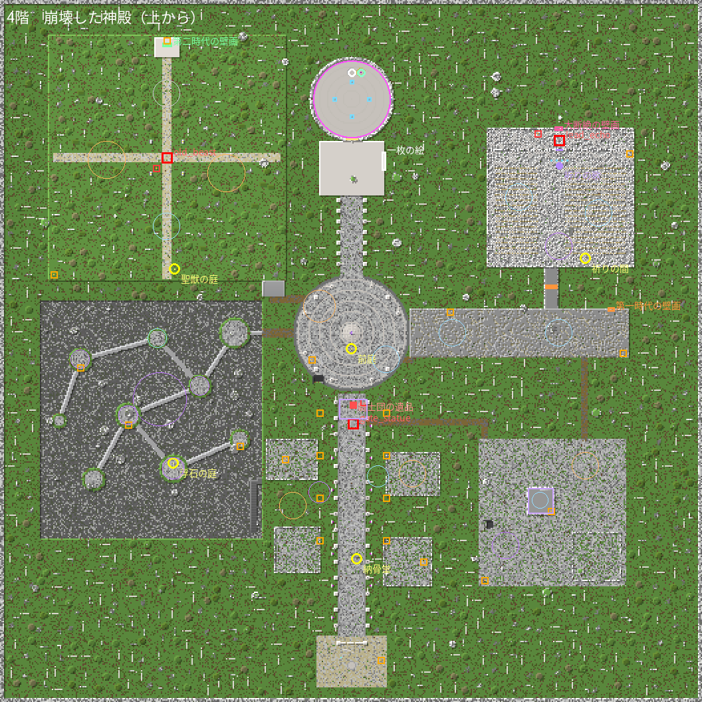
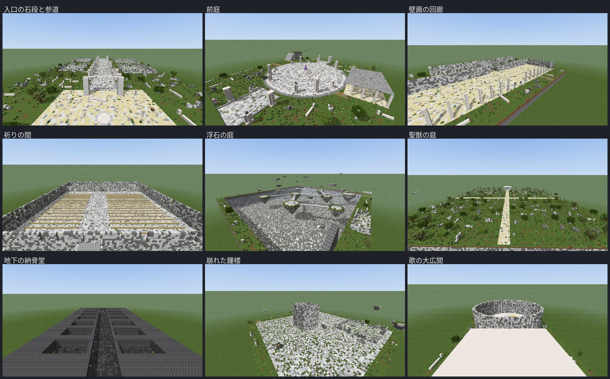

# Phase 8 その3：4階「崩壊した神殿」（11月24日）

0-A 9章の4階（確定）と、11月23日・24日のご指示から作った階です。数値と細かい形は【補完】です。

## 0-A 9章の4階（確定）

| 項目 | 内容 |
| --- | --- |
| おすすめのレベル | 7〜10 |
| 地形・環境 | 崩れた柱と浮かぶ瓦礫の神殿。手をつないで大きな結晶を囲む古代人の壁画。顔の削れた石像 |
| 雑魚 | 沈黙の石像（近づくと動き出す）／祈り手の残響（祈りの歌で仲間を回復させるので先に倒す）／結晶甲虫（硬いが魔法に弱い）／欠けた聖獣（神殿の守護獣がロストで欠けたもの） |
| ボス | 祈りの残響カンターレ。4体の歌い手で、歌の順番どおりに4つの音の床を踏むと無防備になる |
| ギミック | 壁画パズル。回転するパネルを正しく並べると、第一時代から第二時代までの歴史が一枚の絵になる（表：壁画の復元・音の順番） |
| 古代記録 | 「神殿の碑文」――「われらは神を祀らない。祀るのは、人と人の間にあるものである」（`records/f04_temple.json`） |
| 物語 | 4日目。結晶騎士団の遺品（冑と認識票）が見つかる |
| ロストの侵食 | 壁画の人物が何人か白く消されている（誰かが、誰かを忘れた跡） |
| ボスのレア | 祈り手の鈴（ヒーラーの鈴杖：回復した相手の防御が少し上がる）5% |

## ご指示から

- 11月23日：一層上がるたびに広く・複雑に・難しく（体力と攻撃だけでなく）。後半は時間がかかってよい
- 11月24日：ボスはパーティでないと倒せない強さ。ボスの攻撃は分かりやすく。**一部屋ずつではなく、何層か作ってから見せる**（4階と5階をまとめて作った）

## 広さと区画【補完】

528×528（1階の約1.9倍）・高さ72の、空の見える神殿（`tools/mapgen/build_floor4.py` が組み立て、`structures/map/floor4/` と
`floors/floor4.json` を書き出す）。歩ける所は3つの層：**地面**（床のブロックの高さ 24。立つのは 25）・**地下の納骨堂**（床 10）・
**聖獣の庭の高い段**（床 36）。上の段と地下を足して、歩ける広さは1階の約2倍。外まわりは高さ12の塀（落ちて外へ出ない）。
霧は明るい砂色（`#CDBF96`。30〜170）。

| 区画 | 層 | 中身 |
| --- | --- | --- |
| 入口の石段 | 地面 | 戻りの円・道しるべの石。両脇の大きな台と、2本の太い柱と落ちた横木の門 |
| 崩れた参道 | 地面 | 南北にまっすぐな石の道。柱の並木（ところどころ折れている）と、顔の削れた石像。脇に崩れた建物が6つ（宝箱） |
| 前庭 | 地面 | 丸い広場。まん中に割れた結晶の祭壇（欠けた所が白い）、16本の柱の輪。**中継の灯**。北は前室、東は壁画の回廊、西は浮石の庭と聖獣の庭へ。南西のすみから納骨堂へ下りる階段 |
| 壁画の回廊 | 地面 | 東西に長い柱廊。北の壁に白く消された飾りの壁画。東のはしに**壁画「第一時代」（3枚）**。これを戻すと、祈りの間へ上る通路の扉が開く |
| 祈りの間 | 地面 | 長椅子の並ぶ大きな礼拝堂（屋根が半分落ちている）。**音の順番**（鈴の石と4つの音の床）で奥の院の扉が開く。奥の院に名のある魔物「祈りの導き手」・宝箱・**壁画「大断絶」（4枚）**。**中継の灯** |
| 浮石の庭 | 谷の上 | 深い谷（底は床 4）に浮かぶ石の島と、ところどころ欠けた細い橋（1マス跳ぶ）。**中継の灯**（いちばん大きな島）。落ちると谷の底から長い坂で前庭へ戻れる |
| 聖獣の庭 | 高い段 | 前庭の北西から大階段で上る庭。十字の道・生け垣・聖獣の像。名のある魔物「古き番獣」。北の祠に**壁画「第二時代」（5枚）**（戻すと奥の小部屋の扉が開き、宝箱）。**中継の灯** |
| 地下の納骨堂 | 地下 | 南北に長い通路と、両脇の小部屋。北のはしの部屋に**結晶騎士団の野営の跡**（遺品）と、それを守る名のある魔物「門の大石像」。**中継の灯**。前庭と鐘楼の2か所から下りる |
| 崩れた鐘楼 | 地面〜上 | 四角い塔。中に**白い壁画の間**（ロストの侵食）。四すみを回るらせん階段で、てっぺんの見晴らし台（落ちた鐘・宝箱）へ |
| 前室 | 地面 | 歌の大広間の前。東の壁に**「一枚の絵」（12枚）**、西の壁に**古代記録「神殿の碑文」**。北が封印の門 |
| 歌の大広間 | 地面 | ボスの部屋（丸い。半径30。壁の高さ18、屋根はなく空が見える）。東西南北の半径13に4つの音の床（白・青・金・紅）と歌い手の壁がん。北に出口の円と、**次の階への円** |

決まり：

- 中継の灯は5つ（前庭・浮石の庭・聖獣の庭・納骨堂・祈りの間）。入口の道しるべの石から、ともした中でいちばん先の灯へ
- 宝箱は25（`chests/floor4_ancient`）。名のある魔物3体は、それぞれ宝箱を守る（倒すまで開かない）
- `tools/mapgen/check_floor4.py`：壁画も音の順番も解いていないとき、入口から前庭・壁画「第一時代」の前・浮石の庭・聖獣の庭の
  壁画「第二時代」の前・納骨堂（遺品）・碑文まで歩いて行ける。祈りの間とボスの部屋へは入れない。扉をすべて開けると、宝箱25・
  中継の灯5・守り手3・壁画のパネルの前・鈴の石と音の床・封印の前まで行ける。封印を通れば、ボスの部屋・4つの音の床・出口の円・
  次の階への円まで行ける。落ちて世界の外へ出る穴がない

## ギミック：壁画と音の順番【補完】

- **壁画**：パネルを右クリックで90度ずつ回す。組のパネルがすべて正しい向きになると、元の絵に戻り、歴史の一文が字幕で読める。
  扉のある組は扉が開く。戻した壁画はみんなの分（`amemaru_temple.dat`）で、進行日が変わると、また崩れる（扉も閉じる）

| 壁画 | 場所 | 枚数 | 戻すと |
| --- | --- | --- | --- |
| 第一時代 | 壁画の回廊の東のはし | 3 | 祈りの間へ上る通路の扉が開く |
| 大断絶 | 祈りの間の奥の院 | 4 | （扉はない。一枚の絵の一部） |
| 第二時代 | 聖獣の庭の北の祠 | 5 | 祠の奥の小部屋の扉が開く（宝箱） |
| 一枚の絵 | 前室の東の壁 | 12 | 回せない（飾り）。3つの壁画がすべて戻ると灯る |

- **音の順番**（祈りの間）：鈴の石を鳴らすと、4つの音の床のうち3つが順に光って鳴る。同じ順番で踏むと、奥の院の扉が開く
  （ボスの「歌の順番どおりに音の床を踏む」の練習）。違う床を踏むと、はじめから
- **封印の門**：`seal_requires`：`murals+guardians`（3つの壁画がすべて戻っている（みんなの分。その日のうち）＋名のある魔物を3体とも
  倒した印（人ごと））。足りないと「光の幕が道をふさいでいる。この階の壁画を、すべて元の絵に戻そう（1/3）」などと出る。
  【11月24日の直し】CI の自動テストで、壁画を戻さなくても封印が開くことが分かった（封印を開ける判定が、壁画を数えていなかった）。
  直して、テスト（`muralsOpenTheSeal`）で確かめる

## 敵（11月24日の強さに合わせた【補完】）

| 敵 | HP | 攻撃 | 動き |
| --- | --- | --- | --- |
| 沈黙の石像 | 4200 | 82 | 眠っている間はただの像（受けるダメージ 0.3 倍）。5ブロックまで近づく・叩くと、石がきしんで目覚める。重い石の拳（前）と、両腕の叩きつけ（まわりの円）。石の体で 0.85 倍。しばらく誰もいないと、元の場所で像に戻る |
| 祈り手の残響 | 1800 | 58 | 少し離れて止まり、祈りの歌（足もとに金の輪）で、まわりの神殿の敵のHPを治す。歌の間に大きな傷（最大HPの12%）を受けると歌が止まる。嘆きの声（まわりの円）。宙に浮く |
| 結晶甲虫 | 3200 | 70 | 結晶の殻：魔力でないダメージは 0.35 倍、魔力のダメージは 1.6 倍。噛みつきと、殻を丸めた体当たり（短い線の予兆） |
| 欠けた聖獣 | 3600 | 84 | 爪（前の扇）と跳びかかり（短い線の予兆）。HPが半分を下回ると一度吠えて、まわりの神殿の敵の攻撃を1.25倍（10秒）。ときどき、守るものを忘れて立ち止まる（ロストの侵食） |

| 名のある魔物 | いる所 | HP | 攻撃 | 動き |
| --- | --- | --- | --- | --- |
| 門の大石像 | 納骨堂の野営の跡の前 | 24000 | 96 | 大きな沈黙の石像。目覚める距離7・叩きつけが広い |
| 古き番獣 | 聖獣の庭 | 26000 | 98 | 大きな欠けた聖獣。咆哮が2回（1.3倍・12秒） |
| 祈りの導き手 | 祈りの間の奥の院 | 18000 | 72 | 大きな祈り手の残響。歌が速く、よく治す（止めるには最大HPの6%） |

名のある魔物が落とすもの：祈り石 35%・レアのお守り「欠けた聖印」5%・紅の結晶果 6%。

## ボス：祈りの残響カンターレ【補完】

顔のない白い衣の指揮者のまわりを、4人の歌い手（白・青・金・紅）が回る、宙に浮く祈りの残響。HP 80000（ひとりでも2人ぶん。
1人増えるごとに +60%）・攻撃 120・怒るまで28分。

- **歌の守り**：ふだんは歌い手の歌に守られ、受けるダメージが **1/3**
- **選律の歌**：歌い手が1人ずつ歌い、部屋の同じ色の音の床が順に光る（1音0.9秒）。歌い終えたら12秒のうちに、同じ順番で床を
  踏む（誰が踏んでもよい。手分けすると速い）。そろうと歌い手が黙り、**12秒無防備**（受けるダメージ 2.5 倍）。違う床を踏む・
  時間切れは**不協和音**（部屋の全員にダメージ）で、8秒あとにまた歌う
- 技（どれも技の名前が出る）：嘆きの波（前の扇。120度・12ブロック）・高音の柱（何人かの足もとの円）・祈りの合唱（みんなで受ける
  一撃。円の中の人みなで、最大HPの180%を分け合う）
- HP60%：祈り手の残響を2体呼ぶ（4体まで。歌で治されるので先に倒す）。HP30%：歌が5音になり、技が速くなる
- レア：祈り手の鈴 5%（天井あり）。祈り石 60%・結晶果

## 物語・古代記録・ロストの侵食

- 4階に入る（本人）と、初撃破（パーティ。「崩壊した神殿　踏破」）
- **結晶騎士団の野営の跡**（物語の場所。一人一度）：「崩れた天幕と、立てかけたままの白い旗。人の手で作った野営の跡だ。
  古代のものではない」
- **遺品**：野営の跡の奥の台を右クリックすると、「結晶騎士団の冑」と「ハロルドの認識票」を受け取る（人ごとに1回）。クエスト
  「結晶騎士団の遺品」が始まり、冑はガルドに見せる・認識票はリリアに届ける（ガルドの「騎士団の遺品」・リリアの「ハロルドの認識票」の会話）
- **白い壁画の間**（鐘楼の中。物語の場所）：「壁画の人物が、何人か白く消されている。削られたのではない。はじめから、そこに
  いなかったかのように」「誰かが、誰かを忘れた跡――」
- 古代記録「神殿の碑文」：前室の西の壁の前に立つと読める

## 素材と宝箱

| 素材 | 落とす敵 |
| --- | --- |
| 石像のかけら | 沈黙の石像 |
| 歌声の結晶 | 祈り手の残響 |
| 甲虫の結晶殻 | 結晶甲虫 |
| 聖獣のたてがみ | 欠けた聖獣 |
| 祈り石（レア） | 名のある魔物（35%）・カンターレ（60%）・宝箱 |

宝箱は25（`chests/floor4_ancient`）：4階の素材・1〜2階の素材・祈り石・結晶果。4階のアクセサリー（闘環・智環・首飾り・腕輪・お守りと、
レアのお守り「欠けた聖印」）は [`docs/gear/accessories.md`](gear/accessories.md)。

## 管理者のコマンド

- `/amemaru admin floor murals 4 solve`：壁画をすべて元に戻す（確かめ用。「一枚の絵」も灯る）
- `/amemaru admin floor murals 4 reset`：壁画をすべて崩す（扉も閉じる）
- `/amemaru admin floor guardians 4 done @p`：名のある魔物を倒した印をつける
- `/amemaru admin boss skill 4 <wave|pillars|song|call|share>`：カンターレの技を出させる

## 確かめたこと

- `python3 tools/mapgen/check_floor4.py`（上の「決まり」）
- 自動テスト `TempleGameTests`（4階の形と音の順番の定義・壁画と封印・敵の守り・遺品とクエスト・祈り手の鈴）
- CIの写真 `phase8_f4_*`（入口・参道・前庭・崩れた壁画と戻した壁画・祈りの間・音の床・浮石の庭・聖獣の庭・野営の跡・白い壁画・
  4階の敵・封印・カンターレ・選律の歌・嘆きの波・倒したとき・祈り手の鈴）
- 見本の絵：`python3 tools/mapgen/build_floor4.py /tmp/out --render /tmp/out`（上から見た地図・納骨堂の図と、屋根を切り取った絵）

## 【補完】の一覧

広さ528×528と3つの層・区画の中身と並び・壁画の組の数（3・4・5枚）と場所と扉・壁画が崩れるのは進行日が変わったとき・音の順番
（3音）・封印の条件（壁画＋名のある魔物）・名のある魔物3体・敵とボスの数値と技・カンターレの歌の守り（1/3）と無防備（12秒・2.5倍）・
野営の跡と白い壁画の物語の文・素材と宝箱の中身。
