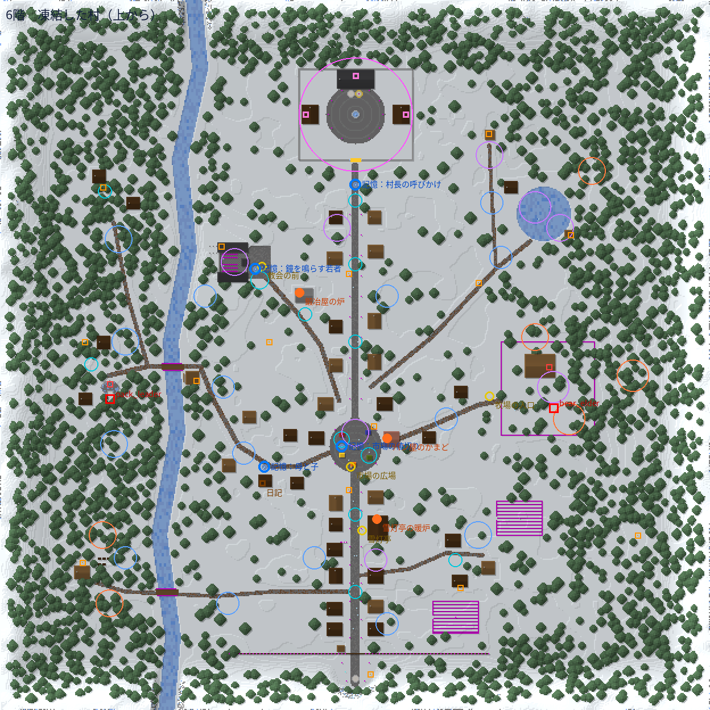
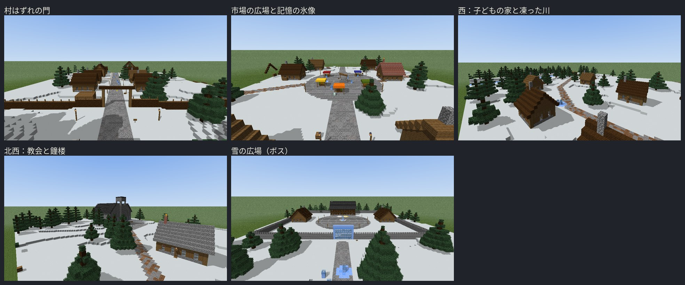

# Phase 8 その5：6階「凍結した村」と第2章のはじめ（11月25日）

0-A 9章の6階・20章の第2世代の装備・13章と15章の「6日目」（確定）と、11月25日のご指示から作った階です。数値と細かい形は【補完】です。



## 0-A の6階（確定）

| 項目 | 内容 |
| --- | --- |
| 章 | 第2章「凍てついた記憶」（6〜10階）。テーマは忘却と喪失。「忘れることは、凍ること」。色は氷青・白銀・オーロラの緑紫。敵は凍った記憶（残響）と霜の獣。装備は第2世代 |
| 地形・環境 | 一瞬のまま凍りついた雪の村。母の手を取ろうとする子ども、市場で値切る商人などが氷像になっている。空にオーロラ |
| 雑魚 | 霜狼／氷像の残響（村人の氷像の一部が近づくと動く）／凍て鳥（吹雪を起こす）／霜の欠け熊（大型） |
| ボス | 村長の残響オルド。村を守るつもりで、誰が仲間か分からなくなっている（「おまえは……村の者か……？」）。戦いながら家々から「記憶の結晶」を3つ集めて渡すと、思い出して戦いをやめる（撃破扱い） |
| ギミック | 記憶の解凍。熱の結晶を運んで氷像を溶かすと、その日の村の短い場面が見える。運ぶ人は足が遅くなるので、ほかの人が護衛する |
| 古代記録 | 「村の子どもの日記」――「おかあさんが、わたしの名前を呼ばなくなった」 |
| 物語 | 6日目。この階に到達すると、ロストがコネリアにも及ぶ演出が起き、街の人の一部がプレイヤーを忘れ始める。教会に「記憶の相談所」（記憶を戻すクエスト） |
| ロストの侵食 | 氷像の顔が空白 |
| 装備（20章） | 第2章：霜銀・氷晶・凍て毛皮。霜銀シリーズ → 女王シリーズ（10階のレア）。対応レベル 15〜28 |

## ご指示から（11月25日）

- 「テストは後でまとめてやるので次の階層も作ってください」：6階を作りました。遊んで確かめていただく所は
  [`docs/ingame_check.md`](ingame_check.md) の「Phase 8 その5 を確かめる」にまとめました
- 「防具は一式全部揃えた形にしてください」**【11月25日に決定】**：5階の守護者シリーズを頭・胴・脚・足の一式にし（[`docs/gear/guardian.md`](gear/guardian.md)）、
  6階からの新しい防具（霜銀シリーズ・村長の毛皮）も、すべて一式で作りました。4つそろえると「一式の効果」が効きます

## 広さと区画【補完】

624×624（5階より広い）・高さ80（`tools/mapgen/build_floor6.py` が組み立て、`structures/map/floor6/` の169区画と `floors/floor6.json` を
書き出す）。地面の高さ 16（立つのは 17）。空は開いていて、まわりは雪の山。霧は雪の白（`#C9D9EC`。40〜200）。

| 区画 | 中身 |
| --- | --- |
| 村はずれの門（南） | 戻りの円・道しるべの石。雪に埋もれた門をくぐると、物語の場所「村の入口」 |
| 雪の通り | 家並みと、宿屋「雪灯亭」（2階建て。**熱の炉**「雪灯亭の暖炉」・**中継の灯**） |
| 市場の広場 | 屋台と、**記憶の氷像**「市場の値切り」（物語の場所「凍った市場」）。東のパン屋に**熱の炉**「パン屋のかまど」・**中継の灯** |
| 西 | 子どもの家（**古代記録の石板**「村の子どもの日記」）と、**記憶の氷像**「母と子」。凍った川と水車小屋。川向こうの林に霜狼のねぐら（名のある魔物「霜狼の群れ長」と、その宝箱） |
| 北西 | 鍛冶屋（**熱の炉**「鍛冶屋の炉」）と教会（**中継の灯**）。鐘楼の前に**記憶の氷像**「鐘を鳴らす若者」 |
| 東 | 牧場と納屋（名のある魔物「霜の欠け熊の主」と、その宝箱。牧場の入口に**中継の灯**） |
| 北東 | 凍った池と氷釣りの小屋。見張りの塔（はしごで上がる。上に宝箱。物語の場所「オーロラの見晴らし」） |
| 北の通り | 凍りついた門（**封印**）の手前に、**記憶の氷像**「村長の呼びかけ」 |
| 雪の広場（ボス） | 半径50の戦いの場。まん中に敷石の広場、まわりに西の家・東の家・村長の家（戦いの間、記憶の結晶が現れる台）。北に出口の円と**次の階への円** |

宝箱は17（`chests/floor6_village`）。中継の灯は4つ（雪灯亭・市場の広場・教会の前・牧場の入口）。



## 記憶の解凍（熱の炉と記憶の氷像）【補完】

- **熱の炉**（3つ）を右クリックすると「熱の結晶」を1つもらえる（1人1つまで。持っていると、もらえない）
- 熱の結晶は **240秒** で冷えて消える。村の階の外へ持ち出すと砕ける
- 結晶を運ぶ人は、**足が35%遅くなり、走れない**。体のまわりに火の粉が舞い、**まわりの魔物（16ブロック）に毎秒狙われやすくなる**
  （敵視 +80。ボスは別）。ほかの人が護衛する（0-A のとおり）
- **記憶の氷像**（4つ）に熱の結晶を持って右クリックすると溶け始め、**4.5ブロック以内にいる間 5秒** で溶ける（離れる・結晶をなくすと止まる）。
  溶けると、結晶は使い切り、まわり40ブロックの人に「その日の村」の短い場面が流れる（下の「物語の場面」）
- 溶けた氷像は、**みんなの分**（ひとりが溶かせば、ほかの人も溶けたことになる）。**進行日が変わると、また凍る**
- 記憶の氷像のほか、顔の空白な村人の氷像（ロストの侵食）が村じゅうに立つ。触ると「凍った村人の氷像。顔のところだけが、白く抜け落ちている……」と出る

## 封印【補完】

記憶の氷像を4つとも溶かし（みんなの分）、名のある魔物2体（霜狼の群れ長・霜の欠け熊の主）を倒した人（人ごと）だけが、雪の広場の
凍りついた門を通れる（`floors/floor6.json` の `seal_requires`：`statues+guardians`）。足りないときは「凍りついた門は、まだ固く閉じている。
村の記憶の氷像を、すべて溶かそう（1/4）」のように出る。

## 6階の敵【補完】

| 敵 | Lv | HP | 攻撃 | 動き |
| --- | --- | --- | --- | --- |
| 霜狼 | 25 | 1500 | 185 | 群れで動く。噛みつきと突進（1階の欠け牙の狼と同じ）。噛まれると**凍え**1つ（4秒） |
| 氷像の残響 | 26 | 2700 | 190 | 凍った村人の氷像と同じ姿で、ふだんは像のまま。5ブロックまで近づく・叩くと動き出す（眠っている間はほとんど減らない）。拳と叩きつけ（凍え2つ）。姿は村人11人のうちから |
| 凍て鳥 | 25 | 1100 | 175 | 空に浮き、氷の羽根を撃つ。**吹雪**：狙った人のまわりに円の予兆のあと、5秒の吹雪（1秒ごとに傷と凍え。近くが白く見えにくくなる） |
| 霜の欠け熊 | 27 | 3800 | 205 | 爪の薙ぎ払い（扇。凍え2つ）・跳びかかり・咆哮（まわりの仲間の攻撃+）。体が白く欠け、ときどき立ち止まる |
| 霜狼の群れ長（名） | 29 | 14800 | 200 | 川向こうの林のねぐら。大きく、噛まれると凍え2つ。**HPが半分を切ると遠吠えで霜狼を3匹呼ぶ**。レア：群れ長の白牙（5%） |
| 霜の欠け熊の主（名） | 30 | 17500 | 220 | 牧場の納屋。もっと大きく、咆哮が2回。レア：霜熊の氷の棘（5%） |

数値は `python3 tools/balance/estimate.py` の目安（Lv26・霜銀シリーズの2人で、雑魚 2〜9秒・名のある魔物 33〜42秒）に合わせました。

### 凍え（人にかかる寒さ）と「寒さに強い」【補完】

- 6階の敵の攻撃の多くは、**凍え**（移動 −10%。3つまで重なる）を与える
- 装備とアクセサリーの特殊効果「**寒さに強い N%**」（`cold_resist`）で、凍えの時間と、ほかの所でかかる鈍足・凍結の時間が短くなる（80%まで）。
  村長の毛皮（胴 20%・一式 30%）、霜熊の氷の棘（25%）

## ボス：村長の残響オルド【補完】

村を守るつもりで、誰が仲間か分からなくなっている村長の残響。Lv32・HP 85000（2人のときの基準。ひとりでも2人ぶん。3人目から1人ごとに +60%）。
怒るまで30分。曲は「凍てついた村の灯」（ニ短調・3拍子のワルツ。オルゴールの鈴・弦・合唱・そりの鈴。`tools/audio/boss_music.py`）。

| 技 | 予兆 | 中身 |
| --- | --- | --- |
| 杖の薙ぎ払い | 前の扇（120°・7ブロック） | 杖で薙ぎ払う。押し返す |
| 氷柱の道 | 長い線（26ブロック） | 氷柱を走らせる。凍え2つ |
| 吹雪 | まわりの円（9ブロック。第2段階から） | 円の中に吹雪。凍え2つ。画面が白くなる |
| 疑いの眼差し | 見ている方の扇（70°・30ブロック） | 「……おまえは、誰だ」。扇の中で、オルドとの間にブロック（家の壁・柱・樽）がない人は2秒**凍りつく**。物陰に隠れればよい |
| 霜狼を呼ぶ | なし | 霜狼を2匹（第3段階は3匹。4匹まで）、結晶を運んでいる人へ向けて呼ぶ |
| 記憶の結晶 | 光の柱 | 下の「記憶の結晶」 |

- 第2段階（HP70%）・第3段階（HP35%）で、技の間が短くなる（0.88倍・0.75倍）
- **記憶の結晶**：戦いの始まり（2秒後）と、そのあと（HPが70%・40%を切るか、100秒ごと）に、広場のまわりの家（西の家 → 東の家 → 村長の机）の台に
  1つずつ現れる（光の柱）。拾った人は熱の結晶と同じく足が遅くなる。オルドのそば（3.5ブロック）まで運ぶと受け取り、思い出しかけて
  **12秒よろめく（受けるダメージ1.6倍）**。3つ目を受け取ると、ひざをついて礼を言い、消える（撃破扱い。倒した人みなに勝利と報酬）
- 3つ受け取るまでは、**HPが10%より下がらない**（力ずくでは倒せない）
- 倒すと物語の印「オルドが思い出した」がつく。報酬：村長の毛皮（一式4つ。エピック）・霜銀2・結晶果

## 第2章の装備【補完】

| 品 | 手に入れ方 | 中身 |
| --- | --- | --- |
| 霜銀シリーズ（職業ごと） | 工房で作る（第2世代・コモン・Lv24） | 6職業 × 武器（ナイトは剣と大剣）・防具一式（頭・胴・脚・足）と、ナイトの盾。32品。[`docs/gear/frost_silver.md`](gear/frost_silver.md) |
| 村長の毛皮（一式） | オルドのレア（帽4%・外套5%・脚衣4%・長靴4%） | 全職業・Lv26・エピック。胴に「寒さに強い 20%」、一式で「寒さに強い 30%」 |
| 6階のアクセサリー | 装飾工房で作る5つ・名のある魔物のレア2つ | 霜銀の闘環・智環・氷晶の首飾り・凍て毛皮の腕輪・雪灯のお守り／群れ長の白牙・霜熊の氷の棘（[`docs/gear/floor_accessories.md`](gear/floor_accessories.md)） |
| 6階の素材 | 6階の敵と宝箱 | 霜銀・氷晶・凍て毛皮・霜狼の牙・凍て鳥の羽根 |

**生産職どうしの部品（0-A 19章の三すくみ【提案】を、第2章の装備と一緒に入れました）**：第2章からの装備は、別の生産職が作る部品を
1つ使います。

| 部品 | 作る人（工房） | 使う品 |
| --- | --- | --- |
| 補強金具 | 武器職人（武器工房）：霜銀2・苔鉄1 → 2つ | 防具と盾（防具職人） |
| 台座布 | 防具職人（防具工房）：凍て毛皮1・ツノモフの毛2 → 2つ | アクセサリー（装飾師） |
| 結晶細工 | 装飾師（装飾工房）：氷晶2・結晶の欠片1 → 2つ | 武器（武器職人） |

## 6日目：ロストが街に及ぶ（0-A 13章・15章）

- 6階に誰かが初めて入ると、物語の印 `ch2/lost_in_town`（サーバー全体）がつき、全員に「コネリアに、白い雪が降り始めた……」と知らせが出る
- 街に白い灰のような雪が降る（クライアントの演出）
- **門番バルド・カジノのジゼル・料理屋のペトラが、プレイヤーを忘れる**（バルドは「……誰だ。見ない顔だな」）。店や施設の働きは止めない
- **ポッカ爺は魚の名前を忘れる**（魚図鑑の名前が「？？？」）。魚を手に持って話しかけると、一匹ずつ思い出す
- 教会のセレナに「**記憶の相談所**」：忘れられた人ごとのクエスト（バルド・ジゼル・ペトラ）を始められる。その人に話しかけると思い出して
  もらえ、親密度が少し上がる
- 10階のボスの初撃破（`ch2/queen_down`）で、街の記憶は戻る

## 物語の場面【補完】

| 場面 | いつ |
| --- | --- |
| 凍結した村 | 6階に初めて入ったとき。第2章の題「第2章　凍てついた記憶」と、凍った村の字幕 |
| 村の入口・凍った市場・オーロラの見晴らし | その場所に初めて入ったとき |
| 市場の値切り・母と子・鐘を鳴らす若者・村長の呼びかけ | 記憶の氷像が溶けたとき（あの日の村人が、氷のような姿で短い場面を演じる） |
| 6階の初撃破 | オルドが思い出したあと |

## 作り直し方

```
python3 tools/mapgen/build_floor6.py            # 地図（区画と floors/floor6.json）
python3 tools/mapgen/check_floor6.py            # 歩いて届くか（宝箱・炉・氷像・灯・結晶の台）
python3 tools/datagen/build_floor6_data.py      # 敵・落とす物・物語・会話・クエスト・村長の毛皮・素材・言葉
python3 tools/datagen/build_gear_frost_silver.py  # 霜銀シリーズと部品
python3 tools/datagen/build_floor_accessories.py  # 階ごとのアクセサリー（6階を含む）
python3 tools/artgen/make_village_things.py     # 村人の絵と氷像の絵・熱と記憶の結晶・村長の毛皮・素材のモデル
python3 tools/artgen/make_village_models.py     # 霜狼・霜の欠け熊・凍て鳥・オルドのモデル
python3 tools/artgen/make_frost_silver_gear.py  # 霜銀シリーズの見た目（--sheets で確認画像）
python3 tools/artgen/make_floor_accessory_art.py  # アクセサリーと素材の絵（このあと enhance_icons.py）
python3 tools/artgen/enhance_icons.py .         # 16×16 に戻った絵を 32×32 に
python3 tools/audio/boss_music.py ordo          # オルドの曲
```

## 確かめたこと

- 自動テスト：`VillageGameTests`（6階の形・熱の結晶〈遅くなる・敵に狙われる・冷える・外で砕ける〉・氷像と封印・寒さに強い・
  オルドの記憶の結晶・村長の毛皮・群れ長の呼び声と氷像の残響・街の記憶・霜銀シリーズの部品）、`FloorRealPlayGameTests.floor6RealPlay`
  （6階を本当に建て、炉で結晶をもらい、氷像を右クリックしてそばで待って4つとも溶かし、封印が開く）、ボスの曲（1〜6階）
- CIの写真：6階のはじまり（第2章の題）・村の入口・雪灯亭・凍った市場・教会・牧場・オーロラの見晴らし・6階の敵・熱の炉と結晶を運ぶ人・
  記憶の氷像が溶ける場面・封印・オルド戦（氷柱・疑いの眼差し・吹雪・呼び声・記憶の結晶を拾って渡す・思い出す）・村長の毛皮・
  ロストが及んだ街（バルドが忘れている）

## 【補完】したこと

- 地図の形と区画、記憶の氷像4つの場面、熱の炉3つ、宝箱・中継の灯の数と場所
- 熱の結晶の時間（240秒）・足の遅さ（35%）・溶ける時間（5秒）・進行日で凍り直すこと・封印の条件（氷像＋名のある魔物）
- 敵とボスの数値・技の名前と中身・記憶の結晶の出る間と数・HPが10%より下がらないこと
- 凍え（6階の寒さ）と「寒さに強い」
- 霜銀シリーズの数値と素材・村長の毛皮・6階のアクセサリー・部品の材料
- オルドの曲・場面と字幕の台詞・記憶の相談所の会話

## まだのこと

- 7〜10階（第2章の残り）
- 霜銀シリーズと守護者シリーズの見た目は、流紋シリーズの形を塗り直したもの。それぞれだけの形（毛皮の襟・氷晶の飾りなど）は、まだ作っていません
- 職人週間（第2週の全員納品「霜銀と灼鋼」）
